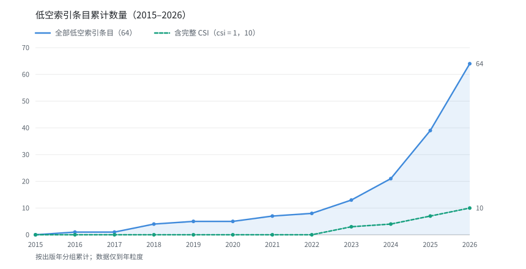

# 低空数据集索引 · Low-Altitude Datasets

面向**低空经济**与**UAV通感一体化（ISAC）**研究的开源数据集汇编，系统收集并展示已有数据集，统一给出**名称、官方网站链接、发布年份、作者/机构**以及**模态覆盖对比**。

清单以 **[LAMBDA: A Low-Altitude Multimodal Base Dataset for UAV Sensing and Communication](https://arxiv.org/abs/2607.03826)**（arXiv:2607.03826）表1 为基准，并逐一核实各数据集的官方主页与论文链接；此外补充收录了 ISAC 仿真与实测、射频/雷达探测、声学感知、无人机视觉与多模态感知等方向的公开数据集。

> 总览、矩阵与详情均按**是否涉及低空 / UAV 场景**拆为两张表：**低空相关数据集**与**通用 / 上游基准数据集**（后者完全不含低空场景）。低空部分另按**信道级数据**用颜色区分：🟢 有 CSI、🟡 部分 CSI、🔵 仅射频信号（原始 I/Q，无 CSI）、⚪ 均无。

> 🌐 **在线浏览**：[sjtu-wirelessai-lab.github.io/Low-Altitude-Dataset](https://sjtu-wirelessai-lab.github.io/Low-Altitude-Dataset/)（可搜索、可筛选、含对比矩阵）。
> 📦 **结构化数据**：[data/datasets.json](https://cdn.jsdelivr.net/gh/SJTU-WirelessAI-Lab/Low-Altitude-Dataset@main/data/datasets.json)（jsDelivr CDN，返回 `application/json`，可直接 fetch；CDN 有缓存延迟，数据更新以仓库内同路径文件为准）。

**增长趋势**：截至 2026 年末，低空相关数据集累计 **57** 个，其中 **11** 个提供完整 MIMO 信道 CSI。下图按出版年结算、累计点落在各年末：实线为全部低空数据集，虚线为含完整 CSI 者。



---

## 目录

- [数据集总览](#数据集总览)
- [模态覆盖对比矩阵](#模态覆盖对比矩阵)
- [数据集详情](#数据集详情)
- [收录说明](#收录说明)
- [贡献方式](#贡献方式)
- [引用](#引用)

---

## 数据集总览

共 **71** 个数据集（含本文 LAMBDA），时间跨度 **2012–2026**；其中**低空相关 57 个**、**通用 / 上游基准 14 个**。

**信道级数据标注**：🟢 有 CSI（完整 MIMO 信道）、🟡 部分 CSI（实测信道测量，但未给完整 MIMO CSI）、🔵 仅射频信号（原始 I/Q 等射频采集，数据本身不含 CSI）、⚪ 均无。**CSI 与射频信号是两类不同模态**，不能互相替代：前者是信道估计结果，后者是接收机采到的原始波形 / 频谱。

**获取方式**：默认标为 **开放下载**（官方页面公开提供，卡片上不另加徽章）；另有 4 种受限情形会单独标注——**仅预览**（只公开子集）、**需注册**（平台账号）、**需申请**（邮件 / 表单审批）、**未发布**（官方标注即将发布）。当前 71 条中：开放下载 60、仅预览 4、需注册 3、需申请 2、未发布 2。

**数据来源**：**实测**（真实传感器 / 外场采集）、**混合**（真实与合成并用）、**仿真**（射线追踪 / 数字孪生 / 渲染器生成）。当前 71 条中实测 47、混合 10、仿真 14；其中低空相关 57 条为实测 42、混合 6、仿真 9。

### 低空相关数据集（57 个）

| # | 数据集 | 来源 | CSI | 射频 | 年份 | 作者 | 机构 | 官网 |
|---|--------|:----:|:---:|:----:|------|------|------|------|
| 1 | **UAV123** | 实测 | ⚪ | · | 2016 | Matthias Mueller, Neil Smith, Bernard Ghanem | King Abdullah University of Science and Technology (KAUST) | [链接](https://cemse.kaust.edu.sa/ivul/datasets) |
| 2 | **DOTA** | 实测 | ⚪ | · | 2018 | Gui-Song Xia, Xiang Bai, Jian Ding, Zhen Zhu, Serge Belongie, et al. | Wuhan University | [链接](https://captain-whu.github.io/DOTA/dataset.html) |
| 3 | **UAVDT** | 实测 | ⚪ | · | 2018 | Dawei Du, Yuankai Qi, Hongyang Yu, Yifan Yang, et al. | Chinese Academy of Sciences 等 | [链接](https://sites.google.com/site/daviddo0323/projects/uavdt) |
| 4 | **VisDrone** | 实测 | ⚪ | · | 2018 | AISKYEYE team（Zhu, Wen, Bian, Ling, Liang, et al.） | Tianjin University | [链接](https://github.com/VisDrone/VisDrone-Dataset) |
| 5 | **DroneRF (Mendeley)** | 实测 | ⚪ | 🔵 | 2019 | Mohammad F. Al-Sa'd, Mhd Saria Allahham, Amr Mohamed, Abdulla Al-Ali, Tamer Khattab, Aiman Erbad | Qatar University | [链接](https://data.mendeley.com/datasets/f4c2b4n755/1) |
| 6 | **Anti-UAV300** | 实测 | ⚪ | · | 2021 | Nan Jiang, Kuiran Wang, Xiaoke Peng, Xuehui Yu, Qiang Wang, Junliang Xing, Guorong Li, Jian Zhao, Guodong Guo, Zhenjun Han | 中国科学院大学 / 北方电子设备研究所 | [链接](https://github.com/ucas-vg/Anti-UAV) |
| 7 | **Drone-detection (DREGON)** | 实测 | ⚪ | · | 2021 | Fredrik Svanström, Fernando Alonso-Fernandez, Cristofer Englund | Halmstad University (CAISR) / Swedish Armed Forces | [链接](https://github.com/DroneDetectionThesis/Drone-detection-dataset) |
| 8 | **DIAT-µSAT** | 实测 | ⚪ | · | 2022 | Harish Chandra Kumawat, Mainak Chakraborty, A. Arockia Bazil Raj, Sunita Vikrant Dhavale | Defence Institute of Advanced Technology (DIAT), India | [链接](https://ieee-dataport.org/documents/diat-msat-micro-doppler-signature-dataset-small-unmanned-aerial-vehicle-suav) |
| 9 | **DeepSense 6G** | 实测 | 🟡 | · | 2023 | Ahmed Alkhateeb, et al. | Arizona State University | [链接](https://www.deepsense6g.net/) |
| 10 | **ISAC UAV (TU Ilmenau)** | 实测 | 🟢 | · | 2023 | Julia Beuster, Carsten Andrich, Michael Döbereiner, Steffen Schieler, Maximilian Engelhardt, Christian Schneider, Reiner Thomä | Technische Universität Ilmenau (EMS Group) | [链接](https://ems-tu-ilmenau.github.io/isac-uav-dataset-docs/) |
| 11 | **MaMIMO-UAV 3D CSI** | 实测 | 🟢 | · | 2023 | Achiel Colpaert, Cel Thys, Zhuangzhuang Cui, Sofie Pollin | KU Leuven (ESAT) | [链接](https://doi.org/10.48804/0IMQDF) |
| 12 | **Sensiverse** | 仿真 | 🟢 | · | 2023 | Jiajin Luo, Baojian Zhou, Yang Yu, Ping Zhang, et al. (Huawei) | Huawei Technologies | [链接](https://sensiverse.github.io/) |
| 13 | **AERPAW** | 实测 | 🟡 | 🔵 | 2024 | Ismail Guvenc, Mihail L. Sichitiu, Rudra Dutta, et al. | North Carolina State University | [链接](https://aerpaw.org/experiments/datasets/) |
| 14 | **DADS** | 实测 | ⚪ | · | 2024 | 社区整理（schiffman / geronimobasso） | Community (Hugging Face) | [链接](https://huggingface.co/datasets/geronimobasso/drone-audio-detection-samples) |
| 15 | **DeepVerse 6G** | 仿真 | 🟢 | · | 2024 | Umut Demirhan, Abdelrahman Taha, Ahmed Alkhateeb | Arizona State University | [链接](https://deepverse6g.net/) |
| 16 | **DroneRFa** | 实测 | ⚪ | 🔵 | 2024 | 俞宁宁, 毛盛健, 周成伟, 孙国威, 史治国, 陈积明 | 浙江大学信息与电子工程学院 | [链接](https://www.scidb.cn/detail?dataSetId=34f0a91e8a544904998b8fdc44477380) |
| 17 | **KU Leuven Drone RF** | 实测 | ⚪ | 🔵 | 2024 | Sanjoy Basak, Sofie Pollin, Bart Scheers | KU Leuven (ESAT) / Royal Military Academy | [链接](https://doi.org/10.48804/HZRVNZ) |
| 18 | **LSS-FMCWR-1.0** | 实测 | ⚪ | · | 2024 | 陈小龙, 袁旺, 杜晓林, 于刚, 何肖阳, 关键, 汪兴海 | 海军航空大学 / 烟台大学 / 济南大学 | [链接](https://radars.ac.cn/article/doi/10.12000/JR23142) |
| 19 | **MMAUD** | 实测 | ⚪ | · | 2024 | Shenghai Yuan, Yizhuo Yang, Thien Hoang Nguyen, Thien-Minh Nguyen, Jianfei Yang, Fen Liu, Jianping Li, Han Wang, Lihua Xie | Nanyang Technological University (NTU) | [链接](https://github.com/ntu-aris/MMAUD) |
| 20 | **3D MaMIMO A2G UAV CSI** | 实测 | 🟢 | · | 2025 | Achiel Colpaert, Sofie Pollin | KU Leuven (ESAT) | [链接](https://doi.org/10.48804/MTNAEG) |
| 21 | **A2G CIR (3.6 GHz)** | 实测 | 🟡 | · | 2025 | Qiuming Zhu, Hangang Li, Kai Mao, Hanpeng Li, Xuhan Wen, Shaolong Zhang, Jie Wang | Nanjing University of Aeronautics and Astronautics (NUAA) | [链接](https://doi.org/10.17632/8p6r8ft4fz.2) |
| 22 | **AnyVisLoc** | 实测 | ⚪ | · | 2025 | Yibin Ye, Xichao Teng, Shuo Chen, Zhang Li, Leqi Liu, Qifeng Yu, Tao Tan | National University of Defense Technology / Macao Polytechnic University | [链接](https://github.com/UAV-AVL/Benchmark) |
| 23 | **DrIFT** | 混合 | ⚪ | · | 2025 | Fardad Dadboud, Hamid Azad, Varun Mehta, Miodrag Bolic, Iraj Mantegh | University of Ottawa / NRC Canada | [链接](https://github.com/CARG-uOttawa/DrIFT) |
| 24 | **Drone Swarm Sounding** | 实测 | 🟢 | · | 2025 | Julia Beuster, Carsten Andrich, Sebastian Giehl, Marc Miranda, et al. | Technische Universität Ilmenau | [链接](https://arxiv.org/abs/2507.12010) |
| 25 | **DroneRFb-DIR** | 实测 | ⚪ | 🔵 | 2025 | 任俊宇, 俞宁宁, 周成伟, 史治国, 陈积明 | 浙江大学信息与电子工程学院 / 工业控制技术全国重点实验室 | [链接](https://www.scidb.cn/detail?dataSetId=84cf9101e739402784b1396783881202) |
| 26 | **Great-MSD** | 仿真 | 🟢 | · | 2025 | Kongwu Huang, Shiyi Mu, Jun Jiang, Yuan Gao, Shugong Xu | Shanghai University / Xi'an Jiaotong-Liverpool University | [链接](https://github.com/hkw-xg/Great-MCD) |
| 27 | **LAE UAV** | 仿真 | ⚪ | · | 2025 | Zhengru Fang, Zhenghao Liu, Jingjing Wang, Senkang Hu, et al., Yuguang Fang | City University of Hong Kong / Beihang University | [链接](https://github.com/fangzr/TOC-Edge-Aerial) |
| 28 | **LIPASE** | 实测 | ⚪ | 🔵 | 2025 | Yifei Sun, Chao Yu, Yan Luo, Tony Xiao Han, Haisheng Tan, Rui Wang, Francis C. M. Lau | The University of Hong Kong / SUSTech / Huawei 等 | [链接](https://github.com/yfsun0327/lipase-dataset) |
| 29 | **Lund UAV Audio** | 实测 | ⚪ | · | 2025 | Erik Tegler, Max Modig, Per Skarin, Kalle Åström, Magnus Oskarsson, Gabrielle Flood | Lund University / SAAB | [链接](https://vision.maths.lth.se/drone_sound/) |
| 30 | **MathWorks Radar Drone** | 实测 | ⚪ | · | 2025 | Zhongliang Guo, Samiur Rahman, Duncan Robertson | University of St Andrews | [链接](https://doi.org/10.5281/zenodo.15224887) |
| 31 | **NeoDrone** | 实测 | ⚪ | · | 2025 | NeoDrone 团队（北京市数据知识产权登记） | 北京 · 低空智能系统 | [链接](https://github.com/playezio/NeoDrone) |
| 32 | **RFUAV** | 实测 | ⚪ | 🔵 | 2025 | Rui Shi, Xiaodong Yu, Shengming Wang, Yijia Zhang, Lu Xu, Peng Pan, Chunlai Ma | Beijing University of Posts and Telecommunications 等 | [链接](https://github.com/kitoweeknd/RFUAV) |
| 33 | **SynthSoM** | 仿真 | 🟢 | · | 2025 | Xiang Cheng, Ziwei Huang, Yong Yu, Lu Bai, Mingran Sun, et al. | Peking University / Shandong University | [链接](https://github.com/ZiweiHuang96/SynthSoM) |
| 34 | **TMRGBT-D2D** | 实测 | ⚪ | · | 2025 | Hexiang Hao, Yueping Peng, Zecong Ye, Baixuan Han, Wei Tang, Wenchao Kang, Xuekai Zhang, Qilong Li, Wenchao Liu | Engineering University of the Chinese People's Armed Police Force | [链接](https://github.com/HexiangH/TMRGBT-D2D) |
| 35 | **UAV-LowAlt-MOT** | 实测 | ⚪ | · | 2025 | Xin Wang | Xidian University | [链接](https://www.scidb.cn/en/detail?dataSetId=239a78b317464fb9943387df112a0345) |
| 36 | **UAVScenes** | 实测 | ⚪ | · | 2025 | Sijie Wang, Siqi Li, Yawei Zhang, Shangshu Yu, Shenghai Yuan, et al., Lihua Xie, Wee Peng Tay | Nanyang Technological University / Shanghai Jiao Tong University 等 | [链接](https://github.com/sijieaaa/UAVScenes) |
| 37 | **16-Ch UAV Acoustic** | 实测 | ⚪ | · | 2026 | Huilong Wang, Peng Chen, Zhimin Chen, Yuye Liu | Southeast University / Shanghai Dianji University | [链接](https://doi.org/10.5281/zenodo.23613504) |
| 38 | **A2A-UAV** | 实测 | ⚪ | · | 2026 | Hongtao Liang, Yiyao Wan, Kezhi Zhu, Jiayi Zhang, Zequn Jiang, Ziyu Zhou, Jiahuan Ji, Fuhui Zhou, Qihui Wu | Nanjing University of Aeronautics and Astronautics (NUAA) / HKUST | [链接](https://github.com/lht-research/A2A-UAV) |
| 39 | **A2G CIR + RT (Multi-band)** | 混合 | 🟡 | · | 2026 | Qiuming Zhu, Nan Ming, Jianan Xie, Weidong Li, Junwei Bao, Kai Mao, et al. | Nanjing University of Aeronautics and Astronautics (NUAA) | [链接](https://doi.org/10.17632/pztzfz4vy4.1) |
| 40 | **AERPAW AADM** | 混合 | ⚪ | 🔵 | 2026 | Md Sharif Hossen, Cole Dickerson, Ozgur Ozdemir, Mihail Sichitiu, Ismail Guvenc | North Carolina State University | [链接](https://doi.org/10.5061/dryad.7d7wm3898) |
| 41 | **ATA** | 实测 | ⚪ | · | 2026 | Wenchao Kang, Xuekai Zhang, Yueping Peng, Wei Tang, Qilong Li, Hexiang Hao, Kang Liu, Qinghe Chen | Engineering University of the Chinese People's Armed Police Force | [链接](https://github.com/kkbushi/ATA) |
| 42 | **CPD-UAV** | 实测 | ⚪ | · | 2026 | Xuekai Zhang, Wenchao Kang, Yueping Peng, Wei Tang, Qilong Li, Hexiang Hao, Liming Hou, Xin Ying | Engineering University of the Chinese People's Armed Police Force | [链接](https://github.com/18510004596/CPD-UAV) |
| 43 | **CageDroneRF** | 混合 | ⚪ | 🔵 | 2026 | Mohammad Rostami, Atik Faysal, Hongtao Xia, Hadi Kasasbeh, Ziang Gao, Huaxia Wang | Rowan University | [链接](https://arxiv.org/abs/2601.03302) |
| 44 | **Cross-layer UAV 6G** | 实测 | ⚪ | 🔹 | 2026 | Francesco Paolucci, Emilio Paolini, Massimo Satler, et al. | CNIT / Scuola Superiore Sant'Anna | [链接](https://zenodo.org/records/21468734) |
| 45 | **DroneRFc-MM** | 实测 | ⚪ | 🔵 | 2026 | 虞涛菘, 杨倩倩, 胡卓, 李明锴, 吴嘉俊, 苏煜繁, 潘俊宇, 史治国, 陈积明 | 浙江大学全省空域感知与自主无人系统重点实验室 | [链接](https://www.scidb.cn/detail?dataSetId=0af05173ce5d45528ebd707d67f3d641) |
| 46 | **FlyAwareV2** | 混合 | ⚪ | · | 2026 | Francesco Barbato, Matteo Caligiuri, Pietro Zanuttigh | University of Padova | [链接](https://medialab.dei.unipd.it/paper_data/FlyAwareV2) |
| 47 | **ITU-ARIS Acoustic** | 实测 | ⚪ | · | 2026 | İhsan Mert Muhacıroğlu, Tayfun Akgül | Istanbul Technical University (ARIS Lab) | [链接](https://zenodo.org/records/22682339) |
| 48 | **MultiFly** | 实测 | ⚪ | · | 2026 | Markus Gross, Andreas Greiner, Taehyoung Kim, Sivasubiramaniam Subbiah, Tomaž Cotič, Conrad Christoph, Oussema Dhaouadi, Simon Zieher, Surya Kumar, Gordon Elger, Henri Meeß, Olaf Wysocki, Paul Spannaus, Daniel Cremers | Fraunhofer IVI / TU Munich / University of Cambridge / TH Ingolstadt | [链接](https://markus-42.github.io/multifly/) |
| 49 | **Multimodal-NF** | 仿真 | 🟢 | · | 2026 | Mengyuan Li, Qianfan Lu, Jiachen Tian, Hongjun Hu, Yu Han, Xiao Li, Chao-Kai Wen, Shi Jin | Southeast University | [链接](https://lmyxxn.github.io/6GXLMIMODatasets/) |
| 50 | **PML-CellularEye** | 实测 | 🟡 | 🔵 | 2026 | Ziguo Zhong, Yongming Huang, Huazhou Hou, Fanfei Xu, Haisheng Feng, Shengheng Liu, Xiaohu You | Purple Mountain Laboratories / Southeast University | [链接](https://ffxu1024.github.io/CellularEye/) |
| 51 | **SkyEV** | 实测 | ⚪ | · | 2026 | Jakub Mandula, Sebastian Heusinger, Julian Moosmann, Christian Vogt, Michele Magno | ETH Zurich | [链接](https://arxiv.org/abs/2607.18747) |
| 52 | **TSMS-Drone** | 实测 | ⚪ | 🔵 | 2026 | Seung-Kyu Han, Young-Ho Jung | Korea Aerospace University | [链接](https://doi.org/10.25452/figshare.plus.30027313) |
| 53 | **TriCross-D2D** | 实测 | ⚪ | · | 2026 | Wei Tang, Qilong Li, Yueping Peng, Hexiang Hao, Wenchao Kang, Xuekai Zhang, Liming Hou, Hongyan Lu | Engineering University of the Chinese People's Armed Police Force | [链接](https://github.com/vv0930/TriCross-D2D) |
| 54 | **UAV Wireless MM-Bench** | 仿真 | ⚪ | · | 2026 | Najmeh Alibabaie, Antonello Calabrò, Eda Marchetti | CNR-ISTI (Italy) | [链接](https://doi.org/10.5281/zenodo.17486134) |
| 55 | **UAV-Flow** | 混合 | ⚪ | · | 2026 | Donglin Yang, Xiangyu Wang, Yantong Zhong, Wenhao Zheng, Zihan Ding, Yue Liao, Hongsheng Li, Ke Xu, Si Liu | Beihang University / National University of Singapore / CUHK MMLab | [链接](https://prince687028.github.io/UAV-Flow/) |
| 56 | **Huangpu River Water–Air** ⭐ | 仿真 | 🟢 | · | 2026 | Haofeng Zhong, Jianhua Mo | Shanghai Jiao Tong University | [链接](https://doi.org/10.57760/sciencedb.0130w) |
| 57 | **LAMBDA** ⭐ | 仿真 | 🟢 | · | 2026 | Lin Zhou, Peichuan Rao, Chenshuo Zhang, Jianhua Mo, Shu Sun, Zhiyong Chen, Meixia Tao | Shanghai Jiao Tong University | [链接](https://doi.org/10.57760/sciencedb.36052) |

### 通用 / 上游基准数据集（14 个）

以下数据集**完全不含低空 / UAV 场景**，多为地面视角感知或纯信道 / 电磁数据集，作为上游经典基准一并列出，不与低空场景条目混排。

| # | 数据集 | 来源 | CSI | 射频 | 年份 | 作者 | 机构 | 官网 |
|---|--------|:----:|:---:|:----:|------|------|------|------|
| 1 | **KITTI** | 实测 | ⚪ | · | 2012 | Andreas Geiger, Philip Lenz, Raquel Urtasun | Karlsruhe Institute of Technology (KIT) | [链接](https://www.cvlibs.net/datasets/kitti/) |
| 2 | **DeepMIMO** | 仿真 | 🟢 | · | 2019 | Ahmed Alkhateeb | Arizona State University | [链接](https://www.deepmimo.net/) |
| 3 | **ViWi** | 混合 | 🟢 | · | 2020 | Muhammad Alrabeiah, Andrew Hredzak, Zhenhao Liu, Ahmed Alkhateeb | Arizona State University | [链接](https://www.viwi-dataset.net/) |
| 4 | **DAIR-V2X** | 实测 | ⚪ | · | 2022 | Haibao Yu, Yizhen Luo, Mao Shu, Yiyi Huo, et al. | Tsinghua University AIR / Baidu | [链接](https://air.tsinghua.edu.cn/DAIR-V2X/index.html) |
| 5 | **E-FLASH** | 实测 | 🟡 | · | 2022 | Jerry Gu, Batool Salehi, Debashri Roy, Kaushik R. Chowdhury | Northeastern University | [链接](https://ieee-dataport.org/documents/e-flash) |
| 6 | **OPV2V** | 仿真 | ⚪ | · | 2022 | Runsheng Xu, Hao Xiang, Zhengzhong Tu, Xin Xia, Ming-Hsuan Yang, Jiaqi Ma | University of California, Los Angeles (UCLA) | [链接](https://mobility-lab.seas.ucla.edu/opv2v/) |
| 7 | **WAIR-D** | 仿真 | 🟢 | · | 2022 | Yourui Huangfu, Jian Wang, Shengchen Dai, Rong Li, et al. | Huawei Wireless Technology Lab / Zhejiang University | [链接](https://www.mobileai-dataset.com/html/default/yingwen/DateSet/1590994253188792322.html?index=1) |
| 8 | **M3SC** | 混合 | 🟢 | · | 2023 | Xiang Cheng, Ziwei Huang, Lu Bai, Haotian Zhang, et al. | Peking University (PCNI Lab) | [链接](http://pcni.pku.edu.cn/dataset_1.html) |
| 9 | **LuViRA** | 实测 | 🟢 | · | 2024 | Ilayda Yaman, Guoda Tian, Martin Larsson, Patrik Persson, et al. (Lund University) | Lund University | [链接](https://github.com/ilaydayaman/LuViRA_Dataset) |
| 10 | **SDCD** | 仿真 | ⚪ | · | 2024 | Jihao Li, Jincheng Hu, Yanjun Huang, Zheng Chen, Bingzhao Gao, Jingjing Jiang, Yuanjian Zhang | University of Southampton / Tongji University | [链接](https://github.com/ReparkHjc/SDCD) |
| 11 | **Multimodal-Wireless** | 仿真 | 🟢 | · | 2025 | Tianhao Mao, Le Liang, Jie Yang, Hao Ye, Shi Jin, Geoffrey Ye Li | Southeast University / Imperial College London | [链接](https://le-liang.github.io/mmw) |
| 12 | **EM-134K** | 混合 | ⚪ | 🔵 | 2026 | Junyu Shen, Zhendong She, Chenghanyu Zhang, Yuchuang Sun, et al., Maosong Sun | Tsinghua University / BUPT / Tianjin University / IMECAS 等 | [链接](https://em-merlin.github.io/) |
| 13 | **EM-Bench** | 混合 | ⚪ | 🔵 | 2026 | Junyu Shen, Zhendong She, Chenghanyu Zhang, Yuchuang Sun, et al., Maosong Sun | Tsinghua University / BUPT / Tianjin University / IMECAS 等 | [链接](https://em-merlin.github.io/) |
| 14 | **U6G-WISE** | 实测 | 🟢 | · | 2026 | Yijia Feng, Hanzhong Zhang, Tao Tao, Ting Zhou, Yang Wang, Dong Li, Yunbo Hu, Zhenghang Zhu, Mingrui Zhu, Shuang Chen, Zhi Wang, Guangxing Li, Jingxin Liu, Liyu Cai | Shanghai Academy of Networked Intelligence / Shanghai University / Transcom Technologies | [链接](https://doi.org/10.57760/sciencedb.01a31) |

**获取受限的 11 条**（其余 60 条可在官网直接下载）：

| 数据集 | 年份 | 获取方式 | 说明 |
|---|---|---|---|
| **DIAT-µSAT** | 2022 | 需注册 | 需在托管平台注册（免费）账号后下载 |
| **E-FLASH** | 2022 | 需注册 | 需在托管平台注册（免费）账号后下载 |
| **ISAC UAV (TU Ilmenau)** | 2023 | 需申请 | 需邮件 / 表单申请，授权后获取 |
| **AERPAW** | 2024 | 需注册 | 需在托管平台注册（免费）账号后下载 |
| **TMRGBT-D2D** | 2025 | 仅预览 | 只公开部分 / 预览子集，完整数据待发布 |
| **A2A-UAV** | 2026 | 仅预览 | 只公开部分 / 预览子集，完整数据待发布 |
| **A2G CIR + RT (Multi-band)** | 2026 | 仅预览 | 只公开部分 / 预览子集，完整数据待发布 |
| **ATA** | 2026 | 未发布 | 官方标注即将发布，当前无法获取 |
| **CPD-UAV** | 2026 | 需申请 | 需邮件 / 表单申请，授权后获取 |
| **MultiFly** | 2026 | 未发布 | 官方标注即将发布，当前无法获取 |
| **TriCross-D2D** | 2026 | 仅预览 | 只公开部分 / 预览子集，完整数据待发布 |

---

## 模态覆盖对比矩阵

模态覆盖对照 LAMBDA 论文表1（并含补充收录的数据集）： 包含； 有限或部分支持； 缺失或不适用。数据集名称前的圆点表示**信道级数据**（🟢 完整 CSI / 🟡 部分 CSI / 🔵 仅射频信号 / ⚪ 均无）。

> **阅读提示**：仿真集的模态覆盖系统性高于实测集——仿真器可任意开模态，实测受设备配置与多传感器硬同步限制。若关注可直接复现的实测数据，建议同时看「来源」列与「CSI」列，两者叠加后的可选面比总表窄得多。

> **关于图标**：Markdown 表格无法填充单元格底色（GitHub、GitLab、VS Code 都会过滤 `style` 与 `bgcolor`），故每格用一个 20×20 的图标表示覆盖情况，配色与网页版一致：深绿 = 包含、琥珀 = 部分支持、浅灰 = 缺失或不适用。

### 低空相关数据集（57 个）

| 数据集 | 年份 | 低空 | CSI信道 | 射频信号 | RGB/深度 | 红外 | LiDAR | 雷达 | IMU/GPS | 天气/时间 | 声学 | 主要关注点 |
|--------|------|:----: | :----: | :----: | :----: | :----: | :----: | :----: | :----: | :----: | :----:|------------|
| ⚪ UAV123 | 2016 |  |  |  |  |  |  |  |  |  |  | 低空无人机视角单目标跟踪基准（123段，11万帧） |
| ⚪ DOTA | 2018 |  |  |  |  |  |  |  |  |  |  | 航空影像目标检测（15/16类，18.8万实例） |
| ⚪ UAVDT | 2018 |  |  |  |  |  |  |  |  |  |  | 无人机车辆检测与跟踪基准（8万帧，含14类属性） |
| ⚪ VisDrone | 2018 |  |  |  |  |  |  |  |  |  |  | 无人机视角目标检测与跟踪基准（14城市，260万+框） |
| 🔵 DroneRF (Mendeley) | 2019 |  |  |  |  |  |  |  |  |  |  | 三型无人机多飞行模式的射频原始I/Q库（227段、约40 GB，含背景射频） |
| ⚪ Anti-UAV300 | 2021 |  |  |  |  |  |  |  |  |  |  | RGB-红外成对视频的反无人机跟踪基准（318对视频、58万+框，昼夜两类光照） |
| ⚪ Drone-detection (DREGON) | 2021 |  |  |  |  |  |  |  |  |  |  | 红外+可见光视频与音频的多传感器无人机探测（650段视频、20.3万标注帧，按DRI距离分档） |
| ⚪ DIAT-µSAT | 2022 |  |  |  |  |  |  |  |  |  |  | X波段连续波雷达小型无人机微多普勒特征（6类4849幅） |
| 🟡 DeepSense 6G | 2023 |  |  |  |  |  |  |  |  |  |  | 实测多模态无线测量 |
| 🟢 ISAC UAV (TU Ilmenau) | 2023 |  |  |  |  |  |  |  |  |  |  | 伊尔梅瑙工业大学：3.75 GHz 三接收机 ISAC 实测库（60场景、约200 GB，含信道传递函数 H(f,t)、目标时延/多普勒估计与机载 RTK 真值，15/30 m 两档飞行高度，需邮件申请解密口令） |
| 🟢 MaMIMO-UAV 3D CSI | 2023 |  |  |  |  |  |  |  |  |  |  | 鲁汶大学：无人机与8×8 Massive MIMO基站的3D非平稳信道CSI（校园飞行轨迹） |
| 🟢 Sensiverse | 2023 |  |  |  |  |  |  |  |  |  |  | 多场景多频段ISAC感知信道数据集（3.5/10/26/100 GHz） |
| 🟡 AERPAW | 2024 |  |  |  |  |  |  |  |  |  |  | 空地/空空信道探测、频谱监测与5G KPI实测合集（30+数据集；其中 Dataset-31 空空信道探测、Dataset-32 3.4 GHz 空地信道探测可单独引用，AADM 多模态测量集已另立条目） |
| ⚪ DADS | 2024 |  |  |  |  |  |  |  |  |  |  | 目前规模最大的公开无人机音频库（约18万条） |
| 🟢 DeepVerse 6G | 2024 |  |  |  |  |  |  |  |  |  |  | 数字孪生无线数据集 |
| 🔵 DroneRFa | 2024 |  |  |  |  |  |  |  |  |  |  | 大规模无人机射频信号低空探测（25类场景，3个ISM频段） |
| 🔵 KU Leuven Drone RF | 2024 |  |  |  |  |  |  |  |  |  |  | 鲁汶大学：半电波暗室采集的无人机射频I/Q（100 MSps @2.44 GHz，43.5 GB） |
| ⚪ LSS-FMCWR-1.0 | 2024 |  |  |  |  |  |  |  |  |  |  | 多波段FMCW雷达低慢小目标探测（6类无人机微动特征） |
| ⚪ MMAUD | 2024 |  |  |  |  |  |  |  |  |  |  | 南洋理工大学：俯视视角的反无人机多模态探测/分类/跟踪与轨迹估计基准（双3D LiDAR、双鱼眼相机、毫米波雷达与四路麦克风阵列，Leica全站仪真值） |
| 🟢 3D MaMIMO A2G UAV CSI | 2025 |  |  |  |  |  |  |  |  |  |  | 鲁汶大学：GPS标注的无人机–64天线Massive MIMO空对地信道CSI（校园环境，46 GB） |
| 🟡 A2G CIR (3.6 GHz) | 2025 |  |  |  |  |  |  |  |  |  |  | 南京航空航天大学：3.6 GHz（带宽61.44 MHz）空地信道实测CIR数据集（运动场、农田、水域三类场景×10 m与15 m飞行高度，提供功率时延谱、路径损耗与RMS时延扩展） |
| ⚪ AnyVisLoc | 2025 |  |  |  |  |  |  |  |  |  |  | 低空多视角无人机绝对视觉定位基准（1.8万图像） |
| ⚪ DrIFT | 2025 |  |  |  |  |  |  |  |  |  |  | 域漂移下的视觉无人机检测（14个域，含背景分割图） |
| 🟢 Drone Swarm Sounding | 2025 |  |  |  |  |  |  |  |  |  |  | 无人机群多基地信道探测与雷达感知实测 |
| 🔵 DroneRFb-DIR | 2025 |  |  |  |  |  |  |  |  |  |  | 非合作无人机个体识别（6类×3架，含视距/非视距标注） |
| 🟢 Great-MSD | 2025 |  |  |  |  |  |  |  |  |  |  | 单引擎仿真低空多模态通感一体化数据集（10万样本） |
| ⚪ LAE UAV | 2025 |  |  |  |  |  |  |  |  |  |  | GNSS拒止城市环境下的无人机视觉导航数据集（35.7万帧） |
| 🔵 LIPASE | 2025 |  |  |  |  |  |  |  |  |  |  | LTE下行信号+数字阵列的无人机被动雷达跟踪 |
| ⚪ Lund UAV Audio | 2025 |  |  |  |  |  |  |  |  |  |  | 隆德大学：无人机自噪声的12元麦克风阵列测向定位（真实飞行+真值位置，17.7 GiB） |
| ⚪ MathWorks Radar Drone | 2025 |  |  |  |  |  |  |  |  |  |  | 大规模雷达无人机分类微多普勒训练集（约10.9 TB） |
| ⚪ NeoDrone | 2025 |  |  |  |  |  |  |  |  |  |  | 无人机近地观测视觉感知（15万+图像，可见光-红外对齐） |
| 🔵 RFUAV | 2025 |  |  |  |  |  |  |  |  |  |  | 37种无人机大规模射频指纹基准（约1.3 TB原始I/Q） |
| 🟢 SynthSoM | 2025 |  |  |  |  |  |  |  |  |  |  | 空地协同机器联觉(SoM)合成数据集 |
| ⚪ TMRGBT-D2D | 2025 |  |  |  |  |  |  |  |  |  |  | 武警工程大学：时间同步但空间错位的空对空RGB-热成像（红外）检测数据集（DJI Mavic 3T双相机并行采集19对视频、各21312帧，夜间占38.8%；两模态分别独立标注共94323框，快速运动帧1830个；因视差与视场差异无法全局配准，平均目标仅占画面0.02%；GitHub当前仅公开1段样例序列，完整集待发布） |
| ⚪ UAV-LowAlt-MOT | 2025 |  |  |  |  |  |  |  |  |  |  | 低空无人机对地多目标检测与跟踪（行人/车辆） |
| ⚪ UAVScenes | 2025 |  |  |  |  |  |  |  |  |  |  | 多模态无人机感知（图像+LiDAR逐帧语义标注，12万+帧） |
| ⚪ 16-Ch UAV Acoustic | 2026 |  |  |  |  |  |  |  |  |  |  | 东南大学：16通道平面十字麦克风阵列的无人机被动声学监测数据集（DJI Flip 悬停200段、背景28段、非无人机对照45段，273条记录/4368个WAV/7.22小时，覆盖四方位、5–30 m高度与5–70 m距离） |
| ⚪ A2A-UAV | 2026 |  |  |  |  |  |  |  |  |  |  | 南京航空航天大学：空对空反无人机多模态探测与机型识别基准（机载RGB-热成像（红外）云台+全景相机+频谱仪+毫米波雷达，13机型15类、昼夜两档、105294同步样本与209539框；200样本预览集已公开，完整集待接收） |
| 🟡 A2G CIR + RT (Multi-band) | 2026 |  |  |  |  |  |  |  |  |  |  | 南京航空航天大学：城市、郊区、农田、水域四类场景的空地CIR实测与射线追踪对照数据集（标称1.4/3.2/4.9 GHz三频段与25/50/100 m三档高度，带宽50 MHz；当前公开文件仅含100 m高度的1.4 GHz与3.2 GHz两档，其余档位待发布） |
| 🔵 AERPAW AADM | 2026 |  |  |  |  |  |  |  |  |  |  | 北卡州立大学AERPAW：自主空中数据中继（AADM）竞赛多模态无线测量集（7.7 GB，含USRP链路质量与数据下载测量、无人机遥测、Keysight射频传感器定位、LoRa接收机链路质量与Fortem雷达测量，覆盖数字孪生与真实外场两阶段；可作为AERPAW体系的独立子集引用） |
| ⚪ ATA | 2026 |  |  |  |  |  |  |  |  |  |  | 武警工程大学：空空反无人机微小目标视觉-语言跟踪基准（50段真实飞行序列、38094帧，逐帧框标注+视频级英文描述，目标平均仅占画面0.03%，支持纯框与语言辅助两种设定；GitHub仓库当前仅放说明页，标注待数据整理后发布） |
| ⚪ CPD-UAV | 2026 |  |  |  |  |  |  |  |  |  |  | 武警工程大学：无人机视角下与环境视觉融合人员的搜救检测基准（DJI Mavic 3T在20–80 m高度采集15段视频抽帧1061张1920×1080图像，丛林46%/草地42%/雪地6.5%/沙漠5.5%，目标多为面积<2.5%的长尾小目标；提供像素级二值掩码而不用框标注。GitHub仅公开31对样例，完整集需向通讯作者申请且限定人道主义非商业用途） |
| 🔵 CageDroneRF | 2026 |  |  |  |  |  |  |  |  |  |  | 射频笼采集+合成增强的无人机检测与识别基准 |
| 🔵 Cross-layer UAV 6G | 2026 |  |  |  |  |  |  |  |  |  |  | 5G测试床无人机跨层（移动性-无线-应用）测量 |
| 🔵 DroneRFc-MM | 2026 |  |  |  |  |  |  |  |  |  |  | 反无人机多模态实测数据集（六类传感器同步观测城市低空目标） |
| ⚪ FlyAwareV2 | 2026 |  |  |  |  |  |  |  |  |  |  | 城市场景理解的多模态跨域无人机数据（真实+合成，含天气昼夜；真实样本深度为单目估计） |
| ⚪ ITU-ARIS Acoustic | 2026 |  |  |  |  |  |  |  |  |  |  | 户外无人机声学探测数据集（无人机/背景两类，5491段） |
| ⚪ MultiFly | 2026 |  |  |  |  |  |  |  |  |  |  | 弗劳恩霍夫IVI：真实低空多模态语义感知基准（RGB/热成像（红外）/LiDAR/雷达四模态逐帧一致标注，4个郊区场景×2档高度×15类语义，17272同步样本，含GNSS-RTK/IMU；截至2026-11数据与代码仍标为即将发布） |
| 🟢 Multimodal-NF | 2026 |  |  |  |  |  |  |  |  |  |  | 近场低空XL-MIMO |
| 🟡 PML-CellularEye | 2026 |  |  |  |  |  |  |  |  |  |  | 实测基站侧低空ISAC数据（含可见光/红外视频） |
| ⚪ SkyEV | 2026 |  |  |  |  |  |  |  |  |  |  | RGB-事件相机同步的无人机检测与跟踪数据集 |
| 🔵 TSMS-Drone | 2026 |  |  |  |  |  |  |  |  |  |  | 韩国航空大学：时间同步多传感器无人机数据集（24 GHz FMCW雷达、2.495 GHz CW雷达与2.4 GHz射频接收机三者同步采集，DJI Inspire 2 / Mavic 2 Pro / Phantom 4 Pro / Matrice 30 及角反射器参照，2–30 m共15个距离点、每条件500次重复；输出原始I/Q、距离-多普勒图与PSD） |
| ⚪ TriCross-D2D | 2026 |  |  |  |  |  |  |  |  |  |  | 武警工程大学：空对空无人机检测的跨场景-跨视角-跨天气域适应基准（13段RGB视频/23403帧抽取7045张图，源域4045+目标域训练2000/验证1000，9771个目标框；操场/树林/建筑/工地四类场景×低角度/平视/鸟瞰三视角×晴天与合成雾两档天气，支持UDA与SSDA两种协议，单类UAV且微小目标占73.8%；GitHub当前仅公开32对样例，完整集待发布） |
| ⚪ UAV Wireless MM-Bench | 2026 |  |  |  |  |  |  |  |  |  |  | 意大利国家研究委员会ISTI：无人机无线通信多模态仿真基准（Wireless InSite射线追踪生成11个乡村/郊区/城市区域、2/3.5/28 GHz、静动态场景的链路级与路径级参数——接收功率、ToA、时延扩展、AoA/AoD与多径交互序列，另附GeoJSON/STL/OBJ/DXF环境几何；纯仿真，不含CSI与原始波形） |
| ⚪ UAV-Flow | 2026 |  |  |  |  |  |  |  |  |  |  | 北京航空航天大学：语言引导短程无人机机动的视觉-语言-动作基准（30692条真实专家轨迹+10109条仿真轨迹，覆盖8类动作与100余小时第一视角视频，同步自然语言指令、6-DoF状态与RTK定位；数据托管于 Hugging Face） |
| 🟢 **Huangpu River Water–Air ⭐** | 2026 |  |  |  |  |  |  |  |  |  |  | **上海交通大学：黄浦江水域-低空一体化多模态感知仿真数据集（UE5+ASVSim 构建岸基基站与船舶场景，同步RGB/深度/LiDAR/雷达点云与多模态天气，Sionna RT 生成多频段复数CSI；当前支持水面船舶与低空无人机场景（UAV 支持状态依据维护者于 2026-11-24 的确认更新））** |
| 🟢 **LAMBDA ⭐** | 2026 |  |  |  |  |  |  |  |  |  |  | **低空多模态通感一体化基础数据集** |

### 通用 / 上游基准数据集（14 个）

| 数据集 | 年份 | 低空 | CSI信道 | 射频信号 | RGB/深度 | 红外 | LiDAR | 雷达 | IMU/GPS | 天气/时间 | 声学 | 主要关注点 |
|--------|------|:----: | :----: | :----: | :----: | :----: | :----: | :----: | :----: | :----: | :----:|------------|
| ⚪ KITTI | 2012 |  |  |  |  |  |  |  |  |  |  | 地面自动驾驶感知基准 |
| 🟢 DeepMIMO | 2019 |  |  |  |  |  |  |  |  |  |  | 可配置射线追踪信道数据集 |
| 🟢 ViWi | 2020 |  |  |  |  |  |  |  |  |  |  | 视觉辅助无线通信 |
| ⚪ DAIR-V2X | 2022 |  |  |  |  |  |  |  |  |  |  | 真实车路协同感知 |
| 🟡 E-FLASH | 2022 |  |  |  |  |  |  |  |  |  |  | 实测毫米波V2X波束选择 |
| ⚪ OPV2V | 2022 |  |  |  |  |  |  |  |  |  |  | 车车协同感知 |
| 🟢 WAIR-D | 2022 |  |  |  |  |  |  |  |  |  |  | 真实地图上的无线AI信道 |
| 🟢 M3SC | 2023 |  |  |  |  |  |  |  |  |  |  | 混合多模态通感一体化数据 |
| 🟢 LuViRA | 2024 |  |  |  |  |  |  |  |  |  |  | 隆德大学：视觉+5G Massive MIMO射频+音频三模态同步室内定位（非低空） |
| ⚪ SDCD | 2024 |  |  |  |  |  |  |  |  |  |  | 合成数字城市RGB-深度鲁棒性 |
| 🟢 Multimodal-Wireless | 2025 |  |  |  |  |  |  |  |  |  |  | V2X多模态通信与感知 |
| 🔵 EM-134K | 2026 |  |  |  |  |  |  |  |  |  |  | 电磁信号-文本配对预训练集（13.4万对，源自3500万信号） |
| 🔵 EM-Bench | 2026 |  |  |  |  |  |  |  |  |  |  | 电磁信号理解与推理评测基准（4200+问答，3级14子任务） |
| 🟢 U6G-WISE | 2026 |  |  |  |  |  |  |  |  |  |  | 上海智联信息技术研究院与上海大学：上6GHz（6425–7125 MHz）实测多模态信道测量数据集（44000+样本、室内20余类场景，同步无线信道测量、图像与LiDAR点云） |

---

## 数据集详情

### 低空相关数据集（57 个）

#### 1. UAV123 (2016)  ⚪
- **作者**：Matthias Mueller, Neil Smith, Bernard Ghanem
- **机构**：King Abdullah University of Science and Technology (KAUST)
- **出处**：ECCV 2016 · [论文](https://doi.org/10.1007/978-3-319-46448-0_27)
- **官网**：[主链接](https://cemse.kaust.edu.sa/ivul/datasets)
- **CSI**：无 CSI
- **射频信号**：无
- **数据来源**：实测 —— 真实传感器 / 外场采集
- **获取方式**：开放下载 —— 官方页面公开提供下载
- **说明**：低空无人机视角单目标跟踪基准，含 123 段视频、11 万+ 帧，全部标注直立边界框，并含长期跟踪子集 UAV20L。

#### 2. DOTA (2018)  ⚪
- **作者**：Gui-Song Xia, Xiang Bai, Jian Ding, Zhen Zhu, Serge Belongie, et al.
- **机构**：Wuhan University
- **出处**：CVPR 2018 · [论文](https://arxiv.org/abs/1711.10398)
- **官网**：[主链接](https://captain-whu.github.io/DOTA/dataset.html)
- **CSI**：无 CSI
- **射频信号**：无
- **数据来源**：实测 —— 真实传感器 / 外场采集
- **获取方式**：开放下载 —— 官方页面公开提供下载
- **说明**：武汉大学发布的航空影像目标检测数据集，含 15/16 类、约 18.8 万实例，图像分辨率最高达 2 万像素级。

#### 3. UAVDT (2018)  ⚪
- **作者**：Dawei Du, Yuankai Qi, Hongyang Yu, Yifan Yang, et al.
- **机构**：Chinese Academy of Sciences 等
- **出处**：ECCV 2018 / IJCV 2019 · [论文](https://arxiv.org/abs/1804.00518)
- **官网**：[主链接](https://sites.google.com/site/daviddo0323/projects/uavdt) ｜ [备用](https://sites.google.com/view/grli-uavdt/)
- **CSI**：无 CSI
- **射频信号**：无
- **数据来源**：实测 —— 真实传感器 / 外场采集
- **获取方式**：开放下载 —— 官方页面公开提供下载
- **说明**：无人机车辆检测与跟踪基准，含约 8 万帧带框与 14 类属性（天气、飞行高度、视角、遮挡等）标注。

#### 4. VisDrone (2018)  ⚪
- **作者**：AISKYEYE team（Zhu, Wen, Bian, Ling, Liang, et al.）
- **机构**：Tianjin University
- **出处**：ECCV Workshops 2018 / TPAMI 2021 · [论文](https://arxiv.org/abs/2001.07420)
- **官网**：[主链接](https://github.com/VisDrone/VisDrone-Dataset)
- **CSI**：无 CSI
- **射频信号**：无
- **数据来源**：实测 —— 真实传感器 / 外场采集
- **获取方式**：开放下载 —— 官方页面公开提供下载
- **说明**：天津大学 AISKYEYE 团队构建的无人机视角目标检测与跟踪基准，含 288 段视频（26 万+ 帧）与 1 万+ 静态图像，覆盖 14 个城市。

#### 5. DroneRF (Mendeley) (2019)  🔵
- **作者**：Mohammad F. Al-Sa'd, Mhd Saria Allahham, Amr Mohamed, Abdulla Al-Ali, Tamer Khattab, Aiman Erbad
- **机构**：Qatar University
- **出处**：Mendeley Data v1 (2019) · Future Generation Computer Systems 98: 259–269 (2019) · [论文](https://doi.org/10.1016/j.future.2019.05.007)
- **官网**：[主链接](https://data.mendeley.com/datasets/f4c2b4n755/1) ｜ [备用](https://al-sad.github.io/DroneRF/)
- **CSI**：无 CSI
- **射频信号**：有 —— 提供原始射频采集（原始 I/Q、频谱、信号片段等）
- **数据来源**：实测 —— 真实传感器 / 外场采集
- **获取方式**：开放下载 —— 官方页面公开提供下载
- **说明**：卡塔尔大学发布的射频无人机数据库：用两台 NI-USRP2943R 接收机（2.4 GHz 频段，各 40 MHz 瞬时带宽）拦截无人机与遥控器之间的通信链路，覆盖 3 型无人机在关机/开机连接/悬停/飞行/录像等飞行模式下的原始 I/Q，共 227 个片段（454 个 csv 文件，约 40 GB），并含无无人机的背景射频记录。

#### 6. Anti-UAV300 (2021)  ⚪
- **作者**：Nan Jiang, Kuiran Wang, Xiaoke Peng, Xuehui Yu, Qiang Wang, Junliang Xing, Guorong Li, Jian Zhao, Guodong Guo, Zhenjun Han
- **机构**：中国科学院大学 / 北方电子设备研究所
- **出处**：arXiv:2101.08466 · CVPR 2021 Workshop · [论文](https://arxiv.org/abs/2101.08466)
- **官网**：[主链接](https://github.com/ucas-vg/Anti-UAV) ｜ [备用](https://anti-uav.github.io/)
- **CSI**：无 CSI
- **射频信号**：无
- **数据来源**：实测 —— 真实传感器 / 外场采集
- **获取方式**：开放下载 —— 官方页面公开提供下载
- **说明**：中国科学院大学与北方电子设备研究所发布的反无人机多模态跟踪基准：318 对高清 RGB 与热红外视频（合计 58 万余个人工标注包围框），6 种消费级机型、昼夜两种光照与建筑/云/树木等多样背景，两模态为非对齐采集；文中给出 DFSC 训练策略与 40 余种跟踪器的基准评测，并附可见性、遮挡、快速运动、尺度变化等属性标签。

#### 7. Drone-detection (DREGON) (2021)  ⚪
- **作者**：Fredrik Svanström, Fernando Alonso-Fernandez, Cristofer Englund
- **机构**：Halmstad University (CAISR) / Swedish Armed Forces
- **出处**：Data in Brief 39: 107521 (2021) · [论文](https://doi.org/10.1016/j.dib.2021.107521)
- **官网**：[主链接](https://github.com/DroneDetectionThesis/Drone-detection-dataset)
- **CSI**：无 CSI
- **射频信号**：无
- **数据来源**：实测 —— 真实传感器 / 外场采集
- **获取方式**：开放下载 —— 官方页面公开提供下载
- **说明**：瑞典哈尔姆斯塔德大学与瑞典国防军联合构建的多传感器无人机探测数据集（DREGON）：在 3 座瑞典机场以云台自动跟踪采集，含 365 段红外视频、285 段可见光视频（合计 203328 个标注帧）与 90 段音频（无人机/直升机/背景），目标类别含 3 型无人机及鸟类、飞机、直升机等易混目标，并按行业 DRI（检测-识别-辨认）准则随传感器-目标距离分档（近/中/远，最大 200 m）。

#### 8. DIAT-µSAT (2022)  ⚪
- **作者**：Harish Chandra Kumawat, Mainak Chakraborty, A. Arockia Bazil Raj, Sunita Vikrant Dhavale
- **机构**：Defence Institute of Advanced Technology (DIAT), India
- **出处**：IEEE GRSL 19: 6004005 (2022) · [论文](https://doi.org/10.1109/LGRS.2021.3102039)
- **官网**：[主链接](https://ieee-dataport.org/documents/diat-msat-micro-doppler-signature-dataset-small-unmanned-aerial-vehicle-suav)
- **CSI**：无 CSI
- **射频信号**：无
- **数据来源**：实测 —— 真实传感器 / 外场采集
- **获取方式**：需注册 —— 需在托管平台注册（免费）账号后下载
- **说明**：X 波段连续波雷达采集的 6 类空中小目标微多普勒特征图像数据集（4849 幅），含 RC 飞机、三叶/长叶旋翼、四旋翼、仿生鸟与迷你直升机等。

#### 9. DeepSense 6G (2023)  🟡
- **作者**：Ahmed Alkhateeb, et al.
- **机构**：Arizona State University
- **出处**：IEEE Communications Magazine 2023 · [论文](https://doi.org/10.1109/MCOM.006.2200730)
- **官网**：[主链接](https://www.deepsense6g.net/)
- **CSI**：部分 CSI（实测信道测量，但未给完整 MIMO CSI）
- **射频信号**：无
- **数据来源**：实测 —— 真实传感器 / 外场采集
- **获取方式**：开放下载 —— 官方页面公开提供下载
- **说明**：大规模真实世界感知-通信一体化多模态数据集，含 100 万+ 样本。

#### 10. ISAC UAV (TU Ilmenau) (2023)  🟢
- **作者**：Julia Beuster, Carsten Andrich, Michael Döbereiner, Steffen Schieler, Maximilian Engelhardt, Christian Schneider, Reiner Thomä
- **机构**：Technische Universität Ilmenau (EMS Group)
- **出处**：EuCAP 2023 · [论文](https://doi.org/10.23919/EuCAP57121.2023.10133118)
- **官网**：[主链接](https://ems-tu-ilmenau.github.io/isac-uav-dataset-docs/) ｜ [备用](https://github.com/EMS-TU-Ilmenau/isac-uav-dataset)
- **CSI**：有 CSI（完整 MIMO 信道）
- **射频信号**：无
- **数据来源**：实测 —— 真实传感器 / 外场采集
- **获取方式**：需申请 —— 需邮件 / 表单申请，授权后获取
- **说明**：伊尔梅瑙工业大学 EMS 组的 3.75 GHz 多基地 ISAC 实测库：以 3 部接收机同时采集无人机回波与发射信号，共 60 个场景（360 个文件、约 200 GB，完整版约 4 TB），每个场景含信道传递函数 H(f,t)、目标时延与多普勒估计、收发天线位置，以及机载 RTK 提供的真值位置/速度/加速度；航线按 15 m 与 30 m 两档飞行高度、5 m/s 与 11 m/s 两档最大速度组合，便于分离多径遮挡与时延-多普勒估计性能。数据需邮件申请解密口令，CC BY-NC-ND 4.0。

#### 11. MaMIMO-UAV 3D CSI (2023)  🟢
- **作者**：Achiel Colpaert, Cel Thys, Zhuangzhuang Cui, Sofie Pollin
- **机构**：KU Leuven (ESAT)
- **出处**：IEEE TVT 73(5): 6061–6072 (2024) · KU Leuven RDR · [论文](https://doi.org/10.1109/TVT.2023.3340447)
- **官网**：[主链接](https://doi.org/10.48804/0IMQDF)
- **CSI**：有 CSI（完整 MIMO 信道）
- **射频信号**：无
- **数据来源**：实测 —— 真实传感器 / 外场采集
- **获取方式**：开放下载 —— 官方页面公开提供下载
- **说明**：KU Leuven 在校园内采集的无人机–Massive MIMO 基站三维非平稳信道数据集：ESAT 楼前停车场架设 8×8 矩形贴片阵列基站指向天空，无人机沿多条轨迹飞行并发射导频序列，据此估计空地信道，采样点带 GPS 位置标注；约 15.8 GB，CC-BY-NC-4.0。

#### 12. Sensiverse (2023)  🟢
- **作者**：Jiajin Luo, Baojian Zhou, Yang Yu, Ping Zhang, et al. (Huawei)
- **机构**：Huawei Technologies
- **出处**：arXiv:2308.13789 · [论文](https://arxiv.org/abs/2308.13789)
- **官网**：[主链接](https://sensiverse.github.io/)
- **CSI**：有 CSI（完整 MIMO 信道）
- **射频信号**：无
- **数据来源**：仿真 —— 射线追踪、数字孪生或渲染器生成，无真实采集
- **获取方式**：开放下载 —— 官方页面公开提供下载
- **说明**：华为发布的 ISAC 感知信道数据集，覆盖 25+ 城市、100+ 场景，总量 15 TB 级，含 3.5/10/26/100 GHz 四个频段，支持三维环境重建与单/双基地动目标检测。

#### 13. AERPAW (2024)  🟡
- **作者**：Ismail Guvenc, Mihail L. Sichitiu, Rudra Dutta, et al.
- **机构**：North Carolina State University
- **出处**：AERPAW / Dryad / IEEE DataPort (2024–2026) · [论文](https://arxiv.org/abs/2510.08752)
- **官网**：[主链接](https://aerpaw.org/experiments/datasets/)
- **CSI**：部分 CSI（实测信道测量，但未给完整 MIMO CSI）
- **射频信号**：有 —— 提供原始射频采集（原始 I/Q、频谱、信号片段等）
- **数据来源**：实测 —— 真实传感器 / 外场采集
- **获取方式**：需注册 —— 需在托管平台注册（免费）账号后下载
- **说明**：北卡州立大学 AERPAW 平台的公开数据集族（30+ 个），涵盖空地/空空信道探测与路损、宽频段频谱监测、5G-NSA KPI、LoRaWAN 传播与 TDOA 定位等，多数托管于 Dryad / IEEE DataPort。

#### 14. DADS (2024)  ⚪
- **作者**：社区整理（schiffman / geronimobasso）
- **机构**：Community (Hugging Face)
- **出处**：Hugging Face Datasets · [论文](https://huggingface.co/datasets/geronimobasso/drone-audio-detection-samples)
- **官网**：[主链接](https://huggingface.co/datasets/geronimobasso/drone-audio-detection-samples) ｜ [备用](https://huggingface.co/datasets/schiffman/drone-audio-detection-samples)
- **CSI**：无 CSI
- **射频信号**：无
- **数据来源**：实测 —— 真实传感器 / 外场采集
- **获取方式**：开放下载 —— 官方页面公开提供下载
- **说明**：目前规模最大的公开无人机音频库（约 18 万条 16 kHz 音频），含「有/无无人机」两类，用于声学无人机检测。

#### 15. DeepVerse 6G (2024)  🟢
- **作者**：Umut Demirhan, Abdelrahman Taha, Ahmed Alkhateeb
- **机构**：Arizona State University
- **出处**：Preprint / IEEE DataPort · [论文](https://doi.org/10.21227/nk8m-6087)
- **官网**：[主链接](https://deepverse6g.net/) ｜ [备用](https://www.wi-lab.net/datasets-page/)
- **CSI**：有 CSI（完整 MIMO 信道）
- **射频信号**：无
- **数据来源**：仿真 —— 射线追踪、数字孪生或渲染器生成，无真实采集
- **获取方式**：开放下载 —— 官方页面公开提供下载
- **说明**：数字孪生数据集生成框架，融合无线射线追踪与逼真视觉/雷达/LiDAR 仿真。

#### 16. DroneRFa (2024)  🔵
- **作者**：俞宁宁, 毛盛健, 周成伟, 孙国威, 史治国, 陈积明
- **机构**：浙江大学信息与电子工程学院
- **出处**：电子与信息学报 46(4): 1147–1156 (2024) · [论文](https://jeit.ac.cn/cn/article/doi/10.11999/JEIT230570)
- **官网**：[主链接](https://www.scidb.cn/detail?dataSetId=34f0a91e8a544904998b8fdc44477380) ｜ [备用](https://jeit.ac.cn/web/data/getData?dataType=Dataset3)
- **CSI**：无 CSI
- **射频信号**：有 —— 提供原始射频采集（原始 I/Q、频谱、信号片段等）
- **数据来源**：实测 —— 真实传感器 / 外场采集
- **获取方式**：开放下载 —— 官方页面公开提供下载
- **说明**：依托 USRP-2955 采集的大规模无人机射频信号数据集，覆盖城市户外 9 类、室内 15 类及背景参照 1 类，涉及 915 MHz / 2.4 GHz / 5.8 GHz 三个 ISM 频段，每类不少于 12 个片段、每片段 1 亿采样点以上，以原始 I/Q 存储并带机型、探测距离、频段标签。2026 年入选 ScienceDB「科学数据奖」十佳数据集。

#### 17. KU Leuven Drone RF (2024)  🔵
- **作者**：Sanjoy Basak, Sofie Pollin, Bart Scheers
- **机构**：KU Leuven (ESAT) / Royal Military Academy
- **出处**：KU Leuven RDR (2024) · ICACT 2023 · [论文](https://doi.org/10.23919/ICACT56868.2023.10079363)
- **官网**：[主链接](https://doi.org/10.48804/HZRVNZ)
- **CSI**：无 CSI
- **射频信号**：有 —— 提供原始射频采集（原始 I/Q、频谱、信号片段等）
- **数据来源**：实测 —— 真实传感器 / 外场采集
- **获取方式**：开放下载 —— 官方页面公开提供下载
- **说明**：KU Leuven 与比利时皇家军事学院（RMA）联合发布的无人机射频数据集：在 RMA 半电波暗室内用 USRP X310 采集，100 MSps 采样、中心频率 2.44 GHz、全向天线，无人机与遥控器距接收天线 7 m，以 .mat 存储原始 I/Q；约 43.5 GB，CC-BY-NC-4.0。

#### 18. LSS-FMCWR-1.0 (2024)  ⚪
- **作者**：陈小龙, 袁旺, 杜晓林, 于刚, 何肖阳, 关键, 汪兴海
- **机构**：海军航空大学 / 烟台大学 / 济南大学
- **出处**：雷达学报 13(3): 539–553 (2024) · [论文](https://radars.ac.cn/article/doi/10.12000/JR23142)
- **官网**：[主链接](https://radars.ac.cn/article/doi/10.12000/JR23142)
- **CSI**：无 CSI
- **射频信号**：无
- **数据来源**：实测 —— 真实传感器 / 外场采集
- **获取方式**：开放下载 —— 官方页面公开提供下载
- **说明**：基于 Ku 波段与 L 波段 FMCW 雷达采集的 6 类无人机回波数据，面向低慢小目标检测与高分辨微动特征提取，并附局部极大值同步提取变换方法。

#### 19. MMAUD (2024)  ⚪
- **作者**：Shenghai Yuan, Yizhuo Yang, Thien Hoang Nguyen, Thien-Minh Nguyen, Jianfei Yang, Fen Liu, Jianping Li, Han Wang, Lihua Xie
- **机构**：Nanyang Technological University (NTU)
- **出处**：ICRA 2024 · [论文](https://doi.org/10.1109/ICRA57147.2024.10610957)
- **官网**：[主链接](https://github.com/ntu-aris/MMAUD) ｜ [备用](https://ntu-aris.github.io/MMAUD/)
- **CSI**：无 CSI
- **射频信号**：无
- **数据来源**：实测 —— 真实传感器 / 外场采集
- **获取方式**：开放下载 —— 官方页面公开提供下载
- **说明**：南洋理工大学 ARIS 实验室发布的反无人机多模态基准：在屋顶与停车场上以**俯视视角**采集 DJI Mavic2/3、Phantom4、Avata、M300 等 5 型消费级无人机的双 3D LiDAR（Conic + Peripheral）、双时间同步鱼眼相机、毫米波雷达与四路麦克风阵列数据，并以 **Leica 全站仪**生成高精度三维真值；面向无人机检测、机型分类、跟踪与轨迹估计，刻意保留重型机械等强背景噪声，V1 飞行高度约 30 m 以内，V2/V3（停车场场景）最高达 100 m。

#### 20. 3D MaMIMO A2G UAV CSI (2025)  🟢
- **作者**：Achiel Colpaert, Sofie Pollin
- **机构**：KU Leuven (ESAT)
- **出处**：KU Leuven RDR (2025) · [论文](https://doi.org/10.48804/MTNAEG)
- **官网**：[主链接](https://doi.org/10.48804/MTNAEG)
- **CSI**：有 CSI（完整 MIMO 信道）
- **射频信号**：无
- **数据来源**：实测 —— 真实传感器 / 外场采集
- **获取方式**：开放下载 —— 官方页面公开提供下载
- **说明**：KU Leuven 校园环境下的无人机–64 天线 Massive MIMO 基站空对地 CSI 数据集：基站位于距 25 m 高楼 17 m、距 25 m 树线 12 m 的停车场，无人机按预设航迹机控飞行，提供**带 GPS 位置标注的信道状态信息**；约 46.3 GB，CC-BY-NC-4.0。

#### 21. A2G CIR (3.6 GHz) (2025)  🟡
- **作者**：Qiuming Zhu, Hangang Li, Kai Mao, Hanpeng Li, Xuhan Wen, Shaolong Zhang, Jie Wang
- **机构**：Nanjing University of Aeronautics and Astronautics (NUAA)
- **出处**：Mendeley Data V2 (2025)
- **官网**：[主链接](https://doi.org/10.17632/8p6r8ft4fz.2)
- **CSI**：部分 CSI（实测信道测量，但未给完整 MIMO CSI）
- **射频信号**：无
- **数据来源**：实测 —— 真实传感器 / 外场采集
- **获取方式**：开放下载 —— 官方页面公开提供下载
- **说明**：南京航空航天大学朱秋明团队发布的 3.6 GHz 空地信道实测 CIR 数据集：中心频率 3.6 GHz、带宽 61.44 MHz，覆盖运动场（SportsField）、农田（Farmland）与水域（OverWater）三类场景，各含 10 m 与 15 m 两档飞行高度。每个场景-高度组合提供功率时延谱（PDP，含时延轴与时间轴两个维度）、路径损耗与 RMS 时延扩展的 `.mat` 文件，另附 `.xlsx` 汇总表与 `guidemanual.pdf` 说明。**测量为实测信道探测而非射线追踪仿真，是本索引中最接近真实低空传播环境的一类数据**；但只给 CIR/PDP 级结果、未提供完整 MIMO 天线对维度的 CSI，故信道级数据记为「部分 CSI」。数据于 2025-08-26 发布（V2），CC BY 4.0。

#### 22. AnyVisLoc (2025)  ⚪
- **作者**：Yibin Ye, Xichao Teng, Shuo Chen, Zhang Li, Leqi Liu, Qifeng Yu, Tao Tan
- **机构**：National University of Defense Technology / Macao Polytechnic University
- **出处**：arXiv:2503.10692 · [论文](https://arxiv.org/abs/2503.10692)
- **官网**：[主链接](https://github.com/UAV-AVL/Benchmark)
- **CSI**：无 CSI
- **射频信号**：无
- **数据来源**：实测 —— 真实传感器 / 外场采集
- **获取方式**：开放下载 —— 官方页面公开提供下载
- **说明**：低空多视角条件下的无人机绝对视觉定位基准，含 1.8 万幅多场景多高度图像与 2.5D 参考图，并统一评测主流 AVL 方法。

#### 23. DrIFT (2025)  ⚪
- **作者**：Fardad Dadboud, Hamid Azad, Varun Mehta, Miodrag Bolic, Iraj Mantegh
- **机构**：University of Ottawa / NRC Canada
- **出处**：WACV 2025 · [论文](https://openaccess.thecvf.com/content/WACV2025/html/Dadboud_DrIFT_Autonomous_Drone_Dataset_with_Integrated_Real_and_Synthetic_Data_WACV_2025_paper.html)
- **官网**：[主链接](https://github.com/CARG-uOttawa/DrIFT)
- **CSI**：无 CSI
- **射频信号**：无
- **数据来源**：混合 —— 真实采集与仿真 / 合成增强并用
- **获取方式**：开放下载 —— 官方页面公开提供下载
- **说明**：面向域漂移下视觉无人机检测的数据集，含 14 个域（视角/真实-合成/季节/恶劣天气），并提供背景分割图以支持按背景评估。

#### 24. Drone Swarm Sounding (2025)  🟢
- **作者**：Julia Beuster, Carsten Andrich, Sebastian Giehl, Marc Miranda, et al.
- **机构**：Technische Universität Ilmenau
- **出处**：arXiv:2507.12010 · [论文](https://arxiv.org/abs/2507.12010)
- **官网**：[主链接](https://arxiv.org/abs/2507.12010)
- **CSI**：有 CSI（完整 MIMO 信道）
- **射频信号**：无
- **数据来源**：实测 —— 真实传感器 / 外场采集
- **获取方式**：开放下载 —— 官方页面公开提供下载
- **说明**：基于地面与机载同步节点的真实信道探测数据集，最多 4 架无人机编队，面向 ISAC 网络中的多基地雷达跟踪与空地/空空定位。

#### 25. DroneRFb-DIR (2025)  🔵
- **作者**：任俊宇, 俞宁宁, 周成伟, 史治国, 陈积明
- **机构**：浙江大学信息与电子工程学院 / 工业控制技术全国重点实验室
- **出处**：电子与信息学报 47(3): 573–581 (2025) · [论文](https://jeit.ac.cn/cn/article/doi/10.11999/JEIT240804)
- **官网**：[主链接](https://www.scidb.cn/detail?dataSetId=84cf9101e739402784b1396783881202)
- **CSI**：无 CSI
- **射频信号**：有 —— 提供原始射频采集（原始 I/Q、频谱、信号片段等）
- **数据来源**：实测 —— 真实传感器 / 外场采集
- **获取方式**：开放下载 —— 官方页面公开提供下载
- **说明**：面向非合作无人机**个体识别**的射频数据集，含 6 种机型、每型 3 架不同个体及 1 类背景信号；2.4–2.48 GHz、80 MHz 采样，原始 I/Q 存储，共 4690 个片段（每片段 4 M 以上采样点），含个体编号与视距/非视距标注，并已划分训练/测试集。

#### 26. Great-MSD (2025)  🟢
- **作者**：Kongwu Huang, Shiyi Mu, Jun Jiang, Yuan Gao, Shugong Xu
- **机构**：Shanghai University / Xi'an Jiaotong-Liverpool University
- **出处**：arXiv:2507.08716（Great-X 平台） · [论文](https://arxiv.org/abs/2507.08716)
- **官网**：[主链接](https://github.com/hkw-xg/Great-MCD)
- **CSI**：有 CSI（完整 MIMO 信道）
- **射频信号**：无
- **数据来源**：仿真 —— 射线追踪、数字孪生或渲染器生成，无真实采集
- **获取方式**：开放下载 —— 官方页面公开提供下载
- **说明**：基于 Great-X 平台（在 Unreal Engine 内重构 Sionna 射线追踪）生成的低空多模态通感一体化数据集，10 万样本同步 CSI、RGB、深度、雷达、LiDAR 与三维坐标/轨迹，并附基于 CSI 的无人机三维定位基线。

#### 27. LAE UAV (2025)  ⚪
- **作者**：Zhengru Fang, Zhenghao Liu, Jingjing Wang, Senkang Hu, et al., Yuguang Fang
- **机构**：City University of Hong Kong / Beihang University
- **出处**：arXiv:2504.18317 · [论文](https://arxiv.org/abs/2504.18317)
- **官网**：[主链接](https://github.com/fangzr/TOC-Edge-Aerial)
- **CSI**：无 CSI
- **射频信号**：无
- **数据来源**：仿真 —— 射线追踪、数字孪生或渲染器生成，无真实采集
- **获取方式**：开放下载 —— 官方页面公开提供下载
- **说明**：面向低空经济中 GNSS 拒止城市环境的无人机视觉导航数据集，基于 CARLA 仿真，含 35.7 万帧对齐的 RGB/深度/语义多视角图像与精确位姿。

#### 28. LIPASE (2025)  🔵
- **作者**：Yifei Sun, Chao Yu, Yan Luo, Tony Xiao Han, Haisheng Tan, Rui Wang, Francis C. M. Lau
- **机构**：The University of Hong Kong / SUSTech / Huawei 等
- **出处**：IEEE OJ-COMS 6: 3779–3794 (2025) · [论文](https://doi.org/10.1109/OJCOMS.2025.3558430)
- **官网**：[主链接](https://github.com/yfsun0327/lipase-dataset)
- **CSI**：无 CSI
- **射频信号**：有 —— 提供原始射频采集（原始 I/Q、频谱、信号片段等）
- **数据来源**：实测 —— 真实传感器 / 外场采集
- **获取方式**：开放下载 —— 官方页面公开提供下载
- **说明**：基于 LTE 下行信号与数字阵列的无人机被动雷达跟踪实测数据集，提供距离-多普勒图与 GPS 轨迹，面向被动雷达与 ISAC 研究。

#### 29. Lund UAV Audio (2025)  ⚪
- **作者**：Erik Tegler, Max Modig, Per Skarin, Kalle Åström, Magnus Oskarsson, Gabrielle Flood
- **机构**：Lund University / SAAB
- **出处**：CVPRW 2025 (Anti-UAV) · [论文](https://openaccess.thecvf.com/content/CVPR2025W/Anti-UAV/html/Tegler_Detection_and_Localization_of_Drones_and_UAVs_Using_Sound_and_CVPRW_2025_paper.html)
- **官网**：[主链接](https://vision.maths.lth.se/drone_sound/)
- **CSI**：无 CSI
- **射频信号**：无
- **数据来源**：实测 —— 真实传感器 / 外场采集
- **获取方式**：开放下载 —— 官方页面公开提供下载
- **说明**：隆德大学（数学科学中心）与 SAAB 联合发布的无人机声学探测数据集：12 元麦克风阵列配合 9 台固定相机（合计 280° 视场）与 PTZ 云台，在 Ljungbyhed 试验场用多种旋翼与固定翼无人机开展真实飞行实验，用到达方向（DOA）方法仅凭无人机自噪声即可定位至数百米，数据集含真实录音与无人机**真值位置**；约 17.7 GiB。

#### 30. MathWorks Radar Drone (2025)  ⚪
- **作者**：Zhongliang Guo, Samiur Rahman, Duncan Robertson
- **机构**：University of St Andrews
- **出处**：Zenodo (2025) · [论文](https://doi.org/10.5281/zenodo.15224887)
- **官网**：[主链接](https://doi.org/10.5281/zenodo.15224887)
- **CSI**：无 CSI
- **射频信号**：无
- **数据来源**：实测 —— 真实传感器 / 外场采集
- **获取方式**：开放下载 —— 官方页面公开提供下载
- **说明**：圣安德鲁斯大学与 MathWorks 发布的雷达无人机分类微多普勒训练集，约 10.9 TB，面向雷达无人机分类。

#### 31. NeoDrone (2025)  ⚪
- **作者**：NeoDrone 团队（北京市数据知识产权登记）
- **机构**：北京 · 低空智能系统
- **出处**：北京市数据知识产权登记 (2025) · [论文](https://webs.bjidex.com/sys-bsc-home/#/bscConsole/intellectualProperty/infoPublicity?action=1)
- **官网**：[主链接](https://github.com/playezio/NeoDrone)
- **CSI**：无 CSI
- **射频信号**：无
- **数据来源**：实测 —— 真实传感器 / 外场采集
- **获取方式**：开放下载 —— 官方页面公开提供下载
- **说明**：面向低空无人机视觉感知的近地观测数据集，含 15 万+ 图像、150 万+ 标注实例与 7176 对时空对齐的可见光-红外图像，附 15 项结构化元数据。

#### 32. RFUAV (2025)  🔵
- **作者**：Rui Shi, Xiaodong Yu, Shengming Wang, Yijia Zhang, Lu Xu, Peng Pan, Chunlai Ma
- **机构**：Beijing University of Posts and Telecommunications 等
- **出处**：arXiv:2503.09033 · [论文](https://arxiv.org/abs/2503.09033)
- **官网**：[主链接](https://github.com/kitoweeknd/RFUAV)
- **CSI**：无 CSI
- **射频信号**：有 —— 提供原始射频采集（原始 I/Q、频谱、信号片段等）
- **数据来源**：实测 —— 真实传感器 / 外场采集
- **获取方式**：开放下载 —— 官方页面公开提供下载
- **说明**：大规模射频无人机检测识别基准，约 1.3 TB 原始 I/Q，覆盖 37 种机型与多档 SNR，并附预处理与评测工具。

#### 33. SynthSoM (2025)  🟢
- **作者**：Xiang Cheng, Ziwei Huang, Yong Yu, Lu Bai, Mingran Sun, et al.
- **机构**：Peking University / Shandong University
- **出处**：Scientific Data 12:819 (2025) · [论文](https://doi.org/10.1038/s41597-025-05065-x)
- **官网**：[主链接](https://github.com/ZiweiHuang96/SynthSoM) ｜ [备用](https://figshare.com/s/3c0203236d3ae2eed872)
- **CSI**：有 CSI（完整 MIMO 信道）
- **射频信号**：无
- **数据来源**：仿真 —— 射线追踪、数字孪生或渲染器生成，无真实采集
- **获取方式**：开放下载 —— 官方页面公开提供下载
- **说明**：面向机器联觉(SoM)的空地多链路协同合成数据集，含 5 个典型场景。

#### 34. TMRGBT-D2D (2025)  ⚪
- **作者**：Hexiang Hao, Yueping Peng, Zecong Ye, Baixuan Han, Wei Tang, Wenchao Kang, Xuekai Zhang, Qilong Li, Wenchao Liu
- **机构**：Engineering University of the Chinese People's Armed Police Force
- **出处**：Drones 9(10):694 (2025) · [论文](https://doi.org/10.3390/drones9100694)
- **官网**：[主链接](https://github.com/HexiangH/TMRGBT-D2D)
- **CSI**：无 CSI
- **射频信号**：无
- **数据来源**：实测 —— 真实传感器 / 外场采集
- **获取方式**：仅预览 —— 只公开部分 / 预览子集，完整数据待发布
- **说明**：武警工程大学发布的空对空 RGB-热成像双模态检测数据集（TMRGBT-D2D）：由 DJI Mavic 3T 的广角可见光相机（1920×1080）与非制冷 VOx 长波红外相机（640×512，8–14 μm，NETD < 50 mK）并行采集 19 对视频、两模态各 21,312 帧，共 94,323 个标注框（RGB 55,086、红外 39,237），夜间场景占 38.8%，并覆盖静止/移动平台、正前视/俯视/仰视与天空、森林、建筑、工地、操场、道路六类背景。**其最具辨识度的特性是「时间同步、空间错位」**：两路视频同一时刻出发、帧率同为 30 fps，但因传感器视差与视场差异，目标在两模态中的位置与视角不同且随景深变化，常规单应性变换无法全局配准（只能对齐固定景深），因此作者对两个模态**分别独立标注**而非只标单模态。快速运动帧（相邻帧位移 > 10 像素）1,830 个；目标尺度极小，平均面积约占图像 0.02%，微小目标在可见光中占 80.4%。**当前 GitHub 仓库仅含 1 段样例序列（1 个 mp4 + 843 个 VOC xml，约 11 MB），README 标注待完整发布**，故记为「仅预览」。

#### 35. UAV-LowAlt-MOT (2025)  ⚪
- **作者**：Xin Wang
- **机构**：Xidian University
- **出处**：Science Data Bank / IEEE DataPort (2025) · [论文](https://doi.org/10.21227/2gt9-aa39)
- **官网**：[主链接](https://www.scidb.cn/en/detail?dataSetId=239a78b317464fb9943387df112a0345)
- **CSI**：无 CSI
- **射频信号**：无
- **数据来源**：实测 —— 真实传感器 / 外场采集
- **获取方式**：开放下载 —— 官方页面公开提供下载
- **说明**：低空无人机对地多目标检测与跟踪基准，含行人、车辆等地物目标的带框与身份标注图像与视频序列，突出小目标、遮挡与尺度变化等挑战。

#### 36. UAVScenes (2025)  ⚪
- **作者**：Sijie Wang, Siqi Li, Yawei Zhang, Shangshu Yu, Shenghai Yuan, et al., Lihua Xie, Wee Peng Tay
- **机构**：Nanyang Technological University / Shanghai Jiao Tong University 等
- **出处**：ICCV 2025 · [论文](https://arxiv.org/abs/2507.22412)
- **官网**：[主链接](https://github.com/sijieaaa/UAVScenes)
- **CSI**：无 CSI
- **射频信号**：无
- **数据来源**：实测 —— 真实传感器 / 外场采集
- **获取方式**：开放下载 —— 官方页面公开提供下载
- **说明**：基于 MARS-LVIG 扩展的大规模多模态无人机数据集，提供逐帧图像与 LiDAR 语义标注及精确 6-DoF 位姿，支持分割、深度估计、定位、场景识别与新视角合成等任务。

#### 37. 16-Ch UAV Acoustic (2026)  ⚪
- **作者**：Huilong Wang, Peng Chen, Zhimin Chen, Yuye Liu
- **机构**：Southeast University / Shanghai Dianji University
- **出处**：Zenodo (2026)
- **官网**：[主链接](https://doi.org/10.5281/zenodo.23613504)
- **CSI**：无 CSI
- **射频信号**：无
- **数据来源**：实测 —— 真实传感器 / 外场采集
- **获取方式**：开放下载 —— 官方页面公开提供下载
- **说明**：东南大学发布的 16 通道平面十字麦克风阵列无人机被动声学监测数据集：以 SMD-CR16 阵列采集 200 段 DJI Flip 悬停、28 段现场背景与 45 段非无人机声音对照，合计 273 条记录、4,368 个 48 kHz/16 bit WAV 文件、7.221 小时；无人机子集覆盖 4 个方位、5–30 m 的 4 档高度与 5–70 m 的 6 档水平距离，含安静的户外与临路城市两类环境，并附麦克风坐标、记录级 JSON 元数据、数据划分与可复现的检测/方位分类基线（检测平衡准确率 0.917、四类方位分类 macro-F1 0.910）。

#### 38. A2A-UAV (2026)  ⚪
- **作者**：Hongtao Liang, Yiyao Wan, Kezhi Zhu, Jiayi Zhang, Zequn Jiang, Ziyu Zhou, Jiahuan Ji, Fuhui Zhou, Qihui Wu
- **机构**：Nanjing University of Aeronautics and Astronautics (NUAA) / HKUST
- **出处**：arXiv:2611.21311 (2026) · [论文](https://arxiv.org/abs/2611.21311)
- **官网**：[主链接](https://github.com/lht-research/A2A-UAV)
- **CSI**：无 CSI
- **射频信号**：无
- **数据来源**：实测 —— 真实传感器 / 外场采集
- **获取方式**：仅预览 —— 只公开部分 / 预览子集，完整数据待发布
- **说明**：南京航空航天大学联合香港科技大学发布的**空对空**反无人机多模态数据集：以无人机挂载 RGB-热成像云台、全景相机、频谱仪与毫米波雷达，在 3 个室外场地对 13 款商用机型的 15 架目标无人机昼夜采集，共 105,294 个时间对齐样本（210,588 幅 RGB/全景图像、209,539 个人工校核框），并给出按采集组分隔的训练/验证/测试划分。热成像与频谱图均为处理后显示产品，不含标定温度/功率；雷达点云无逐点目标身份。200 样本预览子集已公开，完整数据待论文接收后发布。

#### 39. A2G CIR + RT (Multi-band) (2026)  🟡
- **作者**：Qiuming Zhu, Nan Ming, Jianan Xie, Weidong Li, Junwei Bao, Kai Mao, et al.
- **机构**：Nanjing University of Aeronautics and Astronautics (NUAA)
- **出处**：Mendeley Data V1 (2026)
- **官网**：[主链接](https://doi.org/10.17632/pztzfz4vy4.1)
- **CSI**：部分 CSI（实测信道测量，但未给完整 MIMO CSI）
- **射频信号**：无
- **数据来源**：混合 —— 真实采集与仿真 / 合成增强并用
- **获取方式**：仅预览 —— 只公开部分 / 预览子集，完整数据待发布
- **说明**：南京航空航天大学朱秋明团队发布的空地 CIR 实测与射线追踪对照数据集：标称覆盖城市（Urban）、郊区（Suburban）、农田（Farmland）与水域（Over-water）四类场景，频段 1.4/3.2/4.9 GHz，飞行高度 25/50/100 m，带宽 50 MHz，同时给出实测 CIR 与射线追踪结果，便于比较数字孪生与真实传播的偏差。**需注意当前公开文件只含 100 m 高度下 1.4 GHz 与 3.2 GHz 两档**（每个 `.xlsx` 按场景分文件，单文件 33–269 MB），4.9 GHz 与 25/50 m 两档尚未随数据发布，故获取方式记为「仅预览」。V1 于 2026-11-16 发布，CC BY 4.0。

#### 40. AERPAW AADM (2026)  🔵
- **作者**：Md Sharif Hossen, Cole Dickerson, Ozgur Ozdemir, Mihail Sichitiu, Ismail Guvenc
- **机构**：North Carolina State University
- **出处**：Dryad V4 (2026)
- **官网**：[主链接](https://doi.org/10.5061/dryad.7d7wm3898)
- **CSI**：无 CSI
- **射频信号**：有 —— 提供原始射频采集（原始 I/Q、频谱、信号片段等）
- **数据来源**：混合 —— 真实采集与仿真 / 合成增强并用
- **获取方式**：开放下载 —— 官方页面公开提供下载
- **说明**：北卡州立大学 AERPAW 团队发布的自主空中数据中继（AADM，Autonomous Aerial Data Mule）竞赛多模态无线测量集：单包 7.7 GB，含比赛所用的 USRP 测量、无人机遥测、Keysight 射频传感器的位置估计、LoRa 接收机链路质量与 Fortem 雷达测量，同时覆盖第一阶段数字孪生环境与第二阶段室外试验场的最终试飞。任务设定为一架自主无人机充当数据中继，在多基站之间规划航迹与接入决策以在限定时间内最大化下载量，故数据天然带有**多小区关联、调度与空地传播**的标注价值，也可用于数字孪生到真实世界的迁移研究。该集有独立 Dryad DOI（2026-03-12 发布，V4），可视作 AERPAW 体系下的独立子集引用。

#### 41. ATA (2026)  ⚪
- **作者**：Wenchao Kang, Xuekai Zhang, Yueping Peng, Wei Tang, Qilong Li, Hexiang Hao, Kang Liu, Qinghe Chen
- **机构**：Engineering University of the Chinese People's Armed Police Force
- **出处**：Drones 10(6):429 (2026) · [论文](https://doi.org/10.3390/drones10060429)
- **官网**：[主链接](https://github.com/kkbushi/ATA)
- **CSI**：无 CSI
- **射频信号**：无
- **数据来源**：实测 —— 真实传感器 / 外场采集
- **获取方式**：未发布 —— 官方标注即将发布，当前无法获取
- **说明**：武警工程大学信息工程学院发布的空空反无人机微小目标视觉-语言跟踪基准（ATA：Air-to-Air）：50 段真实飞行视频序列合计 38,094 帧，统一 1920×1080、30 fps、总时长约 21 分钟，训练集 40 段（uav-m1~m22、uav-s1~s18）、测试集 10 段；每序列提供逐帧边界框（`groundtruth.txt`）与视频级英文描述（`language.txt`），支持纯框（BBox-only）与语言辅助两种任务设定。目标平均仅占画面 0.03%，呈现显著的微小目标特性，并覆盖双动态扰动（跟踪平台与目标同时运动）、复杂背景切换与同类无人机干扰三类难点；论文另评测 8 个代表性跟踪器并验证相邻帧时序增强模块 AFTE。**截至 2026-11 其 GitHub 仓库仅有说明页，明确标注待数据整理完成后发布，故获取方式记为「未发布」**，引用前需先核仓库状态。

#### 42. CPD-UAV (2026)  ⚪
- **作者**：Xuekai Zhang, Wenchao Kang, Yueping Peng, Wei Tang, Qilong Li, Hexiang Hao, Liming Hou, Xin Ying
- **机构**：Engineering University of the Chinese People's Armed Police Force
- **出处**：Drones 10(6):447 (2026) · [论文](https://doi.org/10.3390/drones10060447)
- **官网**：[主链接](https://github.com/18510004596/CPD-UAV)
- **CSI**：无 CSI
- **射频信号**：无
- **数据来源**：实测 —— 真实传感器 / 外场采集
- **获取方式**：需申请 —— 需邮件 / 表单申请，授权后获取
- **说明**：武警工程大学发布的无人机视角「与环境视觉融合人员」检测基准（CPD-UAV，Wilderness Search and Rescue 场景）：以 DJI Mavic 3T 在 20–80 m 高度、变化斜视角下模拟搜救扫描航迹采集 15 段视频，每 10 帧抽 1 帧并统一到 1920×1080，共 1,061 张图像（野外实拍 929 张 + 网络补充 132 张），按 848/106/107 划分训练、验证、测试。地形背景为丛林 46%、草地 42%、雪地 6.5%、沙漠 5.5%（雪地与沙漠为网络补充图像，用于抑制绿/棕色调先验）；目标是身着低对比度户外装备、采取蹲伏或藏于枝叶下姿态的人员，属**人工伪装**而非自然生物伪装，传统 COD 数据集存在明显域偏移。**标注为像素级二值掩码**（ISAT + Segment Anything 半自动标注后人工精修，抽检 30 张平均 IoU 90.89%），不是检测框；目标面积绝大多数 < 2.5%，呈长尾分布。**仅公开部分**：GitHub 仓库只放 31 对图像-掩码样例，完整 1,061 张需向通讯作者提交正式申请并逐案审批，限人道主义非商业研究用途（论文附 DURC 双重用途声明，故限制完整数据访问）。作者自述当前缺少雾、雨、极端低光与季节变化。

#### 43. CageDroneRF (2026)  🔵
- **作者**：Mohammad Rostami, Atik Faysal, Hongtao Xia, Hadi Kasasbeh, Ziang Gao, Huaxia Wang
- **机构**：Rowan University
- **出处**：arXiv:2601.03302 · [论文](https://arxiv.org/abs/2601.03302)
- **官网**：[主链接](https://arxiv.org/abs/2601.03302)
- **CSI**：无 CSI
- **射频信号**：有 —— 提供原始射频采集（原始 I/Q、频谱、信号片段等）
- **数据来源**：混合 —— 真实采集与仿真 / 合成增强并用
- **获取方式**：开放下载 —— 官方页面公开提供下载
- **说明**：由真实采集与系统化合成增强（SNR 控制、干扰注入、频移）构成的射频无人机检测识别基准，覆盖大量当代机型，支持分类、开集识别与检测。

#### 44. Cross-layer UAV 6G (2026)  🔵
- **作者**：Francesco Paolucci, Emilio Paolini, Massimo Satler, et al.
- **机构**：CNIT / Scuola Superiore Sant'Anna
- **出处**：Zenodo (2026) · [论文](https://doi.org/10.5281/zenodo.21468734)
- **官网**：[主链接](https://zenodo.org/records/21468734)
- **CSI**：无 CSI
- **射频信号**：部分 —— 仅射频侧派生指标（KPI、RSRP、频谱统计等），无原始波形
- **数据来源**：实测 —— 真实传感器 / 外场采集
- **获取方式**：开放下载 —— 官方页面公开提供下载
- **说明**：5G 测试床中以无人机为移动终端采集的跨层数据集，同步 UAV 移动性测量、O-RAN 分离式 DU/CU/UE 无线指标与应用层（合成流量、视频流）性能指标。

#### 45. DroneRFc-MM (2026)  🔵
- **作者**：虞涛菘, 杨倩倩, 胡卓, 李明锴, 吴嘉俊, 苏煜繁, 潘俊宇, 史治国, 陈积明
- **机构**：浙江大学全省空域感知与自主无人系统重点实验室
- **出处**：电子与信息学报（网络优先出版, 2026） · [论文](https://jeit.ac.cn/cn/article/doi/10.11999/JEIT260889)
- **官网**：[主链接](https://www.scidb.cn/detail?dataSetId=0af05173ce5d45528ebd707d67f3d641)
- **CSI**：无 CSI
- **射频信号**：有 —— 提供原始射频采集（原始 I/Q、频谱、信号片段等）
- **数据来源**：实测 —— 真实传感器 / 外场采集
- **获取方式**：开放下载 —— 官方页面公开提供下载
- **说明**：城市低空场景下**六类传感器同步采集**的反无人机多模态数据集——云台相机、广角相机、射频天线（USRP-2955 + VERT2450，2.45 GHz）、激光雷达（RoboSense EM4）、毫米波雷达（Arbe Phoenix，77–81 GHz）与传声器阵列；覆盖 6 种消费级 DJI 机型，飞行数据总时长超 30 分钟，含机型、三维位置、姿态与速度细粒度标注，并附样本处理代码。

#### 46. FlyAwareV2 (2026)  ⚪
- **作者**：Francesco Barbato, Matteo Caligiuri, Pietro Zanuttigh
- **机构**：University of Padova
- **出处**：Signal Processing: Image Communication (2026) · [论文](https://doi.org/10.1016/j.image.2026.117483)
- **官网**：[主链接](https://medialab.dei.unipd.it/paper_data/FlyAwareV2)
- **CSI**：无 CSI
- **射频信号**：无
- **数据来源**：混合 —— 真实采集与仿真 / 合成增强并用
- **获取方式**：开放下载 —— 官方页面公开提供下载
- **说明**：面向城市场景理解的多模态跨域无人机数据集，融合真实与合成影像，提供 RGB/深度/语义标注与天气、昼夜变化。合成样本的深度由 CARLA/UE 渲染引擎的 3D 几何直接导出；真实样本（训练集取自 VisDrone、测试集取自 UAVid）原本无深度标注，改用 **Marigold 单目深度估计**生成，因此真实部分深度为**估计值而非传感器实测**，且统一逐样本归一化到 [0,1] 后绝对尺度已被去除。

#### 47. ITU-ARIS Acoustic (2026)  ⚪
- **作者**：İhsan Mert Muhacıroğlu, Tayfun Akgül
- **机构**：Istanbul Technical University (ARIS Lab)
- **出处**：IEEE SIU 2026 / Zenodo · [论文](https://doi.org/10.1109/SIU71813.2026.11636719)
- **官网**：[主链接](https://zenodo.org/records/22682339)
- **CSI**：无 CSI
- **射频信号**：无
- **数据来源**：实测 —— 真实传感器 / 外场采集
- **获取方式**：开放下载 —— 官方页面公开提供下载
- **说明**：户外无人机声学探测数据集，单次连续采集约 3.12 小时，切分为 5491 段 1 秒音频（无人机 4491 / 背景 1000），并附防泄漏的分组与划分协议。

#### 48. MultiFly (2026)  ⚪
- **作者**：Markus Gross, Andreas Greiner, Taehyoung Kim, Sivasubiramaniam Subbiah, Tomaž Cotič, Conrad Christoph, Oussema Dhaouadi, Simon Zieher, Surya Kumar, Gordon Elger, Henri Meeß, Olaf Wysocki, Paul Spannaus, Daniel Cremers
- **机构**：Fraunhofer IVI / TU Munich / University of Cambridge / TH Ingolstadt
- **出处**：arXiv:2610.10359 (2026) · [论文](https://arxiv.org/abs/2610.10359)
- **官网**：[主链接](https://markus-42.github.io/multifly/) ｜ [备用](https://github.com/Markus-42/MultiFly)
- **CSI**：无 CSI
- **射频信号**：无
- **数据来源**：实测 —— 真实传感器 / 外场采集
- **获取方式**：未发布 —— 官方标注即将发布，当前无法获取
- **说明**：弗劳恩霍夫 IVI 联合慕尼黑工业大学、剑桥大学与因戈尔施塔特应用技术大学发布的真实低空多模态感知数据集：仅人工标注 115 帧 RGB，即借助共享三维几何把标签迁移到其余 RGB、热成像图像以及 8.4 亿个 LiDAR 点与 340 万个雷达点，得到 4 个郊区场景、2 档飞行高度、15 类语义的 17,272 个同步样本，跨模态标注与留出人工标注平均一致率 89.93%；另附标定与 GNSS-RTK/IMU 数据。**截至 2026-11 数据与代码仍标注为即将发布**，仓库目前仅有项目页与示意图。

#### 49. Multimodal-NF (2026)  🟢
- **作者**：Mengyuan Li, Qianfan Lu, Jiachen Tian, Hongjun Hu, Yu Han, Xiao Li, Chao-Kai Wen, Shi Jin
- **机构**：Southeast University
- **出处**：arXiv:2603.28280 · [论文](https://arxiv.org/abs/2603.28280)
- **官网**：[主链接](https://lmyxxn.github.io/6GXLMIMODatasets/)
- **CSI**：有 CSI（完整 MIMO 信道）
- **射频信号**：无
- **数据来源**：仿真 —— 射线追踪、数字孪生或渲染器生成，无真实采集
- **获取方式**：开放下载 —— 官方页面公开提供下载
- **说明**：面向近场低空 XL-MIMO 的无线数据集，同步近场 CSI 与 RGB/LiDAR/GPS 多模态数据。

#### 50. PML-CellularEye (2026)  🟡
- **作者**：Ziguo Zhong, Yongming Huang, Huazhou Hou, Fanfei Xu, Haisheng Feng, Shengheng Liu, Xiaohu You
- **机构**：Purple Mountain Laboratories / Southeast University
- **出处**：Science China Information Sciences 69(6):167301 (2026) · [论文](https://doi.org/10.1007/s11432-026-4923-1)
- **官网**：[主链接](https://ffxu1024.github.io/CellularEye/) ｜ [备用](https://github.com/ffxu1024/CellularEye)
- **CSI**：部分 CSI（实测信道测量，但未给完整 MIMO CSI）
- **射频信号**：有 —— 提供原始射频采集（原始 I/Q、频谱、信号片段等）
- **数据来源**：实测 —— 真实传感器 / 外场采集
- **获取方式**：开放下载 —— 官方页面公开提供下载
- **说明**：基于商用 5G/5G-A 基站设备的实测多模态数据集，含 IQ、可见光/红外视频与气象数据。CSI 以距离域形式随 I/Q 归档，用官方工具包做一次 FFT 即还原为子载波×慢时间的复数 CSI；但采集按 30 波束分时扫描、每波束单 OFDM 符号单接收通道，不含 MIMO 天线对维度，故记为部分 CSI。数据托管于 ScienceDB（DOI: 10.57760/sciencedb.018bv，约 2.7 TB，CC BY-NC 4.0），工具包与格式说明见官网与备用链接。

#### 51. SkyEV (2026)  ⚪
- **作者**：Jakub Mandula, Sebastian Heusinger, Julian Moosmann, Christian Vogt, Michele Magno
- **机构**：ETH Zurich
- **出处**：arXiv:2607.18747 · [论文](https://arxiv.org/abs/2607.18747)
- **官网**：[主链接](https://arxiv.org/abs/2607.18747)
- **CSI**：无 CSI
- **射频信号**：无
- **数据来源**：实测 —— 真实传感器 / 外场采集
- **获取方式**：开放下载 —— 官方页面公开提供下载
- **说明**：面向反无人机检测与跟踪的 RGB-事件相机同步数据集，采集未压缩、高同步的双模态数据，覆盖相机自运动、小目标尺度等真实挑战。

#### 52. TSMS-Drone (2026)  🔵
- **作者**：Seung-Kyu Han, Young-Ho Jung
- **机构**：Korea Aerospace University
- **出处**：Scientific Data 13:407 (2026) · [论文](https://doi.org/10.1038/s41597-026-06802-6)
- **官网**：[主链接](https://doi.org/10.25452/figshare.plus.30027313)
- **CSI**：无 CSI
- **射频信号**：有 —— 提供原始射频采集（原始 I/Q、频谱、信号片段等）
- **数据来源**：实测 —— 真实传感器 / 外场采集
- **获取方式**：开放下载 —— 官方页面公开提供下载
- **说明**：韩国航空大学（Korea Aerospace University）发布的时间同步多传感器无人机数据集：将 24 GHz FMCW 雷达（Analog Devices Eval-TinyRad）、2.495 GHz CW 雷达与 2.4 GHz 射频接收机（均为 ADALM-Pluto SDR 平台）物理共址安装，由单一 MATLAB 主循环控制三路并行采集，靠结构化文件名 `Model_Distance_Index.mat` 保证跨传感器对齐，未使用 GPS/PPS 硬件触发。目标含 DJI Inspire 2、Mavic 2 Pro、Phantom 4 Pro、Matrice 30 四款机型与一个四面角反射器参照物，悬停高度 1.5 m，距离 2–30 m 每 2 m 一档共 15 个距离点，每个条件重复 500 次（分 5 个 100 次子集交替采集机型以防过拟合）。FMCW 侧输出预处理后的距离-多普勒图（161×4096）并附少量原始 ADC 样本与重建代码，CW 与 RF 侧保留原始复 I/Q（分别为 16,384 与 262,144 样本）。数据约 2026-03 发布于 Figshare（CC BY 4.0），附 MATLAB 加载/预处理/融合与 GoogLeNet 分类基线代码。**与 DroneRF 系列、LSS-FMCWR 的关键区别在于跨传感器的时间同步采集**，可直接用于雷达-射频融合检测。

#### 53. TriCross-D2D (2026)  ⚪
- **作者**：Wei Tang, Qilong Li, Yueping Peng, Hexiang Hao, Wenchao Kang, Xuekai Zhang, Liming Hou, Hongyan Lu
- **机构**：Engineering University of the Chinese People's Armed Police Force
- **出处**：Drones 10(6):459 (2026) · [论文](https://doi.org/10.3390/drones10060459)
- **官网**：[主链接](https://github.com/vv0930/TriCross-D2D)
- **CSI**：无 CSI
- **射频信号**：无
- **数据来源**：实测 —— 真实传感器 / 外场采集
- **获取方式**：仅预览 —— 只公开部分 / 预览子集，完整数据待发布
- **说明**：武警工程大学信息工程学院发布的可跨场景、跨视角、跨天气迁移的空对空无人机检测基准（TriCross-D2D）：由 DJI Mavic 3T 在单一有限区域内对 DJI Avata 2、Mini 3 Pro、Mini 4 Pro 三型消费级目标机采集，13 段 RGB 视频共 23,403 帧，按间隔抽帧得到 7,045 张基准图像（`Source_train` 4,045、`Target_train` 2,000、`Target_val` 1,000），合计 9,771 个单类 UAV 水平框实例。三重域偏移由 4 类背景语境（操场、树林、建筑、工地）× 3 类视角（低角度、平视、鸟瞰）× 2 类天气（晴天实拍、基于大气散射模型合成的雾）耦合而成，按视频片段级划分以避免帧级泄漏，支持仅用源域标签的 UDA 与使用部分目标域标签的 SSDA 两种协议；作者的单因子实验显示**视角变化带来的域间差距最大**。极小/微小/小目标合计占 73.8%，双标注一致性平均 IoU > 0.75。**当前 GitHub 仓库仅含 32 对图像-标注样例（约 17 MB），README 明确标注待完整发布**，故获取方式记为「仅预览」；另有 115 网盘镜像（论文给出访问密码）。

#### 54. UAV Wireless MM-Bench (2026)  ⚪
- **作者**：Najmeh Alibabaie, Antonello Calabrò, Eda Marchetti
- **机构**：CNR-ISTI (Italy)
- **出处**：Drones 10(4):244 (2026) · [论文](https://doi.org/10.3390/drones10040244)
- **官网**：[主链接](https://doi.org/10.5281/zenodo.17486134)
- **CSI**：无 CSI
- **射频信号**：无
- **数据来源**：仿真 —— 射线追踪、数字孪生或渲染器生成，无真实采集
- **获取方式**：开放下载 —— 官方页面公开提供下载
- **说明**：意大利国家研究委员会 ISTI 发布的无人机无线通信多模态仿真基准：用 Wireless InSite X3D 射线追踪在 11 个乡村/郊区/城市区域（美国田纳西、加州 Palo Alto、意大利比萨西区、韩国首尔、曼哈顿等）生成 2/3.5/28 GHz 三个频段的信道数据，覆盖静态与移动场景及 G2A/A2G/A2A 三类链路。每个场景输出五类 CSV——空中节点与地面节点空间元数据、链路级统计（多径数、接收功率、平均 ToA、时延扩展、LOS/NLOS/Blocked 状态）、路径级参数（各多径功率、相位、精确 ToA、到达/离开方位角与俯仰角、交互编码）与射线交互序列，另附 GeoJSON/STL/OBJ/DXF 多格式三维环境几何。**该数据集完全基于仿真（作者自述 "entirely simulation-based"），不含原始 CSI、CIR 或任何实测波形**，提供的是几何感知的传播描述符；天线为 0 dBi 全向基线，无波束赋形与极化维度。数据托管于 Zenodo（CC BY 4.0），无需商业仿真软件即可读取。

#### 55. UAV-Flow (2026)  ⚪
- **作者**：Donglin Yang, Xiangyu Wang, Yantong Zhong, Wenhao Zheng, Zihan Ding, Yue Liao, Hongsheng Li, Ke Xu, Si Liu
- **机构**：Beihang University / National University of Singapore / CUHK MMLab
- **出处**：arXiv:2611.17163 (2026) · [论文](https://arxiv.org/abs/2611.17163)
- **官网**：[主链接](https://prince687028.github.io/UAV-Flow/) ｜ [备用](https://github.com/buaa-colalab/UAV-Flow)
- **CSI**：无 CSI
- **射频信号**：无
- **数据来源**：混合 —— 真实采集与仿真 / 合成增强并用
- **获取方式**：开放下载 —— 官方页面公开提供下载
- **说明**：北京航空航天大学联合新加坡国立大学与香港中文大学 MMLab 发布的语言引导无人机飞行基准（Flow / Flying-on-a-Word 任务）：含 30,692 条由持证飞行员在 3 座校园（约 5.02 km²）遥控采集的真实轨迹与 10,109 条 UAV-Flow-Sim 仿真轨迹，覆盖平移、旋转、悬停、后退、环绕、靠近、穿过、降落 8 类动作、100 余小时第一视角视频；每条样本对齐自然语言指令、机载 FPV 图像、6-DoF 位姿与 RTK 定位及连续动作，并提供闭环仿真评测协议。真值采集平台为 DJI Mavic 3T RTK。

#### 56. Huangpu River Water–Air (2026) ⭐  🟢
- **作者**：Haofeng Zhong, Jianhua Mo
- **机构**：Shanghai Jiao Tong University
- **出处**：Science Data Bank V3 (2026)
- **官网**：[主链接](https://doi.org/10.57760/sciencedb.0130w) ｜ [备用](https://www.scidb.cn/en/detail?dataSetId=b84d794e94634d3e80e63422df4fb07b&version=V3)
- **CSI**：有 CSI（完整 MIMO 信道）
- **射频信号**：无
- **数据来源**：仿真 —— 射线追踪、数字孪生或渲染器生成，无真实采集
- **获取方式**：开放下载 —— 官方页面公开提供下载
- **说明**：上海交通大学 Wireless AI 团队构建的黄浦江水域-低空一体化多模态感知仿真数据集：以 Unreal Engine 5 还原黄浦江三维场景，配合 ASVSim 模拟岸基基站与船舶的运动、水动力与多传感器输出，再由 Sionna RT 依据同帧位姿做电磁射线追踪，生成**多频段复数 CSI 及其传播路径参数**（保留未归一化的原始复信道系数，便于跨频段信道建模与对比）。模态含 RGB、深度、GPS/位姿、LiDAR 点云、雷达点云，以及晴/雨/云/雾/雪与不同时段等天气条件；提供相遇与追踪两类运动场景，并要求按船号 + 同一帧号跨模态读取。约 375 GB，V1 于 2026-09-20 发布、V3 于 2026-10-30 更新（CC BY 4.0）。**当前支持水面船舶与低空无人机场景**；UAV 支持状态依据维护者于 2026-11-24 的确认更新。

#### 57. LAMBDA (2026) ⭐  🟢
- **作者**：Lin Zhou, Peichuan Rao, Chenshuo Zhang, Jianhua Mo, Shu Sun, Zhiyong Chen, Meixia Tao
- **机构**：Shanghai Jiao Tong University
- **出处**：arXiv:2607.03826 · Science Data Bank · [论文](https://arxiv.org/abs/2607.03826)
- **官网**：[主链接](https://doi.org/10.57760/sciencedb.36052)
- **CSI**：有 CSI（完整 MIMO 信道）
- **射频信号**：无
- **数据来源**：仿真 —— 射线追踪、数字孪生或渲染器生成，无真实采集
- **获取方式**：开放下载 —— 官方页面公开提供下载
- **说明**：低空多模态基础数据集，通过高保真数字孪生流水线生成，同步 RGB、深度、LiDAR、IMU、UAV 位姿、CSI 与雷达资源，覆盖城市/郊区/园区场景与晴雨雪雾天气。

### 通用 / 上游基准数据集（14 个）

#### 1. KITTI (2012)  ⚪
- **作者**：Andreas Geiger, Philip Lenz, Raquel Urtasun
- **机构**：Karlsruhe Institute of Technology (KIT)
- **出处**：CVPR 2012 · [论文](https://doi.org/10.1109/CVPR.2012.6248074)
- **官网**：[主链接](https://www.cvlibs.net/datasets/kitti/)
- **CSI**：无 CSI
- **射频信号**：无
- **数据来源**：实测 —— 真实传感器 / 外场采集
- **获取方式**：开放下载 —— 官方页面公开提供下载
- **说明**：自动驾驶感知领域经典基准，提供双目相机、LiDAR 与 GPS 数据。

#### 2. DeepMIMO (2019)  🟢
- **作者**：Ahmed Alkhateeb
- **机构**：Arizona State University
- **出处**：ITA Workshop 2019 · [论文](https://doi.org/10.48550/arXiv.1902.06435)
- **官网**：[主链接](https://www.deepmimo.net/)
- **CSI**：有 CSI（完整 MIMO 信道）
- **射频信号**：无
- **数据来源**：仿真 —— 射线追踪、数字孪生或渲染器生成，无真实采集
- **获取方式**：开放下载 —— 官方页面公开提供下载
- **说明**：基于 3D 射线追踪的可配置毫米波/大规模MIMO信道数据集生成框架。

#### 3. ViWi (2020)  🟢
- **作者**：Muhammad Alrabeiah, Andrew Hredzak, Zhenhao Liu, Ahmed Alkhateeb
- **机构**：Arizona State University
- **出处**：IEEE VTC2020-Spring · [论文](https://doi.org/10.1109/VTC2020-Spring48590.2020.9128579)
- **官网**：[主链接](https://www.viwi-dataset.net/)
- **CSI**：有 CSI（完整 MIMO 信道）
- **射频信号**：无
- **数据来源**：混合 —— 真实采集与仿真 / 合成增强并用
- **获取方式**：开放下载 —— 官方页面公开提供下载
- **说明**：面向视觉辅助无线通信的深度学习数据集框架。

#### 4. DAIR-V2X (2022)  ⚪
- **作者**：Haibao Yu, Yizhen Luo, Mao Shu, Yiyi Huo, et al.
- **机构**：Tsinghua University AIR / Baidu
- **出处**：CVPR 2022 · [论文](https://doi.org/10.1109/CVPR52688.2022.02067)
- **官网**：[主链接](https://air.tsinghua.edu.cn/DAIR-V2X/index.html) ｜ [备用](https://thudair.baai.ac.cn/index)
- **CSI**：无 CSI
- **射频信号**：无
- **数据来源**：实测 —— 真实传感器 / 外场采集
- **获取方式**：开放下载 —— 官方页面公开提供下载
- **说明**：大规模真实车路协同 3D 目标检测数据集。

#### 5. E-FLASH (2022)  🟡
- **作者**：Jerry Gu, Batool Salehi, Debashri Roy, Kaushik R. Chowdhury
- **机构**：Northeastern University
- **出处**：IEEE Communications Magazine 2022 · [论文](https://doi.org/10.1109/MCOM.002.2200028)
- **官网**：[主链接](https://ieee-dataport.org/documents/e-flash)
- **CSI**：部分 CSI（实测信道测量，但未给完整 MIMO CSI）
- **射频信号**：无
- **数据来源**：实测 —— 真实传感器 / 外场采集
- **获取方式**：需注册 —— 需在托管平台注册（免费）账号后下载
- **说明**：真实毫米波 V2X 场景下同步 LiDAR/相机/GPS 的多模态波束选择数据集（约 23 GB）。

#### 6. OPV2V (2022)  ⚪
- **作者**：Runsheng Xu, Hao Xiang, Zhengzhong Tu, Xin Xia, Ming-Hsuan Yang, Jiaqi Ma
- **机构**：University of California, Los Angeles (UCLA)
- **出处**：ICRA 2022 · [论文](https://doi.org/10.1109/ICRA46639.2022.9812038)
- **官网**：[主链接](https://mobility-lab.seas.ucla.edu/opv2v/)
- **CSI**：无 CSI
- **射频信号**：无
- **数据来源**：仿真 —— 射线追踪、数字孪生或渲染器生成，无真实采集
- **获取方式**：开放下载 —— 官方页面公开提供下载
- **说明**：基于 CARLA 的车车协同感知基准数据集与融合流水线。

#### 7. WAIR-D (2022)  🟢
- **作者**：Yourui Huangfu, Jian Wang, Shengchen Dai, Rong Li, et al.
- **机构**：Huawei Wireless Technology Lab / Zhejiang University
- **出处**：IEEE/CIC ICCC 2022 · [论文](https://ieeexplore.ieee.org/document/9880684)
- **官网**：[主链接](https://www.mobileai-dataset.com/html/default/yingwen/DateSet/1590994253188792322.html?index=1)
- **CSI**：有 CSI（完整 MIMO 信道）
- **射频信号**：无
- **数据来源**：仿真 —— 射线追踪、数字孪生或渲染器生成，无真实采集
- **获取方式**：开放下载 —— 官方页面公开提供下载
- **说明**：覆盖 40+ 城市真实地图的无线AI研究信道数据集，含稀疏/密集两种部署场景。

#### 8. M3SC (2023)  🟢
- **作者**：Xiang Cheng, Ziwei Huang, Lu Bai, Haotian Zhang, et al.
- **机构**：Peking University (PCNI Lab)
- **出处**：China Communications 2023 · [论文](https://doi.org/10.23919/JCC.fa.2023-0268.202311)
- **官网**：[主链接](http://pcni.pku.edu.cn/dataset_1.html)
- **CSI**：有 CSI（完整 MIMO 信道）
- **射频信号**：无
- **数据来源**：混合 —— 真实采集与仿真 / 合成增强并用
- **获取方式**：开放下载 —— 官方页面公开提供下载
- **说明**：混合多模态感知与通信一体化数据集，物理空间与电磁空间精确对齐。

#### 9. LuViRA (2024)  🟢
- **作者**：Ilayda Yaman, Guoda Tian, Martin Larsson, Patrik Persson, et al. (Lund University)
- **机构**：Lund University
- **出处**：ICRA 2024 · arXiv:2302.05309 · [论文](https://arxiv.org/abs/2302.05309)
- **官网**：[主链接](https://github.com/ilaydayaman/LuViRA_Dataset)
- **CSI**：有 CSI（完整 MIMO 信道）
- **射频信号**：无
- **数据来源**：实测 —— 真实传感器 / 外场采集
- **获取方式**：开放下载 —— 官方页面公开提供下载
- **说明**：隆德大学「视觉-射频-音频」（LuViRA）三模态同步室内定位数据集：RGB-D 相机、5G Massive MIMO（LuMaMi）射频系统与分布式麦克风阵列在同一环境下同步采集（真值 100 Hz、相机 30/15 fps、无线 100 Hz、音频 96 kHz），含 89 条轨迹并附各模态基线。**场景为室内，不含低空/UAV**，故归入通用/上游基准。

#### 10. SDCD (2024)  ⚪
- **作者**：Jihao Li, Jincheng Hu, Yanjun Huang, Zheng Chen, Bingzhao Gao, Jingjing Jiang, Yuanjian Zhang
- **机构**：University of Southampton / Tongji University
- **出处**：Scientific Data 11:301 (2024) · [论文](https://doi.org/10.1038/s41597-024-03025-5)
- **官网**：[主链接](https://github.com/ReparkHjc/SDCD)
- **CSI**：无 CSI
- **射频信号**：无
- **数据来源**：仿真 —— 射线追踪、数字孪生或渲染器生成，无真实采集
- **获取方式**：开放下载 —— 官方页面公开提供下载
- **说明**：合成数字城市数据集，93 万张高清 RGB 图像与完美深度图，覆盖 6 种天气。

#### 11. Multimodal-Wireless (2025)  🟢
- **作者**：Tianhao Mao, Le Liang, Jie Yang, Hao Ye, Shi Jin, Geoffrey Ye Li
- **机构**：Southeast University / Imperial College London
- **出处**：arXiv:2511.03220 · ICC 2026 · [论文](https://arxiv.org/abs/2511.03220)
- **官网**：[主链接](https://le-liang.github.io/mmw)
- **CSI**：有 CSI（完整 MIMO 信道）
- **射频信号**：无
- **数据来源**：仿真 —— 射线追踪、数字孪生或渲染器生成，无真实采集
- **获取方式**：开放下载 —— 官方页面公开提供下载
- **说明**：基于 CARLA + Sionna 的大规模开源数据集，约 16.1 万帧，CSI 与 5 类传感器模态 100 Hz 同步。

#### 12. EM-134K (2026)  🔵
- **作者**：Junyu Shen, Zhendong She, Chenghanyu Zhang, Yuchuang Sun, et al., Maosong Sun
- **机构**：Tsinghua University / BUPT / Tianjin University / IMECAS 等
- **出处**：MERLIN, arXiv:2603.08174 · [论文](https://arxiv.org/abs/2603.08174)
- **官网**：[主链接](https://em-merlin.github.io/)
- **CSI**：无 CSI
- **射频信号**：有 —— 提供原始射频采集（原始 I/Q、频谱、信号片段等）
- **数据来源**：混合 —— 真实采集与仿真 / 合成增强并用
- **获取方式**：开放下载 —— 官方页面公开提供下载
- **说明**：面向多模态大模型的**电磁信号-文本配对预训练集**，由 3500 万+ 真实与仿真信号（10 个子集：调制识别、参数估计、协议识别、雷达/通信干扰及抗干扰等）程序化生成 134,107 条指令微调样本，采用类 LLaVA 的单轮对话格式。

#### 13. EM-Bench (2026)  🔵
- **作者**：Junyu Shen, Zhendong She, Chenghanyu Zhang, Yuchuang Sun, et al., Maosong Sun
- **机构**：Tsinghua University / BUPT / Tianjin University / IMECAS 等
- **出处**：MERLIN, arXiv:2603.08174 · [论文](https://arxiv.org/abs/2603.08174)
- **官网**：[主链接](https://em-merlin.github.io/)
- **CSI**：无 CSI
- **射频信号**：有 —— 提供原始射频采集（原始 I/Q、频谱、信号片段等）
- **数据来源**：混合 —— 真实采集与仿真 / 合成增强并用
- **获取方式**：开放下载 —— 官方页面公开提供下载
- **说明**：电磁信号**理解与推理评测基准**，含 4200+ 条专家校验问答，按 3 个层级、14 个子任务组织：感知（信号刻画、干扰识别、片段检测）与推理（雷达/通信场景下的干扰与抗干扰策略生成）。

#### 14. U6G-WISE (2026)  🟢
- **作者**：Yijia Feng, Hanzhong Zhang, Tao Tao, Ting Zhou, Yang Wang, Dong Li, Yunbo Hu, Zhenghang Zhu, Mingrui Zhu, Shuang Chen, Zhi Wang, Guangxing Li, Jingxin Liu, Liyu Cai
- **机构**：Shanghai Academy of Networked Intelligence / Shanghai University / Transcom Technologies
- **出处**：Science Data Bank V1 (2026)
- **官网**：[主链接](https://doi.org/10.57760/sciencedb.01a31) ｜ [备用](https://www.scidb.cn/en/detail?dataSetId=b234b4646bf34e95bf401365bd2b1bf0)
- **CSI**：有 CSI（完整 MIMO 信道）
- **射频信号**：无
- **数据来源**：实测 —— 真实传感器 / 外场采集
- **获取方式**：开放下载 —— 官方页面公开提供下载
- **说明**：上海智联信息技术研究院与上海大学联合发布的上6GHz频段实测多模态数据集（U6G-WISE：Wireless, Imaging, and Spatial Sensing of Environments）：44000+ 样本、20 余类室内场景与无线配置，同步无线信道测量、场景图像与 LiDAR 点云，面向 6G 无线 AI 从仿真走向实测、从单模态走向多模态的环境-信道联合建模。V1 于 2026-11-23 上线（CC BY 4.0），官方表示将持续扩充。**场景为室内，不含低空/UAV**，故归入通用/上游基准。

---

## 收录说明

- **模态标注**：`1` 包含 / `0.5` 有限或部分支持 / `0` 缺失或不适用。
- **低空 / 通用分区**：`la = 0` 即完全不含低空 / UAV 场景的数据集，统一归入「通用 / 上游基准数据集」表，不与低空相关条目混排。`la = 0.5` 表示数据或构建平台**部分支持**低空场景——例如仅有平台级扩展能力、当前发布版本仅部分覆盖飞行场景，或低空仅为若干场景之一；这类条目按 `la > 0` 一并归入低空组。
- **获取方式（`access` 字段）**：`open` 为默认档——官方页面公开提供下载，页面卡片不另加徽章；`preview`（仅预览子集）、`register`（需平台账号）、`request`（需申请审批）、`pending`（尚未发布）四档会在卡片上标出，并集中列于「获取受限」表。该字段只记录**获取门槛**，不等同于许可条款——各数据集的许可证（CC BY、CC BY-NC、自定义学术用途等）请以官网为准。
- **数据来源（`source` 字段）**：`real` 实测——真实传感器 / 外场采集；`mixed` 混合——真实采集与合成增强并用；`sim` 仿真——射线追踪、数字孪生或渲染器生成，无真实采集。判定口径看**底层数据是否来自真实传感器采集**：由实测 I/Q 处理出的微多普勒谱图仍算实测（如 MathWorks Radar Drone），纯渲染 / 射线追踪生成的一律算仿真（LAMBDA、Sensiverse、DeepVerse 6G、SynthSoM、Great-MSD、Multimodal-NF、LAE UAV、UAV Wireless MM-Bench），真实与合成拼接的算混合（DrIFT、FlyAwareV2、UAV-Flow、CageDroneRF、A2G CIR + RT、AERPAW AADM）。每条都必须显式声明，`gen.js` 生成时会校验缺失或非法取值。
- **信道级数据颜色标注**：🟢 有 CSI —— 提供完整 MIMO 信道 CSI（含仿真射线追踪与实测信道）；🟡 部分 CSI —— 有实测信道测量（波束 SNR、功率时延谱、下行信道传递函数等），但未给完整 MIMO CSI；🔵 仅射频信号 —— 数据是接收机采到的射频波形 / 频谱（原始 I/Q、距离-多普勒图等），**本身不含 CSI**，矩阵中 `CSI` 列为 `×`、`射频信号` 列为 `✓`；⚪ 均无 —— 既无 CSI 也无射频采集数据。同一颜色同时体现在总览表、矩阵表名称前的圆点与详情条目。
- **核心模态与补充模态**：核心模态为低空、CSI、RGB/深度、LiDAR、雷达、IMU/GPS、天气/时间 7 类；**射频信号**、**红外**与**声学**为补充模态（页面筛选条中以虚线边框区分）。射频信号见于 DroneRF 系列、RFUAV、CageDroneRF、KU Leuven Drone RF、EM-134K / EM-Bench、LIPASE、TSMS-Drone（雷达与射频同步采集）、AERPAW AADM、AERPAW、PML-CellularEye（后两条同时含 CSI）与 Cross-layer UAV 6G（仅 KPI）；红外见于 Anti-UAV300、Drone-detection、NeoDrone 与 PML-CellularEye（部分）；声学见于 DroneRFc-MM、Drone-detection、LuViRA、ITU-ARIS Acoustic、DADS 与 Lund UAV Audio。
- **年份**：以 LAMBDA 论文表1 为准；个别数据集论文发表年与数据集发布年不同，已在详情中注明出处。
- **链接**：优先给出数据集官方主页；如官网不稳定，另附备用镜像或代码仓库链接。
- **范围**：聚焦低空/UAV 通感一体化相关，同时收录必要的上游经典基准（如 KITTI、DeepMIMO 等）、低空安防常用的射频/雷达探测数据集（DroneRF 系列、RFUAV、LSS-FMCWR 等）与电磁信号理解数据集（EM-134K / EM-Bench）。
- **射频信号（`rf`）与 CSI 分开标注**：`CSI` 只记信道估计结果，`rf` 记射频采集数据——`1` 提供原始波形 / 频谱（I/Q、距离-多普勒图、信号片段），`0.5` 仅射频侧派生指标（KPI、RSRP、频谱统计），`0` 无。DroneRF 系列、RFUAV、CageDroneRF、KU Leuven Drone RF、DroneRF (Mendeley)、EM-134K / EM-Bench、LIPASE 等只采射频、不做信道估计，故 `CSI` 为 `0`、`射频信号` 为 `1`；AERPAW 与 PML-CellularEye 两者兼有，两列同时标注。EM-134K / EM-Bench 同时含雷达与通信域信号，`雷达` 列另标为「有限支持」。
- **已知访问限制**：UAVDT 官网（Google Sites）与 DADS 托管页（Hugging Face）在部分网络环境下不可达，如无法访问可改用各自的镜像或联系数据发布方。

## 贡献方式

欢迎补充遗漏的数据集或修正失效链接：

1. Fork 本仓库；
2. 在 `assets/app.js` 的 `DATASETS` 数组中新增/修改条目，并运行 `node tools/gen.js` 与 `python tools/gen_readme.py` 同步 JSON 与 README；
3. 提交 Pull Request，或直接开 Issue 说明（数据集名称、官网、年份、作者、模态覆盖）。

## 引用

若本索引对你的研究有帮助，请引用 LAMBDA 论文：

```bibtex
@article{zhou2026lambda,
  title   = {LAMBDA: A Low-Altitude Multimodal Base Dataset for UAV Sensing and Communication},
  author  = {Zhou, Lin and Rao, Peichuan and Zhang, Chenshuo and Mo, Jianhua
             and Sun, Shu and Chen, Zhiyong and Tao, Meixia},
  journal = {arXiv:2607.03826},
  year    = {2026}
}
```

使用具体数据集时，请另行引用其对应论文或数据论文（见各条目「出处」）。

## License

本索引的整理内容以 CC BY 4.0 发布；各数据集本身的使用请遵循其各自许可协议。

## 无线数据类型索引

字段 `wirelessTypes` 独立于模态矩阵；标签仅表示已确认的数据类型，空数组表示尚无细分标注或不适用，不表示数据不存在。网页支持按类型筛选。RF KPI 不代表原始 I/Q；CIR/PDP 不自动等同于完整 MIMO CSI。

| 类型 | 数据集 |
|---|---|
| Beam/RSRP | DeepSense 6G |
| CIR/PDP | A2G CIR (3.6 GHz), A2G CIR + RT (Multi-band) |
| MIMO CSI | DeepMIMO, ViWi, WAIR-D, M3SC, DeepVerse 6G, SynthSoM, Multimodal-Wireless, Multimodal-NF, Great-MSD, Sensiverse, Drone Swarm Sounding, MaMIMO-UAV 3D CSI, 3D MaMIMO A2G UAV CSI, LuViRA, ISAC UAV (TU Ilmenau), U6G-WISE, Huangpu River Water–Air, LAMBDA |
| Path Loss/RSSI | AERPAW |
| RF KPI | Cross-layer UAV 6G, AERPAW |
| Raw I/Q | AERPAW, KU Leuven Drone RF, DroneRF (Mendeley) |

AERPAW 子集保留在父条目下，不增加总数：

- [Dataset-31: A2A channel sounding](https://aerpaw.org/dataset/dataset-31-aerpaw-air-to-air-channel-sounding-measurement-with-uavs/)
- [Dataset-32: A2G sounding / path loss](https://aerpaw.org/dataset/dataset-32-aerpaw-air-to-ground-channel-sounding-and-path-loss-measurements-at-3-4-ghz-with-linear-and-zigzag-uav-trajectories/)

本地更新流程：修改 `assets/app.js` 后运行 `node tools/gen.js`、`python tools/gen_readme.py`。生成器同步结构化 JSON 与 README。
