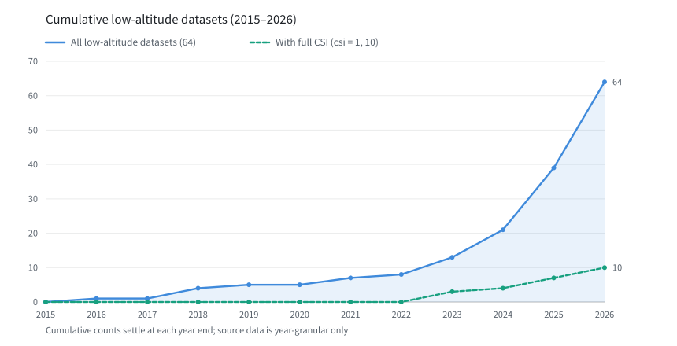

# Low-Altitude Datasets · An Open Dataset Index

[中文](README.zh-CN.md) ｜ **English**

An open catalogue of datasets for **low-altitude economy** and **UAV integrated sensing and communication (ISAC)** research. Every entry reports its **name, official website, release year, authors / affiliation** and a **modality coverage comparison**.

The catalogue is built on Table 1 of **[LAMBDA: A Low-Altitude Multimodal Base Dataset for UAV Sensing and Communication](https://arxiv.org/abs/2607.03826)** (arXiv:2607.03826), with official pages and paper links verified entry by entry. It extends that table with public datasets on ISAC simulation and measurement, RF and radar detection, acoustic sensing, and UAV vision and multimodal perception.

> Overview, matrix and details are all split into two tables by **whether low-altitude / UAV scenarios are involved**: **low-altitude datasets** and **general / upstream benchmarks** (the latter contain no low-altitude scenarios at all). Low-altitude entries are further colour-coded by **channel-level data**: 🟢 full CSI, 🟡 partial CSI, 🔵 RF signal only (waveform, spectrum or RF metrics, no CSI), ⚪ none.

> 🌐 **Browse online**: [sjtu-wirelessai-lab.github.io/Low-Altitude-Dataset](https://sjtu-wirelessai-lab.github.io/Low-Altitude-Dataset/) — searchable, filterable, with a comparison matrix.
> 📦 **Structured data**: [data/datasets.json](https://cdn.jsdelivr.net/gh/SJTU-WirelessAI-Lab/Low-Altitude-Dataset@main/data/datasets.json) — served by jsDelivr as `application/json` and directly fetchable; the CDN caches, so treat the in-repo file at the same path as authoritative.

**Growth**: the catalogue currently covers publication years up to 2026, with **64** low-altitude entries in total, **10** of which provide full MIMO channel CSI. The chart below accumulates by publication year: the solid line counts all low-altitude entries, the dashed line those with full CSI.



---

## Table of contents

- [Dataset overview](#dataset-overview)
- [Modality coverage matrix](#modality-coverage-matrix)
- [Dataset details](#dataset-details)
- [Inclusion notes](#inclusion-notes)
- [Contributing](#contributing)
- [Citation](#citation)

---

## Dataset overview

**78** indexed records (including LAMBDA itself), spanning **2012–2026**: **64 low-altitude** and **14 general / upstream benchmarks**.

**Channel-level annotation**: 🟢 full CSI (complete MIMO channel); 🟡 partial CSI (measured channel data, but not full MIMO CSI); 🔵 RF signal only (waveform, spectrum or RF metrics; the data itself carries no CSI); ⚪ none. **CSI and RF signal are distinct modalities** and do not substitute for each other: the first is a channel-estimation product, the second is the raw waveform or spectrum captured by the receiver.

**Access**: **open** is the default (publicly downloadable from the official page; no badge on the card). Four restricted cases are flagged separately — **preview** (subset only), **register** (platform account), **request** (email / form approval) and **unreleased** (announced but not yet available). Of the 78 entries: open 64, preview 4, register 4, request 4, unreleased 2.

**Data origin**: **measured** (real sensors / field campaign), **mixed** (real acquisition plus synthetic augmentation), **simulated** (ray tracing / digital twin / renderer). Of the 78 entries: measured 53, mixed 10, simulated 15; among the 64 low-altitude entries: measured 48, mixed 6, simulated 10.

### Low-altitude datasets (64)

| # | Dataset | Origin | CSI | RF | Year | Authors | Affiliation | Website |
|---|--------|:----:|:---:|:----:|------|------|------|------|
| 1 | **UAV123** | Measured | ⚪ | · | 2016 | Matthias Mueller, Neil Smith, Bernard Ghanem | King Abdullah University of Science and Technology (KAUST) | [link](https://cemse.kaust.edu.sa/ivul/datasets) |
| 2 | **DOTA** | Measured | ⚪ | · | 2018 | Gui-Song Xia, Xiang Bai, Jian Ding, Zhen Zhu, Serge Belongie, et al. | Wuhan University | [link](https://captain-whu.github.io/DOTA/dataset.html) |
| 3 | **UAVDT** | Measured | ⚪ | · | 2018 | Dawei Du, Yuankai Qi, Hongyang Yu, Yifan Yang, et al. | Chinese Academy of Sciences and others | [link](https://sites.google.com/site/daviddo0323/projects/uavdt) |
| 4 | **VisDrone** | Measured | ⚪ | · | 2018 | AISKYEYE team (Zhu, Wen, Bian, Ling, Liang, et al.) | Tianjin University | [link](https://github.com/VisDrone/VisDrone-Dataset) |
| 5 | **DroneRF (Mendeley)** | Measured | ⚪ | 🔵 | 2019 | Mohammad F. Al-Sa'd, Mhd Saria Allahham, Amr Mohamed, Abdulla Al-Ali, Tamer Khattab, Aiman Erbad | Qatar University | [link](https://data.mendeley.com/datasets/f4c2b4n755/1) |
| 6 | **Anti-UAV300** | Measured | ⚪ | · | 2021 | Nan Jiang, Kuiran Wang, Xiaoke Peng, Xuehui Yu, Qiang Wang, Junliang Xing, Guorong Li, Jian Zhao, Guodong Guo, Zhenjun Han | University of Chinese Academy of Sciences / North Institute of Electronic Equipment | [link](https://github.com/ucas-vg/Anti-UAV) |
| 7 | **Drone-detection (DREGON)** | Measured | ⚪ | · | 2021 | Fredrik Svanström, Fernando Alonso-Fernandez, Cristofer Englund | Halmstad University (CAISR) / Swedish Armed Forces | [link](https://github.com/DroneDetectionThesis/Drone-detection-dataset) |
| 8 | **DIAT-µSAT** | Measured | ⚪ | · | 2022 | Harish Chandra Kumawat, Mainak Chakraborty, A. Arockia Bazil Raj, Sunita Vikrant Dhavale | Defence Institute of Advanced Technology (DIAT), India | [link](https://ieee-dataport.org/documents/diat-msat-micro-doppler-signature-dataset-small-unmanned-aerial-vehicle-suav) |
| 9 | **DeepSense 6G** | Measured | 🟡 | · | 2023 | Ahmed Alkhateeb, et al. | Arizona State University | [link](https://www.deepsense6g.net/) |
| 10 | **ISAC UAV (TU Ilmenau)** | Measured | 🟢 | · | 2023 | Julia Beuster, Carsten Andrich, Michael Döbereiner, Steffen Schieler, Maximilian Engelhardt, Christian Schneider, Reiner Thomä | Technische Universität Ilmenau (EMS Group) | [link](https://ems-tu-ilmenau.github.io/isac-uav-dataset-docs/) |
| 11 | **M3ED** | Measured | ⚪ | · | 2023 | Kenneth Chaney, Fernando Cladera, Ziyun Wang, Anthony Bisulco, M. Ani Hsieh, Christopher Korpela, Vijay Kumar, Camillo J. Taylor, Kostas Daniilidis | University of Pennsylvania et al. | [link](https://m3ed.io/) |
| 12 | **MaMIMO-UAV 3D CSI** | Measured | 🟢 | · | 2023 | Achiel Colpaert, Cel Thys, Zhuangzhuang Cui, Sofie Pollin | KU Leuven (ESAT) | [link](https://doi.org/10.48804/0IMQDF) |
| 13 | **Sensiverse** | Simulated | 🟢 | · | 2023 | Jiajin Luo, Baojian Zhou, Yang Yu, Ping Zhang, et al. (Huawei) | Huawei Technologies | [link](https://sensiverse.github.io/) |
| 14 | **AERPAW** | Measured | 🟡 | 🔵 | 2024 | Ismail Guvenc, Mihail L. Sichitiu, Rudra Dutta, et al. | North Carolina State University | [link](https://aerpaw.org/experiments/datasets/) |
| 15 | **DADS** | Measured | ⚪ | · | 2024 | Community (schiffman / geronimobasso) | Community (Hugging Face) | [link](https://huggingface.co/datasets/geronimobasso/drone-audio-detection-samples) |
| 16 | **DeepVerse 6G** | Simulated | 🟢 | · | 2024 | Umut Demirhan, Abdelrahman Taha, Ahmed Alkhateeb | Arizona State University | [link](https://deepverse6g.net/) |
| 17 | **DroneRFa** | Measured | ⚪ | 🔵 | 2024 | 俞宁宁, 毛盛健, 周成伟, 孙国威, 史治国, 陈积明 | College of Information Science and Electronic Engineering, Zhejiang University | [link](https://www.scidb.cn/detail?dataSetId=34f0a91e8a544904998b8fdc44477380) |
| 18 | **KU Leuven Drone RF** | Measured | ⚪ | 🔵 | 2024 | Sanjoy Basak, Sofie Pollin, Bart Scheers | KU Leuven (ESAT) / Royal Military Academy | [link](https://doi.org/10.48804/HZRVNZ) |
| 19 | **LSS-FMCWR-1.0** | Measured | ⚪ | · | 2024 | 陈小龙, 袁旺, 杜晓林, 于刚, 何肖阳, 关键, 汪兴海 | Naval Aviation University / Yantai University / University of Jinan | [link](https://radars.ac.cn/article/doi/10.12000/JR23142) |
| 20 | **MMAUD** | Measured | ⚪ | · | 2024 | Shenghai Yuan, Yizhuo Yang, Thien Hoang Nguyen, Thien-Minh Nguyen, Jianfei Yang, Fen Liu, Jianping Li, Han Wang, Lihua Xie | Nanyang Technological University (NTU) | [link](https://github.com/ntu-aris/MMAUD) |
| 21 | **UAVSig** | Measured | ⚪ | 🔵 | 2024 | T. Zhao, B. W. Domae, C. Steigerwald, L. B. Paradis, T. Chabuk, D. Cabric | University of California, Los Angeles (UCLA) | [link](https://cores.ee.ucla.edu/downloads/datasets/uavsig/) |
| 22 | **3D MaMIMO A2G UAV CSI** | Measured | 🟢 | · | 2025 | Achiel Colpaert, Sofie Pollin | KU Leuven (ESAT) | [link](https://doi.org/10.48804/MTNAEG) |
| 23 | **A2G CIR (3.6 GHz)** | Measured | 🟡 | · | 2025 | Qiuming Zhu, Hangang Li, Kai Mao, Hanpeng Li, Xuhan Wen, Shaolong Zhang, Jie Wang | Nanjing University of Aeronautics and Astronautics (NUAA) | [link](https://doi.org/10.17632/8p6r8ft4fz.2) |
| 24 | **AnyVisLoc** | Measured | ⚪ | · | 2025 | Yibin Ye, Xichao Teng, Shuo Chen, Zhang Li, Leqi Liu, Qifeng Yu, Tao Tan | National University of Defense Technology / Macao Polytechnic University | [link](https://github.com/UAV-AVL/Benchmark) |
| 25 | **DrIFT** | Mixed | ⚪ | · | 2025 | Fardad Dadboud, Hamid Azad, Varun Mehta, Miodrag Bolic, Iraj Mantegh | University of Ottawa / NRC Canada | [link](https://github.com/CARG-uOttawa/DrIFT) |
| 26 | **DroneRFb-DIR** | Measured | ⚪ | 🔵 | 2025 | 任俊宇, 俞宁宁, 周成伟, 史治国, 陈积明 | College of Information Science and Electronic Engineering, Zhejiang University / State Key Laboratory of Industrial Control Technology | [link](https://www.scidb.cn/detail?dataSetId=84cf9101e739402784b1396783881202) |
| 27 | **Great-MSD** | Simulated | 🟢 | · | 2025 | Kongwu Huang, Shiyi Mu, Jun Jiang, Yuan Gao, Shugong Xu | Shanghai University / Xi'an Jiaotong-Liverpool University | [link](https://github.com/hkw-xg/Great-MCD) |
| 28 | **LAE UAV** | Simulated | ⚪ | · | 2025 | Zhengru Fang, Zhenghao Liu, Jingjing Wang, Senkang Hu, et al., Yuguang Fang | City University of Hong Kong / Beihang University | [link](https://github.com/fangzr/TOC-Edge-Aerial) |
| 29 | **LIPASE** | Measured | ⚪ | 🔵 | 2025 | Yifei Sun, Chao Yu, Yan Luo, Tony Xiao Han, Haisheng Tan, Rui Wang, Francis C. M. Lau | The University of Hong Kong / SUSTech / Huawei, among others | [link](https://github.com/yfsun0327/lipase-dataset) |
| 30 | **Lund UAV Audio** | Measured | ⚪ | · | 2025 | Erik Tegler, Max Modig, Per Skarin, Kalle Åström, Magnus Oskarsson, Gabrielle Flood | Lund University / SAAB | [link](https://vision.maths.lth.se/drone_sound/) |
| 31 | **MathWorks Radar Drone** | Measured | ⚪ | · | 2025 | Zhongliang Guo, Samiur Rahman, Duncan Robertson | University of St Andrews | [link](https://doi.org/10.5281/zenodo.15224887) |
| 32 | **NeoDrone** | Measured | ⚪ | · | 2025 | NeoDrone team (Beijing data intellectual property registration) | Beijing Low-Altitude Intelligent Systems | [link](https://github.com/playezio/NeoDrone) |
| 33 | **Oryx (Drone Swarm Sounding)** | Measured | 🟡 | · | 2025 | Julia Beuster, Carsten Andrich, Sebastian Giehl, Marc Miranda, et al. | Technische Universität Ilmenau | [link](https://doi.org/10.71758/refodat.60) |
| 34 | **RFUAV** | Measured | ⚪ | 🔵 | 2025 | Rui Shi, Xiaodong Yu, Shengming Wang, Yijia Zhang, Lu Xu, Peng Pan, Chunlai Ma | Beijing University of Posts and Telecommunications and others | [link](https://github.com/kitoweeknd/RFUAV) |
| 35 | **SynthSoM** | Simulated | 🟢 | · | 2025 | Xiang Cheng, Ziwei Huang, Yong Yu, Lu Bai, Mingran Sun, et al. | Peking University / Shandong University | [link](https://github.com/ZiweiHuang96/SynthSoM) |
| 36 | **TMRGBT-D2D** | Measured | ⚪ | · | 2025 | Hexiang Hao, Yueping Peng, Zecong Ye, Baixuan Han, Wei Tang, Wenchao Kang, Xuekai Zhang, Qilong Li, Wenchao Liu | Engineering University of the Chinese People's Armed Police Force | [link](https://github.com/HexiangH/TMRGBT-D2D) |
| 37 | **UAV-LowAlt-MOT** | Measured | ⚪ | · | 2025 | Xin Wang | Xidian University | [link](https://www.scidb.cn/en/detail?dataSetId=239a78b317464fb9943387df112a0345) |
| 38 | **UAV-MM3D** | Simulated | ⚪ | · | 2025 | Longkun Zou, Jiale Wang, Rongqin Liang, Hai Wu, Ke Chen, Yaowei Wang | Pengcheng Laboratory / University of Southern California | [link](https://github.com/zou-longkun/UAVMM3D) |
| 39 | **UAVScenes** | Measured | ⚪ | · | 2025 | Sijie Wang, Siqi Li, Yawei Zhang, Shangshu Yu, Shenghai Yuan, et al., Lihua Xie, Wee Peng Tay | Nanyang Technological University / Shanghai Jiao Tong University, among others | [link](https://github.com/sijieaaa/UAVScenes) |
| 40 | **16-Ch UAV Acoustic** | Measured | ⚪ | · | 2026 | Huilong Wang, Peng Chen, Zhimin Chen, Yuye Liu | Southeast University / Shanghai Dianji University | [link](https://doi.org/10.5281/zenodo.23613504) |
| 41 | **A2A-UAV** | Measured | ⚪ | · | 2026 | Hongtao Liang, Yiyao Wan, Kezhi Zhu, Jiayi Zhang, Zequn Jiang, Ziyu Zhou, Jiahuan Ji, Fuhui Zhou, Qihui Wu | Nanjing University of Aeronautics and Astronautics (NUAA) / HKUST | [link](https://github.com/lht-research/A2A-UAV) |
| 42 | **A2G CIR + RT (Multi-band)** | Mixed | 🟡 | · | 2026 | Qiuming Zhu, Nan Ming, Jianan Xie, Weidong Li, Junwei Bao, Kai Mao, et al. | Nanjing University of Aeronautics and Astronautics (NUAA) | [link](https://doi.org/10.17632/pztzfz4vy4.1) |
| 43 | **AERPAW AADM** | Mixed | ⚪ | 🔵 | 2026 | Md Sharif Hossen, Cole Dickerson, Ozgur Ozdemir, Mihail Sichitiu, Ismail Guvenc | North Carolina State University | [link](https://doi.org/10.5061/dryad.7d7wm3898) |
| 44 | **ATA** | Measured | ⚪ | · | 2026 | Wenchao Kang, Xuekai Zhang, Yueping Peng, Wei Tang, Qilong Li, Hexiang Hao, Kang Liu, Qinghe Chen | Engineering University of the Chinese People's Armed Police Force | [link](https://github.com/kkbushi/ATA) |
| 45 | **CPD-UAV** | Measured | ⚪ | · | 2026 | Xuekai Zhang, Wenchao Kang, Yueping Peng, Wei Tang, Qilong Li, Hexiang Hao, Liming Hou, Xin Ying | Engineering University of the Chinese People's Armed Police Force | [link](https://github.com/18510004596/CPD-UAV) |
| 46 | **CageDroneRF** | Mixed | ⚪ | 🔵 | 2026 | Mohammad Rostami, Atik Faysal, Hongtao Xia, Hadi Kasasbeh, Ziang Gao, Huaxia Wang | Rowan University | [link](https://arxiv.org/abs/2601.03302) |
| 47 | **Cooperative Monostatic/Bistatic UAV ISAC** | Measured | 🟡 | · | 2026 | Nan Ming, Hanwen Xu, Kai Mao, Hanpeng Li, Mingqi Guo, Xiaomin Chen, Qiuming Zhu | NUAA / Queen’s University Belfast | [link](https://www.mdpi.com/1424-8220/26/16/5015#data-availability) |
| 48 | **Cross-layer UAV 6G** | Measured | ⚪ | 🔹 | 2026 | Francesco Paolucci, Emilio Paolini, Massimo Satler, et al. | CNIT / Scuola Superiore Sant'Anna | [link](https://zenodo.org/records/21468734) |
| 49 | **DroneRFc-MM** | Measured | ⚪ | 🔵 | 2026 | 虞涛菘, 杨倩倩, 胡卓, 李明锴, 吴嘉俊, 苏煜繁, 潘俊宇, 史治国, 陈积明 | Zhejiang Provincial Key Laboratory of Airspace Perception and Autonomous Unmanned Systems, Zhejiang University | [link](https://www.scidb.cn/detail?dataSetId=0af05173ce5d45528ebd707d67f3d641) |
| 50 | **FlyAwareV2** | Mixed | ⚪ | · | 2026 | Francesco Barbato, Matteo Caligiuri, Pietro Zanuttigh | University of Padova | [link](https://medialab.dei.unipd.it/paper_data/FlyAwareV2) |
| 51 | **ITU-ARIS Acoustic** | Measured | ⚪ | · | 2026 | İhsan Mert Muhacıroğlu, Tayfun Akgül | Istanbul Technical University (ARIS Lab) | [link](https://zenodo.org/records/22682339) |
| 52 | **LACN-Dataset** | Measured | ⚪ | 🔹 | 2026 | Boqun Huang, Yancheng Wang, Wei Guo, Zhaojie Guo, Di Wu, Ran Li, Dayang Liu, Wanshun Lan, Chuan Huang, Shuguang Cui | UESTC / CUHK-Shenzhen / HKUST / China Mobile | [link](https://github.com/ycw671/LACN-Dataset/tree/main/dataset) |
| 53 | **LIVE-RIS** | Measured | 🟡 | · | 2026 | David Müller, Kevin Weinberger, Aydin Sezgin, Martin Mönnigmann | Ruhr University Bochum | [link](https://zenodo.org/records/23011126) |
| 54 | **MultiFly** | Measured | ⚪ | · | 2026 | Markus Gross, Andreas Greiner, Taehyoung Kim, Sivasubiramaniam Subbiah, Tomaž Cotič, Conrad Christoph, Oussema Dhaouadi, Simon Zieher, Surya Kumar, Gordon Elger, Henri Meeß, Olaf Wysocki, Paul Spannaus, Daniel Cremers | Fraunhofer IVI / TU Munich / University of Cambridge / TH Ingolstadt | [link](https://markus-42.github.io/multifly/) |
| 55 | **Multimodal-NF** | Simulated | 🟢 | · | 2026 | Mengyuan Li, Qianfan Lu, Jiachen Tian, Hongjun Hu, Yu Han, Xiao Li, Chao-Kai Wen, Shi Jin | Southeast University | [link](https://lmyxxn.github.io/6GXLMIMODatasets/) |
| 56 | **PML-CellularEye** | Measured | 🟡 | 🔵 | 2026 | Ziguo Zhong, Yongming Huang, Huazhou Hou, Fanfei Xu, Haisheng Feng, Shengheng Liu, Xiaohu You | Purple Mountain Laboratories / Southeast University | [link](https://ffxu1024.github.io/CellularEye/) |
| 57 | **SkyEV** | Measured | ⚪ | · | 2026 | Jakub Mandula, Sebastian Heusinger, Julian Moosmann, Christian Vogt, Michele Magno | ETH Zurich | [link](https://arxiv.org/abs/2607.18747) |
| 58 | **TSMS-Drone** | Measured | ⚪ | 🔵 | 2026 | Seung-Kyu Han, Young-Ho Jung | Korea Aerospace University | [link](https://doi.org/10.25452/figshare.plus.30027313) |
| 59 | **TalTech UAV 5G mmWave** | Measured | ⚪ | 🔹 | 2026 | Junaid Sajid, Marika Kulmar, Lauri Anton, Margus Rohtla, Priit Roosipuu, Ivo Müürsepp, Muhammad Mahtab Alam | Tallinn University of Technology / University of Essex | [link](https://data.taltech.ee/records/p1hk3-ve652) |
| 60 | **TriCross-D2D** | Measured | ⚪ | · | 2026 | Wei Tang, Qilong Li, Yueping Peng, Hexiang Hao, Wenchao Kang, Xuekai Zhang, Liming Hou, Hongyan Lu | Engineering University of the Chinese People's Armed Police Force | [link](https://github.com/vv0930/TriCross-D2D) |
| 61 | **UAV Wireless MM-Bench** | Simulated | ⚪ | · | 2026 | Najmeh Alibabaie, Antonello Calabrò, Eda Marchetti | CNR-ISTI (Italy) | [link](https://doi.org/10.5281/zenodo.17486134) |
| 62 | **UAV-Flow** | Mixed | ⚪ | · | 2026 | Donglin Yang, Xiangyu Wang, Yantong Zhong, Wenhao Zheng, Zihan Ding, Yue Liao, Hongsheng Li, Ke Xu, Si Liu | Beihang University / National University of Singapore / CUHK MMLab | [link](https://prince687028.github.io/UAV-Flow/) |
| 63 | **Huangpu River Water–Air** ⭐ | Simulated | 🟢 | · | 2026 | Haofeng Zhong, Jianhua Mo | Shanghai Jiao Tong University | [link](https://doi.org/10.57760/sciencedb.0130w) |
| 64 | **LAMBDA** ⭐ | Simulated | 🟢 | · | 2026 | Lin Zhou, Peichuan Rao, Chenshuo Zhang, Jianhua Mo, Shu Sun, Zhiyong Chen, Meixia Tao | Shanghai Jiao Tong University | [link](https://doi.org/10.57760/sciencedb.36052) |

### General / upstream benchmark datasets (14)

These datasets contain **no low-altitude / UAV scenarios at all**. Most are terrestrial perception or pure channel / electromagnetic datasets, listed here as upstream references and never mixed with low-altitude entries.

| # | Dataset | Origin | CSI | RF | Year | Authors | Affiliation | Website |
|---|--------|:----:|:---:|:----:|------|------|------|------|
| 1 | **KITTI** | Measured | ⚪ | · | 2012 | Andreas Geiger, Philip Lenz, Raquel Urtasun | Karlsruhe Institute of Technology (KIT) | [link](https://www.cvlibs.net/datasets/kitti/) |
| 2 | **DeepMIMO** | Simulated | 🟢 | · | 2019 | Ahmed Alkhateeb | Arizona State University | [link](https://www.deepmimo.net/) |
| 3 | **ViWi** | Mixed | 🟢 | · | 2020 | Muhammad Alrabeiah, Andrew Hredzak, Zhenhao Liu, Ahmed Alkhateeb | Arizona State University | [link](https://www.viwi-dataset.net/) |
| 4 | **DAIR-V2X** | Measured | ⚪ | · | 2022 | Haibao Yu, Yizhen Luo, Mao Shu, Yiyi Huo, et al. | Tsinghua University AIR / Baidu | [link](https://air.tsinghua.edu.cn/DAIR-V2X/index.html) |
| 5 | **E-FLASH** | Measured | 🟡 | · | 2022 | Jerry Gu, Batool Salehi, Debashri Roy, Kaushik R. Chowdhury | Northeastern University | [link](https://ieee-dataport.org/documents/e-flash) |
| 6 | **OPV2V** | Simulated | ⚪ | · | 2022 | Runsheng Xu, Hao Xiang, Zhengzhong Tu, Xin Xia, Ming-Hsuan Yang, Jiaqi Ma | University of California, Los Angeles (UCLA) | [link](https://mobility-lab.seas.ucla.edu/opv2v/) |
| 7 | **WAIR-D** | Simulated | 🟢 | · | 2022 | Yourui Huangfu, Jian Wang, Shengchen Dai, Rong Li, et al. | Huawei Wireless Technology Lab / Zhejiang University | [link](https://www.mobileai-dataset.com/html/default/yingwen/DateSet/1590994253188792322.html?index=1) |
| 8 | **M3SC** | Mixed | 🟢 | · | 2023 | Xiang Cheng, Ziwei Huang, Lu Bai, Haotian Zhang, et al. | Peking University (PCNI Lab) | [link](http://pcni.pku.edu.cn/dataset_1.html) |
| 9 | **LuViRA** | Measured | 🟢 | · | 2024 | Ilayda Yaman, Guoda Tian, Martin Larsson, Patrik Persson, et al. (Lund University) | Lund University | [link](https://github.com/ilaydayaman/LuViRA_Dataset) |
| 10 | **SDCD** | Simulated | ⚪ | · | 2024 | Jihao Li, Jincheng Hu, Yanjun Huang, Zheng Chen, Bingzhao Gao, Jingjing Jiang, Yuanjian Zhang | University of Southampton / Tongji University | [link](https://github.com/ReparkHjc/SDCD) |
| 11 | **Multimodal-Wireless** | Simulated | 🟢 | · | 2025 | Tianhao Mao, Le Liang, Jie Yang, Hao Ye, Shi Jin, Geoffrey Ye Li | Southeast University / Imperial College London | [link](https://le-liang.github.io/mmw) |
| 12 | **EM-134K** | Mixed | ⚪ | 🔵 | 2026 | Junyu Shen, Zhendong She, Chenghanyu Zhang, Yuchuang Sun, et al., Maosong Sun | Tsinghua University / BUPT / Tianjin University / IMECAS, among others | [link](https://em-merlin.github.io/) |
| 13 | **EM-Bench** | Mixed | ⚪ | 🔵 | 2026 | Junyu Shen, Zhendong She, Chenghanyu Zhang, Yuchuang Sun, et al., Maosong Sun | Tsinghua University / BUPT / Tianjin University / IMECAS, among others | [link](https://em-merlin.github.io/) |
| 14 | **U6G-WISE** | Measured | 🟢 | · | 2026 | Yijia Feng, Hanzhong Zhang, Tao Tao, Ting Zhou, Yang Wang, Dong Li, Yunbo Hu, Zhenghang Zhu, Mingrui Zhu, Shuang Chen, Zhi Wang, Guangxing Li, Jingxin Liu, Liyu Cai | Shanghai Academy of Networked Intelligence / Shanghai University / Transcom Technologies | [link](https://doi.org/10.57760/sciencedb.01a31) |

**14 entries with restricted access** (the other 64 are directly downloadable from their official pages):

| Dataset | Year | Access | Note |
|---|---|---|---|
| **DIAT-µSAT** | 2022 | Register | Requires a (free) account on the hosting platform |
| **E-FLASH** | 2022 | Register | Requires a (free) account on the hosting platform |
| **ISAC UAV (TU Ilmenau)** | 2023 | On request | Requires an email / form request and approval |
| **AERPAW** | 2024 | Register | Requires a (free) account on the hosting platform |
| **TMRGBT-D2D** | 2025 | Preview | Only a subset / preview is public; full data pending release |
| **UAV-MM3D** | 2025 | Register | Requires a (free) account on the hosting platform |
| **A2A-UAV** | 2026 | Preview | Only a subset / preview is public; full data pending release |
| **A2G CIR + RT (Multi-band)** | 2026 | Preview | Only a subset / preview is public; full data pending release |
| **ATA** | 2026 | Unreleased | Announced but not yet available |
| **CPD-UAV** | 2026 | On request | Requires an email / form request and approval |
| **Cooperative Monostatic/Bistatic UAV ISAC** | 2026 | On request | Requires an email / form request and approval |
| **MultiFly** | 2026 | Unreleased | Announced but not yet available |
| **TalTech UAV 5G mmWave** | 2026 | On request | Requires an email / form request and approval |
| **TriCross-D2D** | 2026 | Preview | Only a subset / preview is public; full data pending release |

---

## Modality coverage matrix

Coverage follows Table 1 of the LAMBDA paper, plus curator-added datasets:  included;  limited or partial;  absent or not applicable. The dot before each dataset name indicates **channel-level data** (🟢 full CSI / 🟡 partial CSI / 🔵 RF signal only / ⚪ none).

> **Reading note**: simulated datasets show systematically higher modality coverage than measured ones — a simulator can switch on any modality at will, while real campaigns are limited by sensor configuration and multi-sensor hard synchronization. If you need directly reproducible measured data, read the Origin and CSI columns together: the usable subset is far narrower than the full table suggests.

> **About the icons**: Markdown tables cannot fill cell backgrounds (GitHub, GitLab and VS Code all filter `style` and `bgcolor`), so each cell carries a 20×20 icon whose colours match the web version: dark green = included, amber = partial, light grey = absent or not applicable.

### Low-altitude datasets (64)

| Dataset | Year | Low-altitude | CSI | RF | RGB/Depth | IR | LiDAR | Radar | IMU/GPS | Weather/Time | Acoustic | Main focus |
|--------|------|:----: | :----: | :----: | :----: | :----: | :----: | :----: | :----: | :----: | :----:|------------|
| ⚪ UAV123 | 2016 |  |  |  |  |  |  |  |  |  |  | Low-altitude UAV single-object tracking benchmark |
| ⚪ DOTA | 2018 |  |  |  |  |  |  |  |  |  |  | Aerial image object detection |
| ⚪ UAVDT | 2018 |  |  |  |  |  |  |  |  |  |  | UAV vehicle detection & tracking benchmark |
| ⚪ VisDrone | 2018 |  |  |  |  |  |  |  |  |  |  | Drone-view object detection & tracking benchmark |
| 🔵 DroneRF (Mendeley) | 2019 |  |  |  |  |  |  |  |  |  |  | RF samples (CSV) of three drones in multiple flight modes |
| ⚪ Anti-UAV300 | 2021 |  |  |  |  |  |  |  |  |  |  | RGB-T multi-modal benchmark for UAV tracking |
| ⚪ Drone-detection (DREGON) | 2021 |  |  |  |  |  |  |  |  |  |  | Multi-sensor drone detection with IR, visible and audio |
| ⚪ DIAT-µSAT | 2022 |  |  |  |  |  |  |  |  |  |  | Micro-Doppler signatures of small UAVs |
| 🟡 DeepSense 6G | 2023 |  |  |  |  |  |  |  |  |  |  | Real-world multimodal wireless measurements |
| 🟢 ISAC UAV (TU Ilmenau) | 2023 |  |  |  |  |  |  |  |  |  |  | Multistatic ISAC channel measurements of UAV at 3.75 GHz |
| ⚪ M3ED | 2023 |  |  |  |  |  |  |  |  |  |  | Multi-robot event-camera benchmark with aerial sequences |
| 🟢 MaMIMO-UAV 3D CSI | 2023 |  |  |  |  |  |  |  |  |  |  | 3D non-stationary UAV–MaMIMO channel CSI |
| 🟢 Sensiverse | 2023 |  |  |  |  |  |  |  |  |  |  | Multi-scenario multi-band ISAC sensing channel dataset |
| 🟡 AERPAW | 2024 |  |  |  |  |  |  |  |  |  |  | A2G/A2A channel sounding, spectrum & KPI datasets |
| ⚪ DADS | 2024 |  |  |  |  |  |  |  |  |  |  | Largest public drone audio database |
| 🟢 DeepVerse 6G | 2024 |  |  |  |  |  |  |  |  |  |  | Digital-twin wireless datasets |
| 🔵 DroneRFa | 2024 |  |  |  |  |  |  |  |  |  |  | Large-scale drone RF signals for low-altitude detection |
| 🔵 KU Leuven Drone RF | 2024 |  |  |  |  |  |  |  |  |  |  | Drone RF I/Q in a semi-anechoic chamber |
| ⚪ LSS-FMCWR-1.0 | 2024 |  |  |  |  |  |  |  |  |  |  | Multiband FMCW radar low-slow-small target dataset |
| ⚪ MMAUD | 2024 |  |  |  |  |  |  |  |  |  |  | Multi-modal anti-UAV detection, classification and trajectory estimation |
| 🔵 UAVSig | 2024 |  |  |  |  |  |  |  |  |  |  | Labeled raw I/Q for drone and controller RF fingerprinting |
| 🟢 3D MaMIMO A2G UAV CSI | 2025 |  |  |  |  |  |  |  |  |  |  | GPS-labeled UAV–MaMIMO air-to-ground CSI |
| 🟡 A2G CIR (3.6 GHz) | 2025 |  |  |  |  |  |  |  |  |  |  | Measured 3.6 GHz A2G channel CIR over sports field, farmland and over-water |
| ⚪ AnyVisLoc | 2025 |  |  |  |  |  |  |  |  |  |  | Low-altitude multi-view UAV visual localization benchmark |
| ⚪ DrIFT | 2025 |  |  |  |  |  |  |  |  |  |  | Visual drone detection under domain shifts |
| 🔵 DroneRFb-DIR | 2025 |  |  |  |  |  |  |  |  |  |  | Non-cooperative drone individual identification |
| 🟢 Great-MSD | 2025 |  |  |  |  |  |  |  |  |  |  | Single-engine multimodal ISAC simulation dataset |
| ⚪ LAE UAV | 2025 |  |  |  |  |  |  |  |  |  |  | UAV visual navigation in GNSS-denied urban LAE |
| 🔵 LIPASE | 2025 |  |  |  |  |  |  |  |  |  |  | Passive UAV tracking with LTE downlink & digital arrays |
| ⚪ Lund UAV Audio | 2025 |  |  |  |  |  |  |  |  |  |  | Mic-array DOA drone localization from sound |
| ⚪ MathWorks Radar Drone | 2025 |  |  |  |  |  |  |  |  |  |  | Large-scale radar drone classification dataset |
| ⚪ NeoDrone | 2025 |  |  |  |  |  |  |  |  |  |  | Near-earth drone observation vision dataset |
| 🟡 Oryx (Drone Swarm Sounding) | 2025 |  |  |  |  |  |  |  |  |  |  | Multi-static channel sounding with a drone swarm |
| 🔵 RFUAV | 2025 |  |  |  |  |  |  |  |  |  |  | Large-scale RF drone fingerprint benchmark |
| 🟢 SynthSoM | 2025 |  |  |  |  |  |  |  |  |  |  | Synthetic SoM dataset with air-ground scenarios |
| ⚪ TMRGBT-D2D | 2025 |  |  |  |  |  |  |  |  |  |  | Temporally aligned but spatially misaligned RGB-thermal drone-to-drone detection |
| ⚪ UAV-LowAlt-MOT | 2025 |  |  |  |  |  |  |  |  |  |  | Low-altitude UAV multi-target detection & tracking |
| ⚪ UAV-MM3D | 2025 |  |  |  |  |  |  |  |  |  |  | Synthetic multimodal low-altitude UAV perception and tracking |
| ⚪ UAVScenes | 2025 |  |  |  |  |  |  |  |  |  |  | Multi-modal UAV perception benchmark |
| ⚪ 16-Ch UAV Acoustic | 2026 |  |  |  |  |  |  |  |  |  |  | 16-channel passive acoustic monitoring of small UAVs |
| ⚪ A2A-UAV | 2026 |  |  |  |  |  |  |  |  |  |  | Air-to-air multimodal UAV detection and identification |
| 🟡 A2G CIR + RT (Multi-band) | 2026 |  |  |  |  |  |  |  |  |  |  | Measured and ray-tracing A2G CIR across urban / suburban / farmland / over-water |
| 🔵 AERPAW AADM | 2026 |  |  |  |  |  |  |  |  |  |  | AERPAW autonomous aerial data mule multi-modal wireless measurements |
| ⚪ ATA | 2026 |  |  |  |  |  |  |  |  |  |  | Vision-language tracking benchmark for air-to-air counter-UAV of tiny drones |
| ⚪ CPD-UAV | 2026 |  |  |  |  |  |  |  |  |  |  | UAV-view detection of personnel visually blended with the environment |
| 🔵 CageDroneRF | 2026 |  |  |  |  |  |  |  |  |  |  | RF drone detection benchmark with synthetic augmentation |
| 🟡 Cooperative Monostatic/Bistatic UAV ISAC | 2026 |  |  |  |  |  |  |  |  |  |  | Cooperative monostatic and bistatic low-altitude UAV ISAC sounding |
| 🔵 Cross-layer UAV 6G | 2026 |  |  |  |  |  |  |  |  |  |  | Cross-layer UAV measurements over a 5G testbed |
| 🔵 DroneRFc-MM | 2026 |  |  |  |  |  |  |  |  |  |  | Anti-UAV multimodal measured dataset |
| ⚪ FlyAwareV2 | 2026 |  |  |  |  |  |  |  |  |  |  | Multimodal cross-domain UAV urban-scene dataset |
| ⚪ ITU-ARIS Acoustic | 2026 |  |  |  |  |  |  |  |  |  |  | Outdoor acoustic drone detection dataset |
| 🔵 LACN-Dataset | 2026 |  |  |  |  |  |  |  |  |  |  | Before/after 5G NR coverage measurements over four UAV altitudes |
| 🟡 LIVE-RIS | 2026 |  |  |  |  |  |  |  |  |  |  | In-flight UAV-mounted RIS S21 channel measurements |
| ⚪ MultiFly | 2026 |  |  |  |  |  |  |  |  |  |  | Real-world multimodal aerial semantic perception |
| 🟢 Multimodal-NF | 2026 |  |  |  |  |  |  |  |  |  |  | Near-field low-altitude XL-MIMO |
| 🟡 PML-CellularEye | 2026 |  |  |  |  |  |  |  |  |  |  | Real-world BS-side low-altitude ISAC data |
| ⚪ SkyEV | 2026 |  |  |  |  |  |  |  |  |  |  | Synchronized RGB-event UAV detection & tracking |
| 🔵 TSMS-Drone | 2026 |  |  |  |  |  |  |  |  |  |  | Time-synchronized FMCW radar / CW radar / RF receiver drone dataset |
| 🔵 TalTech UAV 5G mmWave | 2026 |  |  |  |  |  |  |  |  |  |  | Restricted 5G NR beam and coverage measurements from UAV and ground scans |
| ⚪ TriCross-D2D | 2026 |  |  |  |  |  |  |  |  |  |  | Cross-scene / cross-view / cross-weather drone-to-drone detection benchmark |
| ⚪ UAV Wireless MM-Bench | 2026 |  |  |  |  |  |  |  |  |  |  | Ray-tracing UAV wireless benchmark: link/path-level parameters and 3D geometry |
| ⚪ UAV-Flow | 2026 |  |  |  |  |  |  |  |  |  |  | Language-guided UAV flight benchmark |
| 🟢 **Huangpu River Water–Air ⭐** | 2026 |  |  |  |  |  |  |  |  |  |  | **Huangpu River multimodal simulation dataset supporting surface vessels and low-altitude UAVs** |
| 🟢 **LAMBDA ⭐** | 2026 |  |  |  |  |  |  |  |  |  |  | **Low-altitude multimodal ISAC data** |

### General / upstream benchmark datasets (14)

| Dataset | Year | Low-altitude | CSI | RF | RGB/Depth | IR | LiDAR | Radar | IMU/GPS | Weather/Time | Acoustic | Main focus |
|--------|------|:----: | :----: | :----: | :----: | :----: | :----: | :----: | :----: | :----: | :----:|------------|
| ⚪ KITTI | 2012 |  |  |  |  |  |  |  |  |  |  | Terrestrial autonomous-driving perception |
| 🟢 DeepMIMO | 2019 |  |  |  |  |  |  |  |  |  |  | Configurable ray-tracing channels |
| 🟢 ViWi | 2020 |  |  |  |  |  |  |  |  |  |  | Vision-aided wireless communications |
| ⚪ DAIR-V2X | 2022 |  |  |  |  |  |  |  |  |  |  | Real-world vehicle-infrastructure perception |
| 🟡 E-FLASH | 2022 |  |  |  |  |  |  |  |  |  |  | Real-world mmWave V2X beam selection |
| ⚪ OPV2V | 2022 |  |  |  |  |  |  |  |  |  |  | V2V cooperative perception |
| 🟢 WAIR-D | 2022 |  |  |  |  |  |  |  |  |  |  | Wireless AI channels over real-world maps |
| 🟢 M3SC | 2023 |  |  |  |  |  |  |  |  |  |  | Mixed multimodal ISAC data |
| 🟢 LuViRA | 2024 |  |  |  |  |  |  |  |  |  |  | Synchronized vision/radio/audio indoor localization |
| ⚪ SDCD | 2024 |  |  |  |  |  |  |  |  |  |  | Synthetic digital-city RGB-depth robustness |
| 🟢 Multimodal-Wireless | 2025 |  |  |  |  |  |  |  |  |  |  | V2X multimodal communication and perception |
| 🔵 EM-134K | 2026 |  |  |  |  |  |  |  |  |  |  | EM signal-text pair corpus for MLLM pre-training |
| 🔵 EM-Bench | 2026 |  |  |  |  |  |  |  |  |  |  | EM signal perception & reasoning benchmark |
| 🟢 U6G-WISE | 2026 |  |  |  |  |  |  |  |  |  |  | Measured U6G multimodal channel dataset (44k+ samples, 20+ indoor scenes) |

---

## Dataset details

### Low-altitude datasets (64)

#### 1. UAV123 (2016)  ⚪
- **Authors**: Matthias Mueller, Neil Smith, Bernard Ghanem
- **Affiliation**: King Abdullah University of Science and Technology (KAUST)
- **Venue**: ECCV 2016 · [Paper](https://doi.org/10.1007/978-3-319-46448-0_27)
- **Website**: [Primary](https://cemse.kaust.edu.sa/ivul/datasets)
- **CSI**: No CSI
- **RF signal**: None
- **Data origin**: Measured — Real sensors / field campaign
- **Access**: Open — Publicly downloadable from the official page
- **Notes**: A low-altitude single-object tracking benchmark with 123 sequences and more than 110,000 frames, all annotated with upright bounding boxes, plus the long-term UAV20L subset.

#### 2. DOTA (2018)  ⚪
- **Authors**: Gui-Song Xia, Xiang Bai, Jian Ding, Zhen Zhu, Serge Belongie, et al.
- **Affiliation**: Wuhan University
- **Venue**: CVPR 2018 · [Paper](https://arxiv.org/abs/1711.10398)
- **Website**: [Primary](https://captain-whu.github.io/DOTA/dataset.html)
- **CSI**: No CSI
- **RF signal**: None
- **Data origin**: Measured — Real sensors / field campaign
- **Access**: Open — Publicly downloadable from the official page
- **Notes**: Wuhan University's aerial image object detection dataset with 15 (later 16) categories and about 188,000 instances, in images up to 20,000 pixels on the long side. Oriented bounding boxes make it a standard upstream reference for aerial detection.

#### 3. UAVDT (2018)  ⚪
- **Authors**: Dawei Du, Yuankai Qi, Hongyang Yu, Yifan Yang, et al.
- **Affiliation**: Chinese Academy of Sciences and others
- **Venue**: ECCV 2018 / IJCV 2019 · [Paper](https://arxiv.org/abs/1804.00518)
- **Website**: [Primary](https://sites.google.com/site/daviddo0323/projects/uavdt) ｜ [Mirror](https://sites.google.com/view/grli-uavdt/)
- **CSI**: No CSI
- **RF signal**: None
- **Data origin**: Measured — Real sensors / field campaign
- **Access**: Open — Publicly downloadable from the official page
- **Notes**: A UAV vehicle detection and tracking benchmark with roughly 80,000 annotated frames and 14 attribute types covering weather, flight altitude, viewpoint and occlusion.

#### 4. VisDrone (2018)  ⚪
- **Authors**: AISKYEYE team (Zhu, Wen, Bian, Ling, Liang, et al.)
- **Affiliation**: Tianjin University
- **Venue**: ECCV Workshops 2018 / TPAMI 2021 · [Paper](https://arxiv.org/abs/2001.07420)
- **Website**: [Primary](https://github.com/VisDrone/VisDrone-Dataset)
- **CSI**: No CSI
- **RF signal**: None
- **Data origin**: Measured — Real sensors / field campaign
- **Access**: Open — Publicly downloadable from the official page
- **Notes**: The Tianjin University AISKYEYE benchmark for UAV-view object detection and tracking: 288 video sequences (over 260,000 frames) and more than 10,000 static images collected across 14 cities.

#### 5. DroneRF (Mendeley) (2019)  🔵
- **Authors**: Mohammad F. Al-Sa'd, Mhd Saria Allahham, Amr Mohamed, Abdulla Al-Ali, Tamer Khattab, Aiman Erbad
- **Affiliation**: Qatar University
- **Venue**: Mendeley Data v1 (2019) · Future Generation Computer Systems 98: 259–269 (2019) · [Paper](https://doi.org/10.1016/j.future.2019.05.007)
- **Website**: [Primary](https://data.mendeley.com/datasets/f4c2b4n755/1) ｜ [Mirror](https://al-sad.github.io/DroneRF/)
- **CSI**: No CSI
- **RF signal**: Yes — provides raw RF captures (raw I/Q, spectrum, signal segments, etc.)
- **Data origin**: Measured — Real sensors / field campaign
- **Access**: Open — Publicly downloadable from the official page
- **Notes**: A drone RF database from Qatar University: two NI-USRP2943R receivers at 2.4 GHz with 40 MHz instantaneous bandwidth each intercept the link between drone and controller for three drone models across power-off, connected, hovering, flying and recording modes. 227 segments (454 CSV files, about 40 GB) of RF samples plus drone-free background recordings.

#### 6. Anti-UAV300 (2021)  ⚪
- **Authors**: Nan Jiang, Kuiran Wang, Xiaoke Peng, Xuehui Yu, Qiang Wang, Junliang Xing, Guorong Li, Jian Zhao, Guodong Guo, Zhenjun Han
- **Affiliation**: University of Chinese Academy of Sciences / North Institute of Electronic Equipment
- **Venue**: arXiv:2101.08466 · CVPR 2021 Workshop · [Paper](https://arxiv.org/abs/2101.08466)
- **Website**: [Primary](https://github.com/ucas-vg/Anti-UAV) ｜ [Mirror](https://anti-uav.github.io/)
- **CSI**: No CSI
- **RF signal**: None
- **Data origin**: Measured — Real sensors / field campaign
- **Access**: Open — Publicly downloadable from the official page
- **Notes**: A multimodal anti-UAV tracking benchmark from UCAS and the North Institute of Electronic Equipment: 318 pairs of high-definition RGB and thermal infrared videos with more than 580,000 manually annotated boxes, covering six consumer drone models, day and night illumination and diverse backgrounds. The two modalities are not spatially aligned. Ships the DFSC training strategy and benchmarks of more than 40 trackers, with attribute labels for visibility, occlusion, fast motion and scale change.

#### 7. Drone-detection (DREGON) (2021)  ⚪
- **Authors**: Fredrik Svanström, Fernando Alonso-Fernandez, Cristofer Englund
- **Affiliation**: Halmstad University (CAISR) / Swedish Armed Forces
- **Venue**: Data in Brief 39: 107521 (2021) · [Paper](https://doi.org/10.1016/j.dib.2021.107521)
- **Website**: [Primary](https://github.com/DroneDetectionThesis/Drone-detection-dataset)
- **CSI**: No CSI
- **RF signal**: None
- **Data origin**: Measured — Real sensors / field campaign
- **Access**: Open — Publicly downloadable from the official page
- **Notes**: A multi-sensor drone detection dataset (DREGON) from Halmstad University and the Swedish Armed Forces, collected at three Swedish airports with automated PTZ tracking: 365 infrared and 285 visible-light sequences (203,328 annotated frames in total) plus 90 audio clips of drones, helicopters and background. Classes include three drone types and confusable targets such as birds and aircraft, binned by sensor-to-target distance following DRI criteria (near, mid, far, up to 200 m).

#### 8. DIAT-µSAT (2022)  ⚪
- **Authors**: Harish Chandra Kumawat, Mainak Chakraborty, A. Arockia Bazil Raj, Sunita Vikrant Dhavale
- **Affiliation**: Defence Institute of Advanced Technology (DIAT), India
- **Venue**: IEEE GRSL 19: 6004005 (2022) · [Paper](https://doi.org/10.1109/LGRS.2021.3102039)
- **Website**: [Primary](https://ieee-dataport.org/documents/diat-msat-micro-doppler-signature-dataset-small-unmanned-aerial-vehicle-suav)
- **CSI**: No CSI
- **RF signal**: None
- **Data origin**: Measured — Real sensors / field campaign
- **Access**: Register — Requires a (free) account on the hosting platform
- **Notes**: A micro-Doppler signature image dataset of small aerial targets recorded with an X-band continuous-wave radar: 4849 images across six classes including RC planes, three-blade and long-blade rotors, quadrotors, a biomimetic bird and a mini helicopter.

#### 9. DeepSense 6G (2023)  🟡
- **Authors**: Ahmed Alkhateeb, et al.
- **Affiliation**: Arizona State University
- **Venue**: IEEE Communications Magazine 2023 · [Paper](https://doi.org/10.1109/MCOM.006.2200730)
- **Website**: [Primary](https://www.deepsense6g.net/)
- **CSI**: Partial CSI (measured channel data, no full MIMO CSI)
- **RF signal**: None
- **Data origin**: Measured — Real sensors / field campaign
- **Access**: Open — Publicly downloadable from the official page
- **Notes**: A large real-world sensing-communication dataset with more than one million synchronized samples: camera, GPS, LiDAR and 5G mmWave beam and power measurements collected across multiple cities and scenarios. Widely used as a benchmark for beam prediction and multimodal wireless learning.

#### 10. ISAC UAV (TU Ilmenau) (2023)  🟢
- **Authors**: Julia Beuster, Carsten Andrich, Michael Döbereiner, Steffen Schieler, Maximilian Engelhardt, Christian Schneider, Reiner Thomä
- **Affiliation**: Technische Universität Ilmenau (EMS Group)
- **Venue**: EuCAP 2023 · [Paper](https://doi.org/10.23919/EuCAP57121.2023.10133118)
- **Website**: [Primary](https://ems-tu-ilmenau.github.io/isac-uav-dataset-docs/) ｜ [Mirror](https://github.com/EMS-TU-Ilmenau/isac-uav-dataset)
- **CSI**: Full CSI (complete MIMO channel)
- **RF signal**: None
- **Data origin**: Measured — Real sensors / field campaign
- **Access**: On request — Requires an email / form request and approval
- **Notes**: A 3.75 GHz multistatic ISAC measurement library from TU Ilmenau's EMS group: three receivers capture UAV echoes and the transmit signal simultaneously across 60 scenarios (360 files, about 200 GB; the complete set is about 4 TB). Each scenario provides the channel transfer function H(f,t), target delay and Doppler estimates, antenna positions, and RTK-derived position, velocity and acceleration. Trajectories combine 15 m and 30 m altitudes with 5 m/s and 11 m/s maximum speeds; decryption requires an email request, under CC BY-NC-ND 4.0.

#### 11. M3ED (2023)  ⚪
- **Authors**: Kenneth Chaney, Fernando Cladera, Ziyun Wang, Anthony Bisulco, M. Ani Hsieh, Christopher Korpela, Vijay Kumar, Camillo J. Taylor, Kostas Daniilidis
- **Affiliation**: University of Pennsylvania et al.
- **Venue**: CVPR Workshops 2023 · [Paper](https://openaccess.thecvf.com/content/CVPR2023W/EventVision/papers/Chaney_M3ED_Multi-Robot_Multi-Sensor_Multi-Environment_Event_Dataset_CVPRW_2023_paper.pdf)
- **Website**: [Primary](https://m3ed.io/)
- **CSI**: No CSI
- **RF signal**: None
- **Data origin**: Measured — Real sensors / field campaign
- **Access**: Open — Publicly downloadable from the official page
- **Notes**: A multi-robot multimodal event-camera dataset (M3ED) from the University of Pennsylvania and collaborators, collected across UAVs, ground vehicles and quadruped robots with one acquisition framework. Sensors include synchronized event cameras, RGB and greyscale images, LiDAR, IMU and RTK. Only the aerial sequences are relevant to low-altitude research, hence the partial low-altitude flag.

#### 12. MaMIMO-UAV 3D CSI (2023)  🟢
- **Authors**: Achiel Colpaert, Cel Thys, Zhuangzhuang Cui, Sofie Pollin
- **Affiliation**: KU Leuven (ESAT)
- **Venue**: IEEE TVT 73(5): 6061–6072 (2024) · KU Leuven RDR · [Paper](https://doi.org/10.1109/TVT.2023.3340447)
- **Website**: [Primary](https://doi.org/10.48804/0IMQDF)
- **CSI**: Full CSI (complete MIMO channel)
- **RF signal**: None
- **Data origin**: Measured — Real sensors / field campaign
- **Access**: Open — Publicly downloadable from the official page
- **Notes**: A three-dimensional non-stationary drone-to-massive-MIMO channel dataset collected on the KU Leuven campus: an 8x8 rectangular patch array mounted in a parking lot and steered skyward, with a UAV flying several trajectories while transmitting pilots so the air-ground channel can be estimated. Sampling points carry GPS labels; about 15.8 GB under CC BY-NC 4.0.

#### 13. Sensiverse (2023)  🟢
- **Authors**: Jiajin Luo, Baojian Zhou, Yang Yu, Ping Zhang, et al. (Huawei)
- **Affiliation**: Huawei Technologies
- **Venue**: arXiv:2308.13789 · [Paper](https://arxiv.org/abs/2308.13789)
- **Website**: [Primary](https://sensiverse.github.io/)
- **CSI**: Full CSI (complete MIMO channel)
- **RF signal**: None
- **Data origin**: Simulated — Ray tracing, digital twin or renderer output; no real acquisition
- **Access**: Open — Publicly downloadable from the official page
- **Notes**: Huawei's ISAC sensing-channel dataset covering more than 25 cities and 100 scenarios at 3.5, 10, 26 and 100 GHz, at a total scale of about 15 TB. Supports 3D environment reconstruction and monostatic or bistatic moving-target detection; fully simulated.

#### 14. AERPAW (2024)  🟡
- **Authors**: Ismail Guvenc, Mihail L. Sichitiu, Rudra Dutta, et al.
- **Affiliation**: North Carolina State University
- **Venue**: AERPAW / Dryad / IEEE DataPort (2024–2026) · [Paper](https://arxiv.org/abs/2510.08752)
- **Website**: [Primary](https://aerpaw.org/experiments/datasets/)
- **CSI**: Partial CSI (measured channel data, no full MIMO CSI)
- **RF signal**: Yes — provides raw RF captures (raw I/Q, spectrum, signal segments, etc.)
- **Data origin**: Measured — Real sensors / field campaign
- **Access**: Register — Requires a (free) account on the hosting platform
- **Notes**: The public dataset family of North Carolina State University's AERPAW platform, comprising more than 30 datasets on air-ground and air-air channel sounding and path loss, wideband spectrum monitoring, 5G-NSA KPIs, and LoRaWAN propagation and TDOA localization. Most are hosted on Dryad or IEEE DataPort; linked subsets are listed separately on the card.

#### 15. DADS (2024)  ⚪
- **Authors**: Community (schiffman / geronimobasso)
- **Affiliation**: Community (Hugging Face)
- **Venue**: Hugging Face Datasets · [Paper](https://huggingface.co/datasets/geronimobasso/drone-audio-detection-samples)
- **Website**: [Primary](https://huggingface.co/datasets/geronimobasso/drone-audio-detection-samples) ｜ [Mirror](https://huggingface.co/datasets/schiffman/drone-audio-detection-samples)
- **CSI**: No CSI
- **RF signal**: None
- **Data origin**: Measured — Real sensors / field campaign
- **Access**: Open — Publicly downloadable from the official page
- **Notes**: The largest public drone audio library to date: about 180,000 clips at 16 kHz, labelled as containing or not containing a drone, for acoustic drone detection.

#### 16. DeepVerse 6G (2024)  🟢
- **Authors**: Umut Demirhan, Abdelrahman Taha, Ahmed Alkhateeb
- **Affiliation**: Arizona State University
- **Venue**: Preprint / IEEE DataPort · [Paper](https://doi.org/10.21227/nk8m-6087)
- **Website**: [Primary](https://deepverse6g.net/) ｜ [Mirror](https://www.wi-lab.net/datasets-page/)
- **CSI**: Full CSI (complete MIMO channel)
- **RF signal**: None
- **Data origin**: Simulated — Ray tracing, digital twin or renderer output; no real acquisition
- **Access**: Open — Publicly downloadable from the official page
- **Notes**: A digital-twin data-generation framework that couples wireless ray tracing with photorealistic visual, radar and LiDAR simulation, so the same 3D scene yields both electromagnetic and perceptual observations. Suited to sensing-communication co-design and cross-modal pretraining.

#### 17. DroneRFa (2024)  🔵
- **Authors**: 俞宁宁, 毛盛健, 周成伟, 孙国威, 史治国, 陈积明
- **Affiliation**: College of Information Science and Electronic Engineering, Zhejiang University
- **Venue**: Journal of Electronics & Information Technology 46(4): 1147–1156 (2024) · [Paper](https://jeit.ac.cn/cn/article/doi/10.11999/JEIT230570)
- **Website**: [Primary](https://www.scidb.cn/detail?dataSetId=34f0a91e8a544904998b8fdc44477380) ｜ [Mirror](https://jeit.ac.cn/web/data/getData?dataType=Dataset3)
- **CSI**: No CSI
- **RF signal**: Yes — provides raw RF captures (raw I/Q, spectrum, signal segments, etc.)
- **Data origin**: Measured — Real sensors / field campaign
- **Access**: Open — Publicly downloadable from the official page
- **Notes**: A large-scale UAV RF dataset collected with a USRP-2955 across 9 outdoor urban classes, 15 indoor classes and one background class, covering the 915 MHz, 2.4 GHz and 5.8 GHz ISM bands. Each class holds at least 12 segments of more than 100 million samples, stored as raw I/Q and labelled with drone model, standoff distance and band. Named one of the ten best datasets at the 2026 Science Data Awards.

#### 18. KU Leuven Drone RF (2024)  🔵
- **Authors**: Sanjoy Basak, Sofie Pollin, Bart Scheers
- **Affiliation**: KU Leuven (ESAT) / Royal Military Academy
- **Venue**: KU Leuven RDR (2024) · ICACT 2023 · [Paper](https://doi.org/10.23919/ICACT56868.2023.10079363)
- **Website**: [Primary](https://doi.org/10.48804/HZRVNZ)
- **CSI**: No CSI
- **RF signal**: Yes — provides raw RF captures (raw I/Q, spectrum, signal segments, etc.)
- **Data origin**: Measured — Real sensors / field campaign
- **Access**: Open — Publicly downloadable from the official page
- **Notes**: A drone RF dataset from KU Leuven and the Belgian Royal Military Academy, captured in a semi-anechoic chamber with a USRP X310 at 100 MSps, 2.44 GHz centre frequency and an omnidirectional antenna, with drone and controller 7 m from the receive antenna. Raw I/Q is stored as .mat; about 43.5 GB under CC BY-NC 4.0.

#### 19. LSS-FMCWR-1.0 (2024)  ⚪
- **Authors**: 陈小龙, 袁旺, 杜晓林, 于刚, 何肖阳, 关键, 汪兴海
- **Affiliation**: Naval Aviation University / Yantai University / University of Jinan
- **Venue**: Journal of Radars 13(3): 539–553 (2024) · [Paper](https://radars.ac.cn/article/doi/10.12000/JR23142)
- **Website**: [Primary](https://radars.ac.cn/article/doi/10.12000/JR23142)
- **CSI**: No CSI
- **RF signal**: None
- **Data origin**: Measured — Real sensors / field campaign
- **Access**: Open — Publicly downloadable from the official page
- **Notes**: Six classes of UAV radar echoes captured with Ku-band and L-band FMCW radars, aimed at low-slow-small target detection and high-resolution micro-motion feature extraction. Accompanied by a local-maximum synchroextracting transform method.

#### 20. MMAUD (2024)  ⚪
- **Authors**: Shenghai Yuan, Yizhuo Yang, Thien Hoang Nguyen, Thien-Minh Nguyen, Jianfei Yang, Fen Liu, Jianping Li, Han Wang, Lihua Xie
- **Affiliation**: Nanyang Technological University (NTU)
- **Venue**: ICRA 2024 · [Paper](https://doi.org/10.1109/ICRA57147.2024.10610957)
- **Website**: [Primary](https://github.com/ntu-aris/MMAUD) ｜ [Mirror](https://ntu-aris.github.io/MMAUD/)
- **CSI**: No CSI
- **RF signal**: None
- **Data origin**: Measured — Real sensors / field campaign
- **Access**: Open — Publicly downloadable from the official page
- **Notes**: NTU's ARIS multimodal anti-UAV benchmark, captured top-down from rooftops and parking lots for five consumer drones (Mavic 2/3, Phantom 4, Avata, M300). Sensors include dual 3D LiDAR (conic plus peripheral), dual time-synchronized fisheye cameras, mmWave radar and a four-channel microphone array, with high-precision 3D ground truth from a Leica total station. Targets detection, model classification, tracking and trajectory estimation; flight altitude is within about 30 m in V1 and up to 100 m in V2/V3.

#### 21. UAVSig (2024)  🔵
- **Authors**: T. Zhao, B. W. Domae, C. Steigerwald, L. B. Paradis, T. Chabuk, D. Cabric
- **Affiliation**: University of California, Los Angeles (UCLA)
- **Venue**: MILCOM 2024 / UCLA Dataverse · [Paper](https://ieeexplore.ieee.org/document/10773837)
- **Website**: [Primary](https://cores.ee.ucla.edu/downloads/datasets/uavsig/)
- **CSI**: No CSI
- **RF signal**: Yes — provides raw RF captures (raw I/Q, spectrum, signal segments, etc.)
- **Data origin**: Measured — Real sensors / field campaign
- **Access**: Open — Publicly downloadable from the official page
- **Notes**: A UCLA dataset of labelled raw I/Q for drone and controller RF fingerprinting, targeting specific emitter identification and RF fingerprinting research. Note that the official description confirms some sample segments are lost, leaving random gaps in the raw sequences, so integrity checking is advisable before use.

#### 22. 3D MaMIMO A2G UAV CSI (2025)  🟢
- **Authors**: Achiel Colpaert, Sofie Pollin
- **Affiliation**: KU Leuven (ESAT)
- **Venue**: KU Leuven RDR (2025) · [Paper](https://doi.org/10.48804/MTNAEG)
- **Website**: [Primary](https://doi.org/10.48804/MTNAEG)
- **CSI**: Full CSI (complete MIMO channel)
- **RF signal**: None
- **Data origin**: Measured — Real sensors / field campaign
- **Access**: Open — Publicly downloadable from the official page
- **Notes**: An air-to-ground CSI dataset for a 64-antenna massive MIMO base station in a campus parking lot, sited 17 m from a 25 m building and 12 m from a 25 m tree line. The UAV flies pre-programmed waypoints, and the released CSI carries GPS position labels; about 46.3 GB under CC BY-NC 4.0.

#### 23. A2G CIR (3.6 GHz) (2025)  🟡
- **Authors**: Qiuming Zhu, Hangang Li, Kai Mao, Hanpeng Li, Xuhan Wen, Shaolong Zhang, Jie Wang
- **Affiliation**: Nanjing University of Aeronautics and Astronautics (NUAA)
- **Venue**: Mendeley Data V2 (2025)
- **Website**: [Primary](https://doi.org/10.17632/8p6r8ft4fz.2)
- **CSI**: Partial CSI (measured channel data, no full MIMO CSI)
- **RF signal**: None
- **Data origin**: Measured — Real sensors / field campaign
- **Access**: Open — Publicly downloadable from the official page
- **Notes**: A measured 3.6 GHz air-ground CIR dataset from Qiuming Zhu's group at NUAA: 3.6 GHz centre frequency and 61.44 MHz bandwidth over sports field, farmland and over-water scenarios at 10 m and 15 m flight altitudes. Each scene-altitude combination provides power delay profiles (with both delay and time axes), path loss and RMS delay spread as .mat files, plus an .xlsx summary and guidemanual.pdf. Measurement-based rather than ray-traced, it is the closest data here to a real low-altitude propagation environment; since only CIR/PDP-level results are released without full MIMO antenna-pair CSI, it is classed as partial CSI. V2 was released on 26 August 2025 under CC BY 4.0.

#### 24. AnyVisLoc (2025)  ⚪
- **Authors**: Yibin Ye, Xichao Teng, Shuo Chen, Zhang Li, Leqi Liu, Qifeng Yu, Tao Tan
- **Affiliation**: National University of Defense Technology / Macao Polytechnic University
- **Venue**: arXiv:2503.10692 · [Paper](https://arxiv.org/abs/2503.10692)
- **Website**: [Primary](https://github.com/UAV-AVL/Benchmark)
- **CSI**: No CSI
- **RF signal**: None
- **Data origin**: Measured — Real sensors / field campaign
- **Access**: Open — Publicly downloadable from the official page
- **Notes**: An absolute visual localization benchmark for UAVs under low-altitude multi-view conditions: about 18,000 images across multiple scenes and altitudes plus 2.5D reference maps, with a unified evaluation of mainstream AVL methods.

#### 25. DrIFT (2025)  ⚪
- **Authors**: Fardad Dadboud, Hamid Azad, Varun Mehta, Miodrag Bolic, Iraj Mantegh
- **Affiliation**: University of Ottawa / NRC Canada
- **Venue**: WACV 2025 · [Paper](https://openaccess.thecvf.com/content/WACV2025/html/Dadboud_DrIFT_Autonomous_Drone_Dataset_with_Integrated_Real_and_Synthetic_Data_WACV_2025_paper.html)
- **Website**: [Primary](https://github.com/CARG-uOttawa/DrIFT)
- **CSI**: No CSI
- **RF signal**: None
- **Data origin**: Mixed — Real acquisition combined with simulation / synthetic augmentation
- **Access**: Open — Publicly downloadable from the official page
- **Notes**: A visual drone detection dataset for domain-shift research, spanning 14 domains that vary viewpoint, real versus synthetic imagery, season and adverse weather. Provides background segmentation masks so performance can be broken down by background.

#### 26. DroneRFb-DIR (2025)  🔵
- **Authors**: 任俊宇, 俞宁宁, 周成伟, 史治国, 陈积明
- **Affiliation**: College of Information Science and Electronic Engineering, Zhejiang University / State Key Laboratory of Industrial Control Technology
- **Venue**: Journal of Electronics & Information Technology 47(3): 573–581 (2025) · [Paper](https://jeit.ac.cn/cn/article/doi/10.11999/JEIT240804)
- **Website**: [Primary](https://www.scidb.cn/detail?dataSetId=84cf9101e739402784b1396783881202)
- **CSI**: No CSI
- **RF signal**: Yes — provides raw RF captures (raw I/Q, spectrum, signal segments, etc.)
- **Data origin**: Measured — Real sensors / field campaign
- **Access**: Open — Publicly downloadable from the official page
- **Notes**: An RF dataset aimed at non-cooperative drone individual identification: 6 models, 3 distinct airframes per model and one background class, captured at 2.4-2.48 GHz with 80 MHz sampling as raw I/Q. Contains 4690 segments of over 4 million samples each, annotated with airframe identity and LOS/NLOS condition, with predefined train and test splits.

#### 27. Great-MSD (2025)  🟢
- **Authors**: Kongwu Huang, Shiyi Mu, Jun Jiang, Yuan Gao, Shugong Xu
- **Affiliation**: Shanghai University / Xi'an Jiaotong-Liverpool University
- **Venue**: arXiv:2507.08716 (Great-X platform) · [Paper](https://arxiv.org/abs/2507.08716)
- **Website**: [Primary](https://github.com/hkw-xg/Great-MCD)
- **CSI**: Full CSI (complete MIMO channel)
- **RF signal**: None
- **Data origin**: Simulated — Ray tracing, digital twin or renderer output; no real acquisition
- **Access**: Open — Publicly downloadable from the official page
- **Notes**: A low-altitude multimodal ISAC dataset generated on the Great-X platform, which rebuilds Sionna ray tracing inside Unreal Engine. Provides 100,000 samples with synchronized CSI, RGB, depth, radar, LiDAR and 3D coordinates and trajectories, together with a CSI-based 3D UAV localization baseline.

#### 28. LAE UAV (2025)  ⚪
- **Authors**: Zhengru Fang, Zhenghao Liu, Jingjing Wang, Senkang Hu, et al., Yuguang Fang
- **Affiliation**: City University of Hong Kong / Beihang University
- **Venue**: arXiv:2504.18317 · [Paper](https://arxiv.org/abs/2504.18317)
- **Website**: [Primary](https://github.com/fangzr/TOC-Edge-Aerial)
- **CSI**: No CSI
- **RF signal**: None
- **Data origin**: Simulated — Ray tracing, digital twin or renderer output; no real acquisition
- **Access**: Open — Publicly downloadable from the official page
- **Notes**: A UAV visual navigation dataset for GNSS-denied urban environments, generated in CARLA: 357,000 aligned multi-view RGB, depth and semantic frames with accurate poses.

#### 29. LIPASE (2025)  🔵
- **Authors**: Yifei Sun, Chao Yu, Yan Luo, Tony Xiao Han, Haisheng Tan, Rui Wang, Francis C. M. Lau
- **Affiliation**: The University of Hong Kong / SUSTech / Huawei, among others
- **Venue**: IEEE OJ-COMS 6: 3779–3794 (2025) · [Paper](https://doi.org/10.1109/OJCOMS.2025.3558430)
- **Website**: [Primary](https://github.com/yfsun0327/lipase-dataset)
- **CSI**: No CSI
- **RF signal**: Yes — provides raw RF captures (raw I/Q, spectrum, signal segments, etc.)
- **Data origin**: Measured — Real sensors / field campaign
- **Access**: Open — Publicly downloadable from the official page
- **Notes**: A measured passive-radar UAV tracking dataset that exploits LTE downlink signals with a digital array, providing range-Doppler maps together with GPS ground truth. Targeted at passive radar and ISAC research where the illuminator is a commercial cellular network.

#### 30. Lund UAV Audio (2025)  ⚪
- **Authors**: Erik Tegler, Max Modig, Per Skarin, Kalle Åström, Magnus Oskarsson, Gabrielle Flood
- **Affiliation**: Lund University / SAAB
- **Venue**: CVPRW 2025 (Anti-UAV) · [Paper](https://openaccess.thecvf.com/content/CVPR2025W/Anti-UAV/html/Tegler_Detection_and_Localization_of_Drones_and_UAVs_Using_Sound_and_CVPRW_2025_paper.html)
- **Website**: [Primary](https://vision.maths.lth.se/drone_sound/)
- **CSI**: No CSI
- **RF signal**: None
- **Data origin**: Measured — Real sensors / field campaign
- **Access**: Open — Publicly downloadable from the official page
- **Notes**: A drone acoustic detection dataset from Lund University and SAAB: a 12-element microphone array with nine fixed cameras (280 degrees total field of view) and a PTZ unit, deployed at the Ljungbyhed test range with several rotary- and fixed-wing drones. Direction-of-arrival processing localizes drones from their own noise out to several hundred metres, and recordings come with true positions. About 17.7 GiB.

#### 31. MathWorks Radar Drone (2025)  ⚪
- **Authors**: Zhongliang Guo, Samiur Rahman, Duncan Robertson
- **Affiliation**: University of St Andrews
- **Venue**: Zenodo (2025) · [Paper](https://doi.org/10.5281/zenodo.15224887)
- **Website**: [Primary](https://doi.org/10.5281/zenodo.15224887)
- **CSI**: No CSI
- **RF signal**: None
- **Data origin**: Measured — Real sensors / field campaign
- **Access**: Open — Publicly downloadable from the official page
- **Notes**: A micro-Doppler training set for radar-based drone classification, released by the University of St Andrews with MathWorks. Roughly 10.9 TB of radar returns from multiple drone types, intended for training deep classifiers on micro-Doppler spectrograms.

#### 32. NeoDrone (2025)  ⚪
- **Authors**: NeoDrone team (Beijing data intellectual property registration)
- **Affiliation**: Beijing Low-Altitude Intelligent Systems
- **Venue**: Beijing Data Intellectual Property Registration (2025) · [Paper](https://webs.bjidex.com/sys-bsc-home/#/bscConsole/intellectualProperty/infoPublicity?action=1)
- **Website**: [Primary](https://github.com/playezio/NeoDrone)
- **CSI**: No CSI
- **RF signal**: None
- **Data origin**: Measured — Real sensors / field campaign
- **Access**: Open — Publicly downloadable from the official page
- **Notes**: A near-ground observation dataset for low-altitude UAV visual perception: more than 150,000 images, over 1.5 million annotated instances and 7176 spatio-temporally aligned visible-infrared pairs, with 15 structured metadata fields per record.

#### 33. Oryx (Drone Swarm Sounding) (2025)  🟡
- **Authors**: Julia Beuster, Carsten Andrich, Sebastian Giehl, Marc Miranda, et al.
- **Affiliation**: Technische Universität Ilmenau
- **Venue**: arXiv:2507.12010 · [Paper](https://arxiv.org/abs/2507.12010)
- **Website**: [Primary](https://doi.org/10.71758/refodat.60) ｜ [Mirror](https://ems-tu-ilmenau.github.io/dataset/multi-node-uav-sensing/)
- **CSI**: Partial CSI (measured channel data, no full MIMO CSI)
- **RF signal**: None
- **Data origin**: Measured — Real sensors / field campaign
- **Access**: Open — Publicly downloadable from the official page
- **Notes**: TU Ilmenau's Oryx dataset, released alongside the Drone Swarm Sounding paper. It provides SISO complex channel frequency responses and position records among multiple static sounding nodes, supporting air-air and air-ground link analysis. Classified as partial CSI based on the released data format.

#### 34. RFUAV (2025)  🔵
- **Authors**: Rui Shi, Xiaodong Yu, Shengming Wang, Yijia Zhang, Lu Xu, Peng Pan, Chunlai Ma
- **Affiliation**: Beijing University of Posts and Telecommunications and others
- **Venue**: arXiv:2503.09033 · [Paper](https://arxiv.org/abs/2503.09033)
- **Website**: [Primary](https://github.com/kitoweeknd/RFUAV)
- **CSI**: No CSI
- **RF signal**: Yes — provides raw RF captures (raw I/Q, spectrum, signal segments, etc.)
- **Data origin**: Measured — Real sensors / field campaign
- **Access**: Open — Publicly downloadable from the official page
- **Notes**: A large-scale RF drone detection and identification benchmark with about 1.3 TB of raw I/Q covering 37 drone models at multiple SNR levels, shipped with preprocessing and evaluation tooling.

#### 35. SynthSoM (2025)  🟢
- **Authors**: Xiang Cheng, Ziwei Huang, Yong Yu, Lu Bai, Mingran Sun, et al.
- **Affiliation**: Peking University / Shandong University
- **Venue**: Scientific Data 12:819 (2025) · [Paper](https://doi.org/10.1038/s41597-025-05065-x)
- **Website**: [Primary](https://github.com/ZiweiHuang96/SynthSoM) ｜ [Mirror](https://figshare.com/s/3c0203236d3ae2eed872)
- **CSI**: Full CSI (complete MIMO channel)
- **RF signal**: None
- **Data origin**: Simulated — Ray tracing, digital twin or renderer output; no real acquisition
- **Access**: Open — Publicly downloadable from the official page
- **Notes**: A synthetic air-ground dataset for machine synesthesia (SoM): five representative scenarios, each with multiple simultaneous links and aligned multimodal observations. Targets joint optimization of sensing and communication over heterogeneous links.

#### 36. TMRGBT-D2D (2025)  ⚪
- **Authors**: Hexiang Hao, Yueping Peng, Zecong Ye, Baixuan Han, Wei Tang, Wenchao Kang, Xuekai Zhang, Qilong Li, Wenchao Liu
- **Affiliation**: Engineering University of the Chinese People's Armed Police Force
- **Venue**: Drones 9(10):694 (2025) · [Paper](https://doi.org/10.3390/drones9100694)
- **Website**: [Primary](https://github.com/HexiangH/TMRGBT-D2D)
- **CSI**: No CSI
- **RF signal**: None
- **Data origin**: Measured — Real sensors / field campaign
- **Access**: Preview — Only a subset / preview is public; full data pending release
- **Notes**: An air-to-air RGB-thermal dual-modality detection dataset (TMRGBT-D2D) from the Engineering University of the Chinese People's Armed Police Force. A DJI Mavic 3T records in parallel with its wide-angle visible camera (1920x1080) and an uncooled VOx long-wave infrared camera (640x512, 8-14 micrometres, NETD below 50 mK): 19 video pairs, 21,312 frames per modality, 94,323 boxes in total (55,086 RGB, 39,237 thermal), with 38.8 percent of scenes at night. Covers static and moving platforms, front, downward and upward views, and six background types (sky, forest, buildings, construction site, playground, road). Its defining property is temporal synchronization with spatial misalignment: both streams start at the same instant at 30 fps, but sensor parallax and field-of-view differences place targets differently in the two modalities and this shifts with depth, so a single homography cannot globally register them (only a fixed depth plane). The authors therefore annotate each modality independently. Fast-motion frames (inter-frame displacement above 10 px) number 1,830; targets are extremely small, averaging about 0.02 percent of image area, with 80.4 percent of tiny targets in the visible band. The GitHub repository currently holds one sample sequence (one mp4 plus 843 VOC XML files, about 11 MB) and states the full release is pending, hence preview-only.

#### 37. UAV-LowAlt-MOT (2025)  ⚪
- **Authors**: Xin Wang
- **Affiliation**: Xidian University
- **Venue**: Science Data Bank / IEEE DataPort (2025) · [Paper](https://doi.org/10.21227/2gt9-aa39)
- **Website**: [Primary](https://www.scidb.cn/en/detail?dataSetId=239a78b317464fb9943387df112a0345)
- **CSI**: No CSI
- **RF signal**: None
- **Data origin**: Measured — Real sensors / field campaign
- **Access**: Open — Publicly downloadable from the official page
- **Notes**: A low-altitude UAV benchmark for multi-object detection and tracking of ground targets such as pedestrians and vehicles, with bounding boxes and identity labels. Emphasizes small targets, occlusion and scale variation.

#### 38. UAV-MM3D (2025)  ⚪
- **Authors**: Longkun Zou, Jiale Wang, Rongqin Liang, Hai Wu, Ke Chen, Yaowei Wang
- **Affiliation**: Pengcheng Laboratory / University of Southern California
- **Venue**: arXiv:2511.22404 · [Paper](https://arxiv.org/abs/2511.22404)
- **Website**: [Primary](https://github.com/zou-longkun/UAVMM3D)
- **CSI**: No CSI
- **RF signal**: None
- **Data origin**: Simulated — Ray tracing, digital twin or renderer output; no real acquisition
- **Access**: Register — Requires a (free) account on the hosting platform
- **Notes**: A synthetic low-altitude 3D perception benchmark (UAV-MM3D) from Pengcheng Laboratory and USC, generated in CARLA: about 400,000 synchronized frames providing five modalities (RGB, infrared, LiDAR, radar and event camera) across clear, overcast, rainy and foggy weather. Distributed through a Baidu cloud-drive link that requires an account, and the complete package has not been verified end to end, hence the registration access level.

#### 39. UAVScenes (2025)  ⚪
- **Authors**: Sijie Wang, Siqi Li, Yawei Zhang, Shangshu Yu, Shenghai Yuan, et al., Lihua Xie, Wee Peng Tay
- **Affiliation**: Nanyang Technological University / Shanghai Jiao Tong University, among others
- **Venue**: ICCV 2025 · [Paper](https://arxiv.org/abs/2507.22412)
- **Website**: [Primary](https://github.com/sijieaaa/UAVScenes)
- **CSI**: No CSI
- **RF signal**: None
- **Data origin**: Measured — Real sensors / field campaign
- **Access**: Open — Publicly downloadable from the official page
- **Notes**: A large multimodal UAV dataset extending MARS-LVIG, with per-frame image and LiDAR semantic labels plus accurate 6-DoF poses. Supports segmentation, depth estimation, localization, scene recognition and novel-view synthesis.

#### 40. 16-Ch UAV Acoustic (2026)  ⚪
- **Authors**: Huilong Wang, Peng Chen, Zhimin Chen, Yuye Liu
- **Affiliation**: Southeast University / Shanghai Dianji University
- **Venue**: Zenodo (2026)
- **Website**: [Primary](https://doi.org/10.5281/zenodo.23613504)
- **CSI**: No CSI
- **RF signal**: None
- **Data origin**: Measured — Real sensors / field campaign
- **Access**: Open — Publicly downloadable from the official page
- **Notes**: A 16-channel planar cross microphone array dataset for passive UAV acoustic monitoring from Southeast University: 200 hovering DJI Flip recordings, 28 field-background and 45 non-drone control recordings, giving 273 records, 4368 WAV files at 48 kHz/16 bit and 7.221 hours in total. The drone subset spans four bearings, four altitudes from 5 to 30 m and six horizontal distances from 5 to 70 m in both quiet outdoor and roadside urban settings, with microphone coordinates, record-level JSON metadata, data splits and reproducible detection and bearing baselines (balanced accuracy 0.917, four-class bearing macro-F1 0.910).

#### 41. A2A-UAV (2026)  ⚪
- **Authors**: Hongtao Liang, Yiyao Wan, Kezhi Zhu, Jiayi Zhang, Zequn Jiang, Ziyu Zhou, Jiahuan Ji, Fuhui Zhou, Qihui Wu
- **Affiliation**: Nanjing University of Aeronautics and Astronautics (NUAA) / HKUST
- **Venue**: arXiv:2611.21311 (2026) · [Paper](https://arxiv.org/abs/2611.21311)
- **Website**: [Primary](https://github.com/lht-research/A2A-UAV)
- **CSI**: No CSI
- **RF signal**: None
- **Data origin**: Measured — Real sensors / field campaign
- **Access**: Preview — Only a subset / preview is public; full data pending release
- **Notes**: An air-to-air counter-UAV multimodal dataset from NUAA and HKUST: a UAV carries an RGB-thermal gimbal, panoramic camera, spectrum analyser and mmWave radar, and records 15 target drones of 13 commercial models across three outdoor sites by day and night. Totals 105,294 time-aligned samples (210,588 RGB and panoramic images, 209,539 manually verified boxes) with collection-group-separated train, validation and test splits. Thermal and spectrum images are processed display products without calibrated temperature or power, and radar point clouds carry no per-point identity. A 200-sample preview subset is public; the full set awaits paper acceptance.

#### 42. A2G CIR + RT (Multi-band) (2026)  🟡
- **Authors**: Qiuming Zhu, Nan Ming, Jianan Xie, Weidong Li, Junwei Bao, Kai Mao, et al.
- **Affiliation**: Nanjing University of Aeronautics and Astronautics (NUAA)
- **Venue**: Mendeley Data V1 (2026)
- **Website**: [Primary](https://doi.org/10.17632/pztzfz4vy4.1)
- **CSI**: Partial CSI (measured channel data, no full MIMO CSI)
- **RF signal**: None
- **Data origin**: Mixed — Real acquisition combined with simulation / synthetic augmentation
- **Access**: Preview — Only a subset / preview is public; full data pending release
- **Notes**: A paired measured and ray-traced air-ground CIR dataset from the same NUAA group: nominally urban, suburban, farmland and over-water scenarios at 1.4, 3.2 and 4.9 GHz, flight altitudes of 25, 50 and 100 m, and 50 MHz bandwidth, giving measured CIR alongside ray-tracing output so that digital-twin error can be quantified. Note that the public files currently cover only 100 m altitude at 1.4 and 3.2 GHz (one .xlsx per scene, 33-269 MB); 4.9 GHz and the 25/50 m tiers are not yet released, hence the preview-only access level. V1 was released on 16 November 2026 under CC BY 4.0.

#### 43. AERPAW AADM (2026)  🔵
- **Authors**: Md Sharif Hossen, Cole Dickerson, Ozgur Ozdemir, Mihail Sichitiu, Ismail Guvenc
- **Affiliation**: North Carolina State University
- **Venue**: Dryad V4 (2026)
- **Website**: [Primary](https://doi.org/10.5061/dryad.7d7wm3898)
- **CSI**: No CSI
- **RF signal**: Yes — provides raw RF captures (raw I/Q, spectrum, signal segments, etc.)
- **Data origin**: Mixed — Real acquisition combined with simulation / synthetic augmentation
- **Access**: Open — Publicly downloadable from the official page
- **Notes**: The multimodal wireless measurement set for AERPAW's Autonomous Aerial Data Mule (AADM) challenge at North Carolina State University: a 7.7 GB package containing the USRP measurements used in the competition, UAV telemetry, position estimates from Keysight RF sensors, LoRa receiver link quality and Fortem radar measurements, spanning both the phase-one digital-twin environment and the final phase-two outdoor flights. The task, one autonomous drone acting as a data relay that plans trajectories and access decisions to maximize downloads under a deadline, gives the data natural labels for multi-cell association, scheduling and air-ground propagation, and makes it useful for digital-twin-to-reality transfer studies. Carries its own Dryad DOI (V4, 12 March 2026) and can be cited independently within the AERPAW family.

#### 44. ATA (2026)  ⚪
- **Authors**: Wenchao Kang, Xuekai Zhang, Yueping Peng, Wei Tang, Qilong Li, Hexiang Hao, Kang Liu, Qinghe Chen
- **Affiliation**: Engineering University of the Chinese People's Armed Police Force
- **Venue**: Drones 10(6):429 (2026) · [Paper](https://doi.org/10.3390/drones10060429)
- **Website**: [Primary](https://github.com/kkbushi/ATA)
- **CSI**: No CSI
- **RF signal**: None
- **Data origin**: Measured — Real sensors / field campaign
- **Access**: Unreleased — Announced but not yet available
- **Notes**: An air-to-air visual-language tracking benchmark for tiny counter-UAV targets from the Engineering University of the Chinese People's Armed Police Force (ATA): 50 real flight sequences totalling 38,094 frames, standardized to 1920x1080 at 30 fps for about 21 minutes and split into 40 training and 10 test sequences. Each sequence provides per-frame boxes (groundtruth.txt) and a video-level English description (language.txt), supporting both box-only and language-assisted settings. Targets average only 0.03 percent of the frame area, and the data covers dual dynamic disturbance (platform and target both moving), complex background switches and same-class drone distractors; the paper benchmarks eight representative trackers and validates an adjacent-frame temporal enhancement module (AFTE). As of November 2026 the GitHub repository holds only a description page and states that data will follow once organized, hence the unreleased access level.

#### 45. CPD-UAV (2026)  ⚪
- **Authors**: Xuekai Zhang, Wenchao Kang, Yueping Peng, Wei Tang, Qilong Li, Hexiang Hao, Liming Hou, Xin Ying
- **Affiliation**: Engineering University of the Chinese People's Armed Police Force
- **Venue**: Drones 10(6):447 (2026) · [Paper](https://doi.org/10.3390/drones10060447)
- **Website**: [Primary](https://github.com/18510004596/CPD-UAV)
- **CSI**: No CSI
- **RF signal**: None
- **Data origin**: Measured — Real sensors / field campaign
- **Access**: On request — Requires an email / form request and approval
- **Notes**: A UAV-view detection benchmark for persons visually blended into their surroundings (CPD-UAV), framed as wilderness search and rescue, from the Engineering University of the Chinese People's Armed Police Force. A DJI Mavic 3T simulates search-and-rescue scan tracks at 20-80 m altitude and varying oblique angles; 15 videos are subsampled every 10 frames and standardized to 1920x1080, giving 1,061 images (929 field captures plus 132 web-sourced) split 848/106/107 into train, validation and test. Terrain is jungle 46 percent, grassland 42 percent, snow 6.5 percent and desert 5.5 percent (snow and desert are web-sourced additions that suppress green and brown colour priors). Targets are people in low-contrast outdoor gear, crouching or hidden under foliage, which is artificial rather than natural camouflage, so conventional camouflaged-object-detection datasets show a clear domain shift. Labels are pixel-level binary masks (ISAT plus Segment Anything, semi-automatic then manually refined; 30 sampled images give a mean IoU of 90.89 percent), not boxes, and target areas are mostly below 2.5 percent with a long-tailed distribution. Only part is public: the GitHub repository holds 31 image-mask pairs and the full 1,061 images require a formal request to the corresponding author, approved case by case and restricted to humanitarian non-commercial research (the paper carries a DURC dual-use statement, which is why full access is limited). The authors note the absence of fog, rain, extreme low light and seasonal variation.

#### 46. CageDroneRF (2026)  🔵
- **Authors**: Mohammad Rostami, Atik Faysal, Hongtao Xia, Hadi Kasasbeh, Ziang Gao, Huaxia Wang
- **Affiliation**: Rowan University
- **Venue**: arXiv:2601.03302 · [Paper](https://arxiv.org/abs/2601.03302)
- **Website**: [Primary](https://arxiv.org/abs/2601.03302)
- **CSI**: No CSI
- **RF signal**: Yes — provides raw RF captures (raw I/Q, spectrum, signal segments, etc.)
- **Data origin**: Mixed — Real acquisition combined with simulation / synthetic augmentation
- **Access**: Open — Publicly downloadable from the official page
- **Notes**: An RF drone detection and identification benchmark built from real captures plus systematic synthetic augmentation (SNR control, interference injection, frequency shifting), covering a broad set of contemporary models. Supports classification, open-set recognition and detection.

#### 47. Cooperative Monostatic/Bistatic UAV ISAC (2026)  🟡
- **Authors**: Nan Ming, Hanwen Xu, Kai Mao, Hanpeng Li, Mingqi Guo, Xiaomin Chen, Qiuming Zhu
- **Affiliation**: NUAA / Queen’s University Belfast
- **Venue**: Sensors 26(16):5015 · [Paper](https://doi.org/10.3390/s26165015)
- **Website**: [Primary](https://www.mdpi.com/1424-8220/26/16/5015#data-availability)
- **CSI**: Partial CSI (measured channel data, no full MIMO CSI)
- **RF signal**: None
- **Data origin**: Measured — Real sensors / field campaign
- **Access**: On request — Requires an email / form request and approval
- **Notes**: A cooperative ISAC measurement dataset from NUAA and Queen's University Belfast that runs airborne monostatic and air-to-ground bistatic sounding in the same low-altitude urban scenario. The main delivered products are CIR and power delay profiles. Access requires a request to the corresponding author, and the scope of raw I/Q delivery is not specified, hence the on-request access level.

#### 48. Cross-layer UAV 6G (2026)  🔵
- **Authors**: Francesco Paolucci, Emilio Paolini, Massimo Satler, et al.
- **Affiliation**: CNIT / Scuola Superiore Sant'Anna
- **Venue**: Zenodo (2026) · [Paper](https://doi.org/10.5281/zenodo.21468734)
- **Website**: [Primary](https://zenodo.org/records/21468734)
- **CSI**: No CSI
- **RF signal**: Partial — RF-side derived metrics only (KPI, RSRP, spectrum statistics), no raw waveform
- **Data origin**: Measured — Real sensors / field campaign
- **Access**: Open — Publicly downloadable from the official page
- **Notes**: A cross-layer dataset from a 5G testbed with a UAV as the mobile terminal, synchronizing UAV mobility traces, O-RAN disaggregated DU/CU/UE radio metrics and application-layer performance (synthetic traffic, video streaming). Useful for cross-layer optimization; the radio side provides KPIs only, not raw waveforms.

#### 49. DroneRFc-MM (2026)  🔵
- **Authors**: 虞涛菘, 杨倩倩, 胡卓, 李明锴, 吴嘉俊, 苏煜繁, 潘俊宇, 史治国, 陈积明
- **Affiliation**: Zhejiang Provincial Key Laboratory of Airspace Perception and Autonomous Unmanned Systems, Zhejiang University
- **Venue**: Journal of Electronics & Information Technology (online first, 2026) · [Paper](https://jeit.ac.cn/cn/article/doi/10.11999/JEIT260889)
- **Website**: [Primary](https://www.scidb.cn/detail?dataSetId=0af05173ce5d45528ebd707d67f3d641)
- **CSI**: No CSI
- **RF signal**: Yes — provides raw RF captures (raw I/Q, spectrum, signal segments, etc.)
- **Data origin**: Measured — Real sensors / field campaign
- **Access**: Open — Publicly downloadable from the official page
- **Notes**: A counter-UAV multimodal dataset with six synchronized sensor types: gimbal camera, wide-angle camera, RF front end (USRP-2955 with VERT2450 at 2.45 GHz), LiDAR (RoboSense EM4), mmWave radar (Arbe Phoenix, 77-81 GHz) and a microphone array. Covers six consumer DJI models over more than 30 minutes of flight, with fine-grained labels for model, 3D position, attitude and velocity, plus sample-processing code.

#### 50. FlyAwareV2 (2026)  ⚪
- **Authors**: Francesco Barbato, Matteo Caligiuri, Pietro Zanuttigh
- **Affiliation**: University of Padova
- **Venue**: Signal Processing: Image Communication (2026) · [Paper](https://doi.org/10.1016/j.image.2026.117483)
- **Website**: [Primary](https://medialab.dei.unipd.it/paper_data/FlyAwareV2)
- **CSI**: No CSI
- **RF signal**: None
- **Data origin**: Mixed — Real acquisition combined with simulation / synthetic augmentation
- **Access**: Open — Publicly downloadable from the official page
- **Notes**: A multimodal cross-domain UAV dataset for urban scene understanding that fuses real and synthetic imagery with RGB, depth and semantic labels under varying weather and day-night conditions. Synthetic depth comes directly from CARLA/UE 3D geometry; real samples (VisDrone for training, UAVid for testing) lack depth, so Marigold monocular estimation is used instead, meaning depth there is estimated rather than sensed and per-sample normalization removes absolute scale.

#### 51. ITU-ARIS Acoustic (2026)  ⚪
- **Authors**: İhsan Mert Muhacıroğlu, Tayfun Akgül
- **Affiliation**: Istanbul Technical University (ARIS Lab)
- **Venue**: IEEE SIU 2026 / Zenodo · [Paper](https://doi.org/10.1109/SIU71813.2026.11636719)
- **Website**: [Primary](https://zenodo.org/records/22682339)
- **CSI**: No CSI
- **RF signal**: None
- **Data origin**: Measured — Real sensors / field campaign
- **Access**: Open — Publicly downloadable from the official page
- **Notes**: An outdoor UAV acoustic detection dataset derived from a single continuous 3.12-hour recording, split into 5491 one-second clips (4491 drone, 1000 background) with a leakage-safe grouping and splitting protocol.

#### 52. LACN-Dataset (2026)  🔵
- **Authors**: Boqun Huang, Yancheng Wang, Wei Guo, Zhaojie Guo, Di Wu, Ran Li, Dayang Liu, Wanshun Lan, Chuan Huang, Shuguang Cui
- **Affiliation**: UESTC / CUHK-Shenzhen / HKUST / China Mobile
- **Venue**: arXiv:2604.17781 · [Paper](https://arxiv.org/abs/2604.17781)
- **Website**: [Primary](https://github.com/ycw671/LACN-Dataset/tree/main/dataset)
- **CSI**: No CSI
- **RF signal**: Partial — RF-side derived metrics only (KPI, RSRP, spectrum statistics), no raw waveform
- **Data origin**: Measured — Real sensors / field campaign
- **Access**: Open — Publicly downloadable from the official page
- **Notes**: A measured 5G NR low-altitude coverage dataset from UESTC and collaborators: paired RSRP, SINR and position logs recorded at four nominal UAV altitudes (about 75, 230, 400 and 500 m) before and after base-station configuration optimization. The paired structure supports before-and-after coverage comparison and deployment-parameter tuning for low-altitude networks; the radio data are derived KPIs rather than raw waveforms.

#### 53. LIVE-RIS (2026)  🟡
- **Authors**: David Müller, Kevin Weinberger, Aydin Sezgin, Martin Mönnigmann
- **Affiliation**: Ruhr University Bochum
- **Venue**: Zenodo / arXiv:2609.34993 · [Paper](https://arxiv.org/abs/2609.34993)
- **Website**: [Primary](https://zenodo.org/records/23011126)
- **CSI**: Partial CSI (measured channel data, no full MIMO CSI)
- **RF signal**: None
- **Data origin**: Measured — Real sensors / field campaign
- **Access**: Open — Publicly downloadable from the official page
- **Notes**: An indoor in-flight measurement dataset for a UAV-mounted reconfigurable intelligent surface, from Ruhr University Bochum. A vector network analyser records S21 channel transfer functions together with the RIS configuration, state estimates and position ground truth. Aimed at airborne RIS channel modelling and beam-control validation; the Zenodo package is about 19.7 MB.

#### 54. MultiFly (2026)  ⚪
- **Authors**: Markus Gross, Andreas Greiner, Taehyoung Kim, Sivasubiramaniam Subbiah, Tomaž Cotič, Conrad Christoph, Oussema Dhaouadi, Simon Zieher, Surya Kumar, Gordon Elger, Henri Meeß, Olaf Wysocki, Paul Spannaus, Daniel Cremers
- **Affiliation**: Fraunhofer IVI / TU Munich / University of Cambridge / TH Ingolstadt
- **Venue**: arXiv:2610.10359 (2026) · [Paper](https://arxiv.org/abs/2610.10359)
- **Website**: [Primary](https://markus-42.github.io/multifly/) ｜ [Mirror](https://github.com/Markus-42/MultiFly)
- **CSI**: No CSI
- **RF signal**: None
- **Data origin**: Measured — Real sensors / field campaign
- **Access**: Unreleased — Announced but not yet available
- **Notes**: A real low-altitude multimodal perception dataset from Fraunhofer IVI with TU Munich, Cambridge and TH Ingolstadt. Only 115 RGB frames are hand-annotated; shared 3D geometry propagates those labels to the remaining RGB and thermal images and to 840 million LiDAR and 3.4 million radar points, yielding 17,272 synchronized samples over four suburban scenes, two flight altitudes and 15 classes, with 89.93 percent mean agreement between propagated and held-out manual labels. Calibration and GNSS-RTK/IMU data are included; as of November 2026 data and code are still marked as forthcoming.

#### 55. Multimodal-NF (2026)  🟢
- **Authors**: Mengyuan Li, Qianfan Lu, Jiachen Tian, Hongjun Hu, Yu Han, Xiao Li, Chao-Kai Wen, Shi Jin
- **Affiliation**: Southeast University
- **Venue**: arXiv:2603.28280 · [Paper](https://arxiv.org/abs/2603.28280)
- **Website**: [Primary](https://lmyxxn.github.io/6GXLMIMODatasets/)
- **CSI**: Full CSI (complete MIMO channel)
- **RF signal**: None
- **Data origin**: Simulated — Ray tracing, digital twin or renderer output; no real acquisition
- **Access**: Open — Publicly downloadable from the official page
- **Notes**: A wireless dataset for near-field low-altitude XL-MIMO, synchronizing near-field CSI with RGB, LiDAR and GPS observations. Addresses the near-field regime of large-aperture arrays where far-field plane-wave assumptions break down.

#### 56. PML-CellularEye (2026)  🟡
- **Authors**: Ziguo Zhong, Yongming Huang, Huazhou Hou, Fanfei Xu, Haisheng Feng, Shengheng Liu, Xiaohu You
- **Affiliation**: Purple Mountain Laboratories / Southeast University
- **Venue**: Science China Information Sciences 69(6):167301 (2026) · [Paper](https://doi.org/10.1007/s11432-026-4923-1)
- **Website**: [Primary](https://ffxu1024.github.io/CellularEye/) ｜ [Mirror](https://github.com/ffxu1024/CellularEye)
- **CSI**: Partial CSI (measured channel data, no full MIMO CSI)
- **RF signal**: Yes — provides raw RF captures (raw I/Q, spectrum, signal segments, etc.)
- **Data origin**: Measured — Real sensors / field campaign
- **Access**: Open — Publicly downloadable from the official page
- **Notes**: A measured multimodal dataset acquired with commercial 5G/5G-A base-station equipment, combining raw I/Q, visible and infrared video, and weather records. CSI is archived in the range domain alongside I/Q and recovered as subcarrier-by-slow-time complex CSI with a single FFT via the official toolkit; because acquisition scans 30 beams in time and each beam records one OFDM symbol on one receive channel, there is no MIMO antenna-pair dimension, so the entry is classed as partial CSI. Roughly 2.7 TB on ScienceDB under CC BY-NC 4.0.

#### 57. SkyEV (2026)  ⚪
- **Authors**: Jakub Mandula, Sebastian Heusinger, Julian Moosmann, Christian Vogt, Michele Magno
- **Affiliation**: ETH Zurich
- **Venue**: arXiv:2607.18747 · [Paper](https://arxiv.org/abs/2607.18747)
- **Website**: [Primary](https://arxiv.org/abs/2607.18747)
- **CSI**: No CSI
- **RF signal**: None
- **Data origin**: Measured — Real sensors / field campaign
- **Access**: Open — Publicly downloadable from the official page
- **Notes**: A synchronized RGB and event-camera dataset for counter-UAV detection and tracking, recorded uncompressed and tightly synchronized. Reproduces real challenges such as camera ego-motion and extreme small-target scale.

#### 58. TSMS-Drone (2026)  🔵
- **Authors**: Seung-Kyu Han, Young-Ho Jung
- **Affiliation**: Korea Aerospace University
- **Venue**: Scientific Data 13:407 (2026) · [Paper](https://doi.org/10.1038/s41597-026-06802-6)
- **Website**: [Primary](https://doi.org/10.25452/figshare.plus.30027313)
- **CSI**: No CSI
- **RF signal**: Yes — provides raw RF captures (raw I/Q, spectrum, signal segments, etc.)
- **Data origin**: Measured — Real sensors / field campaign
- **Access**: Open — Publicly downloadable from the official page
- **Notes**: A time-synchronized multi-sensor drone dataset from Korea Aerospace University that co-locates a 24 GHz FMCW radar (Analog Devices Eval-TinyRad), a 2.495 GHz CW radar and a 2.4 GHz RF receiver, all on ADALM-Pluto SDR platforms. A single MATLAB main loop drives the three acquisitions in parallel, and alignment relies on structured filenames (Model_Distance_Index.mat) rather than GPS or PPS triggering. Targets are four DJI models plus a four-sided corner reflector, hovering at 1.5 m over 15 standoff distances from 2 to 30 m in 2 m steps, with 500 repetitions per condition split into five interleaved 100-run subsets. FMCW output is a preprocessed 161x4096 range-Doppler map plus a few raw ADC samples and reconstruction code; the CW and RF sides keep complex I/Q (16,384 and 262,144 samples). Released in March 2026 on Figshare under CC BY 4.0 with MATLAB loading, preprocessing, fusion and a GoogLeNet baseline. Its distinguishing feature against the DroneRF series and LSS-FMCWR is cross-sensor time synchronization, which makes it directly usable for radar-RF fusion detection.

#### 59. TalTech UAV 5G mmWave (2026)  🔵
- **Authors**: Junaid Sajid, Marika Kulmar, Lauri Anton, Margus Rohtla, Priit Roosipuu, Ivo Müürsepp, Muhammad Mahtab Alam
- **Affiliation**: Tallinn University of Technology / University of Essex
- **Venue**: TalTech Data Repository V1
- **Website**: [Primary](https://data.taltech.ee/records/p1hk3-ve652)
- **CSI**: No CSI
- **RF signal**: Partial — RF-side derived metrics only (KPI, RSRP, spectrum statistics), no raw waveform
- **Data origin**: Measured — Real sensors / field campaign
- **Access**: On request — Requires an email / form request and approval
- **Notes**: A measured 5G NR n258 (26 GHz) mmWave beam dataset from Tallinn University of Technology and the University of Essex, covering aerial UAV, ground and rooftop measurement points. Each record logs coordinates, SSB beam index, RSSI, RSRP, SINR and RSRQ. The metadata records are public but the files themselves are restricted and require a login with granted permission, hence the on-request access level.

#### 60. TriCross-D2D (2026)  ⚪
- **Authors**: Wei Tang, Qilong Li, Yueping Peng, Hexiang Hao, Wenchao Kang, Xuekai Zhang, Liming Hou, Hongyan Lu
- **Affiliation**: Engineering University of the Chinese People's Armed Police Force
- **Venue**: Drones 10(6):459 (2026) · [Paper](https://doi.org/10.3390/drones10060459)
- **Website**: [Primary](https://github.com/vv0930/TriCross-D2D)
- **CSI**: No CSI
- **RF signal**: None
- **Data origin**: Measured — Real sensors / field campaign
- **Access**: Preview — Only a subset / preview is public; full data pending release
- **Notes**: An air-to-air UAV detection benchmark (TriCross-D2D) for cross-scene, cross-view and cross-weather transfer, published by the Engineering University of the Chinese People's Armed Police Force. A DJI Mavic 3T films three consumer targets (Avata 2, Mini 3 Pro, Mini 4 Pro) in a single limited area; 13 RGB videos totalling 23,403 frames are subsampled to 7,045 benchmark images (Source_train 4,045, Target_train 2,000, Target_val 1,000) with 9,771 single-class UAV horizontal boxes. Three domain shifts are coupled: four background contexts (playground, woods, buildings, construction site) times three viewpoints (low angle, eye level, bird's eye) times two weathers (clear-sky capture and fog synthesized from an atmospheric scattering model). Splits are made at video-clip level to avoid frame leakage and support both UDA (source labels only) and SSDA (partial target labels) protocols; the authors' single-factor study finds viewpoint change causes the largest domain gap. Tiny, very tiny and small targets make up 73.8 percent of instances, and dual-annotation mean IoU exceeds 0.75. The GitHub repository currently holds only 32 image-label pairs (about 17 MB) and states the full release is pending, hence preview-only; a 115 cloud-drive mirror with a paper-supplied password also exists.

#### 61. UAV Wireless MM-Bench (2026)  ⚪
- **Authors**: Najmeh Alibabaie, Antonello Calabrò, Eda Marchetti
- **Affiliation**: CNR-ISTI (Italy)
- **Venue**: Drones 10(4):244 (2026) · [Paper](https://doi.org/10.3390/drones10040244)
- **Website**: [Primary](https://doi.org/10.5281/zenodo.17486134)
- **CSI**: No CSI
- **RF signal**: None
- **Data origin**: Simulated — Ray tracing, digital twin or renderer output; no real acquisition
- **Access**: Open — Publicly downloadable from the official page
- **Notes**: A multimodal UAV wireless simulation benchmark from CNR-ISTI: Wireless InSite X3D ray tracing over 11 rural, suburban and urban areas (Tennessee and Palo Alto in the US, western Pisa, Seoul, Manhattan and others) at 2, 3.5 and 28 GHz, covering static and mobile scenarios with G2A, A2G and A2A links. Each scenario ships five CSV families: node spatial metadata, link-level statistics (path count, received power, mean ToA, delay spread, LOS/NLOS/blocked state), path-level parameters (power, phase, exact ToA, azimuth and elevation of departure and arrival, interaction codes) and the ray interaction sequence, plus 3D geometry as GeoJSON/STL/OBJ/DXF. Entirely simulation-based by the authors' own description, it contains no raw CSI, CIR or measured waveform; antennas are 0 dBi omnidirectional baselines with no beamforming or polarization dimension. Hosted on Zenodo under CC BY 4.0 and readable without commercial simulation software.

#### 62. UAV-Flow (2026)  ⚪
- **Authors**: Donglin Yang, Xiangyu Wang, Yantong Zhong, Wenhao Zheng, Zihan Ding, Yue Liao, Hongsheng Li, Ke Xu, Si Liu
- **Affiliation**: Beihang University / National University of Singapore / CUHK MMLab
- **Venue**: arXiv:2611.17163 (2026) · [Paper](https://arxiv.org/abs/2611.17163)
- **Website**: [Primary](https://prince687028.github.io/UAV-Flow/) ｜ [Mirror](https://github.com/buaa-colalab/UAV-Flow)
- **CSI**: No CSI
- **RF signal**: None
- **Data origin**: Mixed — Real acquisition combined with simulation / synthetic augmentation
- **Access**: Open — Publicly downloadable from the official page
- **Notes**: A language-guided UAV flight benchmark (Flow, also called Flying-on-a-Word) from Beihang, NUS and CUHK MMLab: 30,692 real trajectories flown by licensed pilots at three campuses (about 5.02 square kilometres) plus 10,109 simulated UAV-Flow-Sim trajectories. Covers eight action types (translate, rotate, hover, retreat, orbit, approach, pass through, land) over more than 100 hours of first-person video, with each sample aligning a natural-language instruction, FPV image, 6-DoF pose, RTK fix and continuous action. A closed-loop simulation protocol is provided; ground truth was captured with a DJI Mavic 3T RTK.

#### 63. Huangpu River Water–Air (2026) ⭐  🟢
- **Authors**: Haofeng Zhong, Jianhua Mo
- **Affiliation**: Shanghai Jiao Tong University
- **Venue**: Science Data Bank V3 (2026)
- **Website**: [Primary](https://doi.org/10.57760/sciencedb.0130w) ｜ [Mirror](https://www.scidb.cn/en/detail?dataSetId=b84d794e94634d3e80e63422df4fb07b&version=V3)
- **CSI**: Full CSI (complete MIMO channel)
- **RF signal**: None
- **Data origin**: Simulated — Ray tracing, digital twin or renderer output; no real acquisition
- **Access**: Open — Publicly downloadable from the official page
- **Notes**: A multimodal simulation dataset for the Huangpu River water-air scene, built by the SJTU Wireless AI group. Unreal Engine 5 reconstructs the 3D river environment; ASVSim models the motion, hydrodynamics and multi-sensor output of shore base stations and vessels; Sionna RT then performs electromagnetic ray tracing on the same per-frame poses to generate multi-band complex CSI plus propagation path parameters (unnormalized complex channel coefficients are retained for cross-band modelling). Modalities include RGB, depth, GPS and pose, LiDAR point cloud, radar point cloud and weather states (clear, rain, cloudy, fog, snow, various times of day). Two motion scenarios (encounter and pursuit) are provided, with cross-modal reads keyed by vessel ID plus frame index. About 375 GB; V1 released on 20 September 2026 and V3 updated on 30 October 2026 under CC BY 4.0. Supports both surface vessels and low-altitude UAVs, per maintainer confirmation on 24 November 2026.

#### 64. LAMBDA (2026) ⭐  🟢
- **Authors**: Lin Zhou, Peichuan Rao, Chenshuo Zhang, Jianhua Mo, Shu Sun, Zhiyong Chen, Meixia Tao
- **Affiliation**: Shanghai Jiao Tong University
- **Venue**: arXiv:2607.03826 · Science Data Bank · [Paper](https://arxiv.org/abs/2607.03826)
- **Website**: [Primary](https://doi.org/10.57760/sciencedb.36052)
- **CSI**: Full CSI (complete MIMO channel)
- **RF signal**: None
- **Data origin**: Simulated — Ray tracing, digital twin or renderer output; no real acquisition
- **Access**: Open — Publicly downloadable from the official page
- **Notes**: The LAMBDA low-altitude multimodal base dataset, generated by a high-fidelity digital-twin pipeline that synchronizes RGB, depth, LiDAR, IMU, UAV pose, CSI and radar returns. Covers urban, suburban and campus scenes under clear, rainy, snowy and foggy weather. It is the reference catalogue for this index and the only entry with full coverage across all seven core modalities.

### General / upstream benchmark datasets (14)

#### 1. KITTI (2012)  ⚪
- **Authors**: Andreas Geiger, Philip Lenz, Raquel Urtasun
- **Affiliation**: Karlsruhe Institute of Technology (KIT)
- **Venue**: CVPR 2012 · [Paper](https://doi.org/10.1109/CVPR.2012.6248074)
- **Website**: [Primary](https://www.cvlibs.net/datasets/kitti/)
- **CSI**: No CSI
- **RF signal**: None
- **Data origin**: Measured — Real sensors / field campaign
- **Access**: Open — Publicly downloadable from the official page
- **Notes**: The classic benchmark for autonomous-driving perception: stereo cameras, LiDAR and GPS/IMU from 22 sequences of urban, rural and highway driving. Still the de-facto upstream reference for camera-LiDAR fusion work, although it contains no wireless or aerial data.

#### 2. DeepMIMO (2019)  🟢
- **Authors**: Ahmed Alkhateeb
- **Affiliation**: Arizona State University
- **Venue**: ITA Workshop 2019 · [Paper](https://doi.org/10.48550/arXiv.1902.06435)
- **Website**: [Primary](https://www.deepmimo.net/)
- **CSI**: Full CSI (complete MIMO channel)
- **RF signal**: None
- **Data origin**: Simulated — Ray tracing, digital twin or renderer output; no real acquisition
- **Access**: Open — Publicly downloadable from the official page
- **Notes**: A configurable ray-tracing channel generator for mmWave and massive MIMO research. Users choose a scenario, antenna geometry and carrier frequency, and the toolkit returns channel tensors along with ray-tracing metadata. Because scenarios are reconfigurable rather than fixed, DeepMIMO serves as an upstream channel-model source rather than a measured campaign.

#### 3. ViWi (2020)  🟢
- **Authors**: Muhammad Alrabeiah, Andrew Hredzak, Zhenhao Liu, Ahmed Alkhateeb
- **Affiliation**: Arizona State University
- **Venue**: IEEE VTC2020-Spring · [Paper](https://doi.org/10.1109/VTC2020-Spring48590.2020.9128579)
- **Website**: [Primary](https://www.viwi-dataset.net/)
- **CSI**: Full CSI (complete MIMO channel)
- **RF signal**: None
- **Data origin**: Mixed — Real acquisition combined with simulation / synthetic augmentation
- **Access**: Open — Publicly downloadable from the official page
- **Notes**: A deep-learning dataset framework for vision-aided wireless communication: synchronized camera images and mmWave beam power vectors, so that visual context can be used to predict beam selection. Both synthetic ray-traced and measured subsets are provided.

#### 4. DAIR-V2X (2022)  ⚪
- **Authors**: Haibao Yu, Yizhen Luo, Mao Shu, Yiyi Huo, et al.
- **Affiliation**: Tsinghua University AIR / Baidu
- **Venue**: CVPR 2022 · [Paper](https://doi.org/10.1109/CVPR52688.2022.02067)
- **Website**: [Primary](https://air.tsinghua.edu.cn/DAIR-V2X/index.html) ｜ [Mirror](https://thudair.baai.ac.cn/index)
- **CSI**: No CSI
- **RF signal**: None
- **Data origin**: Measured — Real sensors / field campaign
- **Access**: Open — Publicly downloadable from the official page
- **Notes**: A large real-world vehicle-infrastructure cooperative 3D detection dataset collected on Beijing roads, pairing roadside and on-board sensors with calibrated annotations. A standard reference for V2X perception; terrestrial only.

#### 5. E-FLASH (2022)  🟡
- **Authors**: Jerry Gu, Batool Salehi, Debashri Roy, Kaushik R. Chowdhury
- **Affiliation**: Northeastern University
- **Venue**: IEEE Communications Magazine 2022 · [Paper](https://doi.org/10.1109/MCOM.002.2200028)
- **Website**: [Primary](https://ieee-dataport.org/documents/e-flash)
- **CSI**: Partial CSI (measured channel data, no full MIMO CSI)
- **RF signal**: None
- **Data origin**: Measured — Real sensors / field campaign
- **Access**: Register — Requires a (free) account on the hosting platform
- **Notes**: A real-world mmWave V2X beam-selection dataset with synchronized LiDAR, camera, GPS and mmWave beam measurements (about 23 GB). Targets multimodal beam prediction in vehicular settings; access requires an IEEE DataPort account.

#### 6. OPV2V (2022)  ⚪
- **Authors**: Runsheng Xu, Hao Xiang, Zhengzhong Tu, Xin Xia, Ming-Hsuan Yang, Jiaqi Ma
- **Affiliation**: University of California, Los Angeles (UCLA)
- **Venue**: ICRA 2022 · [Paper](https://doi.org/10.1109/ICRA46639.2022.9812038)
- **Website**: [Primary](https://mobility-lab.seas.ucla.edu/opv2v/)
- **CSI**: No CSI
- **RF signal**: None
- **Data origin**: Simulated — Ray tracing, digital twin or renderer output; no real acquisition
- **Access**: Open — Publicly downloadable from the official page
- **Notes**: A CARLA-based benchmark for vehicle-to-vehicle cooperative perception, with LiDAR and camera data from connected vehicles that share their observations. Ships a fusion baseline (Attentive Fusion) and the accompanying training pipeline.

#### 7. WAIR-D (2022)  🟢
- **Authors**: Yourui Huangfu, Jian Wang, Shengchen Dai, Rong Li, et al.
- **Affiliation**: Huawei Wireless Technology Lab / Zhejiang University
- **Venue**: IEEE/CIC ICCC 2022 · [Paper](https://ieeexplore.ieee.org/document/9880684)
- **Website**: [Primary](https://www.mobileai-dataset.com/html/default/yingwen/DateSet/1590994253188792322.html?index=1)
- **CSI**: Full CSI (complete MIMO channel)
- **RF signal**: None
- **Data origin**: Simulated — Ray tracing, digital twin or renderer output; no real acquisition
- **Access**: Open — Publicly downloadable from the official page
- **Notes**: A channel dataset for wireless AI research built on real maps of more than 40 cities, with sparse and dense deployment variants. Provides channel matrices for user to base-station pairs so that deep-learning beamforming and CSI-feedback methods can be trained offline.

#### 8. M3SC (2023)  🟢
- **Authors**: Xiang Cheng, Ziwei Huang, Lu Bai, Haotian Zhang, et al.
- **Affiliation**: Peking University (PCNI Lab)
- **Venue**: China Communications 2023 · [Paper](https://doi.org/10.23919/JCC.fa.2023-0268.202311)
- **Website**: [Primary](http://pcni.pku.edu.cn/dataset_1.html)
- **CSI**: Full CSI (complete MIMO channel)
- **RF signal**: None
- **Data origin**: Mixed — Real acquisition combined with simulation / synthetic augmentation
- **Access**: Open — Publicly downloadable from the official page
- **Notes**: A hybrid multimodal sensing-and-communication dataset that aligns physical space with electromagnetic space, pairing sensor observations with channel data for the same scene. Designed for joint sensing-communication studies in which geometry must stay consistent across modalities.

#### 9. LuViRA (2024)  🟢
- **Authors**: Ilayda Yaman, Guoda Tian, Martin Larsson, Patrik Persson, et al. (Lund University)
- **Affiliation**: Lund University
- **Venue**: ICRA 2024 · arXiv:2302.05309 · [Paper](https://arxiv.org/abs/2302.05309)
- **Website**: [Primary](https://github.com/ilaydayaman/LuViRA_Dataset)
- **CSI**: Full CSI (complete MIMO channel)
- **RF signal**: None
- **Data origin**: Measured — Real sensors / field campaign
- **Access**: Open — Publicly downloadable from the official page
- **Notes**: Lund University's vision-radio-audio (LuViRA) synchronized indoor localization dataset: RGB-D cameras, a 5G massive MIMO (LuMaMi) radio system and distributed microphone arrays recorded in the same environment (ground truth at 100 Hz, cameras at 30/15 fps, radio at 100 Hz, audio at 96 kHz), with 89 trajectories and per-modality baselines. Indoor only, with no low-altitude content, hence filed as a general benchmark.

#### 10. SDCD (2024)  ⚪
- **Authors**: Jihao Li, Jincheng Hu, Yanjun Huang, Zheng Chen, Bingzhao Gao, Jingjing Jiang, Yuanjian Zhang
- **Affiliation**: University of Southampton / Tongji University
- **Venue**: Scientific Data 11:301 (2024) · [Paper](https://doi.org/10.1038/s41597-024-03025-5)
- **Website**: [Primary](https://github.com/ReparkHjc/SDCD)
- **CSI**: No CSI
- **RF signal**: None
- **Data origin**: Simulated — Ray tracing, digital twin or renderer output; no real acquisition
- **Access**: Open — Publicly downloadable from the official page
- **Notes**: A synthetic digital-city dataset with roughly 930,000 high-resolution RGB images and perfectly aligned depth maps across six weather conditions. Built for segmentation and depth estimation, and frequently reused as a vision backbone in wireless multimodal pipelines.

#### 11. Multimodal-Wireless (2025)  🟢
- **Authors**: Tianhao Mao, Le Liang, Jie Yang, Hao Ye, Shi Jin, Geoffrey Ye Li
- **Affiliation**: Southeast University / Imperial College London
- **Venue**: arXiv:2511.03220 · ICC 2026 · [Paper](https://arxiv.org/abs/2511.03220)
- **Website**: [Primary](https://le-liang.github.io/mmw)
- **CSI**: Full CSI (complete MIMO channel)
- **RF signal**: None
- **Data origin**: Simulated — Ray tracing, digital twin or renderer output; no real acquisition
- **Access**: Open — Publicly downloadable from the official page
- **Notes**: A large open dataset coupling CARLA rendering with Sionna ray tracing: about 161,000 frames in which CSI is synchronized at 100 Hz with five sensor modalities. Built for multimodal wireless learning where channel state and scene appearance must be temporally aligned.

#### 12. EM-134K (2026)  🔵
- **Authors**: Junyu Shen, Zhendong She, Chenghanyu Zhang, Yuchuang Sun, et al., Maosong Sun
- **Affiliation**: Tsinghua University / BUPT / Tianjin University / IMECAS, among others
- **Venue**: MERLIN, arXiv:2603.08174 · [Paper](https://arxiv.org/abs/2603.08174)
- **Website**: [Primary](https://em-merlin.github.io/)
- **CSI**: No CSI
- **RF signal**: Yes — provides raw RF captures (raw I/Q, spectrum, signal segments, etc.)
- **Data origin**: Mixed — Real acquisition combined with simulation / synthetic augmentation
- **Access**: Open — Publicly downloadable from the official page
- **Notes**: An electromagnetic signal-text pretraining corpus for multimodal large language models: 134,107 instruction-tuning samples generated programmatically from more than 35 million real and simulated signals across 10 subsets (modulation recognition, parameter estimation, protocol identification, radar and communication jamming and anti-jamming, among others), formatted as LLaVA-style single-turn dialogues.

#### 13. EM-Bench (2026)  🔵
- **Authors**: Junyu Shen, Zhendong She, Chenghanyu Zhang, Yuchuang Sun, et al., Maosong Sun
- **Affiliation**: Tsinghua University / BUPT / Tianjin University / IMECAS, among others
- **Venue**: MERLIN, arXiv:2603.08174 · [Paper](https://arxiv.org/abs/2603.08174)
- **Website**: [Primary](https://em-merlin.github.io/)
- **CSI**: No CSI
- **RF signal**: Yes — provides raw RF captures (raw I/Q, spectrum, signal segments, etc.)
- **Data origin**: Mixed — Real acquisition combined with simulation / synthetic augmentation
- **Access**: Open — Publicly downloadable from the official page
- **Notes**: An evaluation benchmark for electromagnetic signal understanding and reasoning: over 4200 expert-verified question-answer pairs organized into 3 levels and 14 subtasks, spanning perception (signal characterization, jamming identification, burst detection) and reasoning (jamming and anti-jamming strategy generation in radar and communication scenarios).

#### 14. U6G-WISE (2026)  🟢
- **Authors**: Yijia Feng, Hanzhong Zhang, Tao Tao, Ting Zhou, Yang Wang, Dong Li, Yunbo Hu, Zhenghang Zhu, Mingrui Zhu, Shuang Chen, Zhi Wang, Guangxing Li, Jingxin Liu, Liyu Cai
- **Affiliation**: Shanghai Academy of Networked Intelligence / Shanghai University / Transcom Technologies
- **Venue**: Science Data Bank V1 (2026)
- **Website**: [Primary](https://doi.org/10.57760/sciencedb.01a31) ｜ [Mirror](https://www.scidb.cn/en/detail?dataSetId=b234b4646bf34e95bf401365bd2b1bf0)
- **CSI**: Full CSI (complete MIMO channel)
- **RF signal**: None
- **Data origin**: Measured — Real sensors / field campaign
- **Access**: Open — Publicly downloadable from the official page
- **Notes**: A measured upper-6 GHz multimodal dataset (U6G-WISE, for Wireless, Imaging and Spatial Sensing of Environments) from the Shanghai Academy of Networked Intelligence and Shanghai University: more than 44,000 samples over 20-plus indoor scene and radio configurations, synchronizing wireless channel measurements, scene images and LiDAR point clouds. Aims at environment-channel joint modelling as 6G wireless AI moves from simulation to measurement. V1 was released on 23 November 2026 under CC BY 4.0 and is still growing; indoor only, with no low-altitude content.

---

## Inclusion notes

- **Counting unit**: overview, website and timeline all count index entries. A collection and an independently cited subset may each occupy one entry (e.g. AERPAW and AERPAW AADM), so entries may cover overlapping data. Subsets that appear only as links under a collection are not counted, and a version update of the same entry is not counted again.
- **Modality annotation**: `1` included / `0.5` limited or partial / `0` absent or not applicable.
- **Low-altitude / general partition**: `la = 0` means a dataset contains no low-altitude / UAV scenarios at all and is filed under the general / upstream benchmark table, never mixed with low-altitude entries. `la = 0.5` means the data or the construction platform only **partially** supports low-altitude scenarios — for example platform-level extensibility only, partial coverage of flight scenarios in the current release, or low altitude as one of several scenarios. Such entries are still grouped with low-altitude datasets via `la > 0`.
- **Access (the `access` field)**: `open` is the default — publicly downloadable from the official page, with no badge on the card. The four restricted levels — `preview` (subset only), `register` (platform account), `request` (approval required) and `pending` (not yet released) — are shown on the card and collected in the restricted-access table. This field records the **access barrier only** and is not a licence statement: check the official page for each dataset licence (CC BY, CC BY-NC, custom academic-use terms, etc.).
- **Data origin (the `source` field)**: `real` measured — real sensors / field campaign; `mixed` — real acquisition combined with synthetic augmentation; `sim` simulated — ray tracing, digital twin or renderer output with no real acquisition. The criterion is **whether the underlying data came from real sensor acquisition**: micro-Doppler spectrograms computed from measured I/Q still count as measured (e.g. MathWorks Radar Drone); anything purely rendered or ray-traced counts as simulated (LAMBDA, Sensiverse, DeepVerse 6G, SynthSoM, Great-MSD, Multimodal-NF, LAE UAV, UAV Wireless MM-Bench); real stitched with synthetic counts as mixed (DrIFT, FlyAwareV2, UAV-Flow, CageDroneRF, A2G CIR + RT, AERPAW AADM). Every entry must declare this explicitly, and `gen.js` rejects a missing or invalid value at generation time.
- **Channel-level colour coding**: 🟢 full CSI — provides complete MIMO channel CSI (both ray-traced simulation and measured channels); 🟡 partial CSI — measured channel data (beam SNR, power delay profile, downlink channel transfer function, etc.) without full MIMO CSI; 🔵 RF signal only — the data are RF waveforms or spectra captured by a receiver (raw I/Q, range-Doppler maps, etc.) or RF-side metrics, and **contain no CSI**; in the matrix the `CSI` column is `×` and the `RF signal` column is `✓` or limited; ⚪ none — neither CSI nor RF capture data. The same colour appears in the overview table, the dot before each matrix row name, and the detail entry.
- **Core and supplementary modalities**: the seven core modalities are low-altitude, CSI, RGB/depth, LiDAR, radar, IMU/GPS and weather/time; **RF signal**, **infrared** and **acoustic** are supplementary. RF signal appears in the DroneRF series, RFUAV, CageDroneRF, KU Leuven Drone RF, EM-134K / EM-Bench, LIPASE, TSMS-Drone (synchronized radar and RF), AERPAW AADM, AERPAW, PML-CellularEye (the last two also carry CSI), Cross-layer UAV 6G, LACN and TalTech UAV 5G mmWave (RF-side metrics only); infrared appears in Anti-UAV300, Drone-detection, NeoDrone and PML-CellularEye (partial); acoustics appear in DroneRFc-MM, Drone-detection, LuViRA, ITU-ARIS Acoustic, DADS and Lund UAV Audio.
- **Year**: follows Table 1 of the LAMBDA paper; where a dataset paper year differs from the dataset release year, the venue is noted in the detail entry.
- **Links**: the official dataset homepage is preferred; where it is unstable, a mirror or code repository is added.
- **Scope**: focused on low-altitude / UAV ISAC, while also including the necessary upstream classics (KITTI, DeepMIMO, etc.), the RF and radar detection datasets commonly used in low-altitude security (DroneRF series, RFUAV, LSS-FMCWR, etc.) and electromagnetic signal understanding datasets (EM-134K / EM-Bench).
- **RF signal (`rf`) is annotated separately from CSI**: `CSI` records channel-estimation results only, `rf` records RF capture data — `1` raw waveform / spectrum (I/Q, range-Doppler map, signal segments), `0.5` RF-side derived metrics only (KPI, RSRP, spectrum statistics), `0` none. The DroneRF series, RFUAV, CageDroneRF, KU Leuven Drone RF, DroneRF (Mendeley), EM-134K / EM-Bench and LIPASE capture RF without channel estimation, so `CSI` is `0` and `RF signal` is `1`; AERPAW and PML-CellularEye have both and are annotated in both columns. EM-134K / EM-Bench also contain radar and communication-domain signals, so the `radar` column is marked as limited.
- **Known access limitations**: the UAVDT homepage (Google Sites) and the DADS hosting page (Hugging Face) are unreachable on some networks; use a mirror or contact the data publisher if needed.

## Contributing

Corrections and additions are welcome:

1. Fork this repository;
2. Add or edit an entry in the `DATASETS` array of `assets/app.js`, then run `node tools/gen.js`, `python tools/gen_readme.py` and `python tools/gen_chart.py` to regenerate the JSON, README and timeline;
3. Open a Pull Request, or simply file an Issue with the dataset name, website, year, authors and modality coverage.

## Citation

If this index helps your research, please cite the LAMBDA paper:

```bibtex
@article{zhou2026lambda,
  title   = {LAMBDA: A Low-Altitude Multimodal Base Dataset for UAV Sensing and Communication},
  author  = {Zhou, Lin and Rao, Peichuan and Zhang, Chenshuo and Mo, Jianhua
             and Sun, Shu and Chen, Zhiyong and Tao, Meixia},
  journal = {arXiv:2607.03826},
  year    = {2026}
}
```

When using a specific dataset, please also cite its own paper or data descriptor (see the venue field of each entry).

## License

The curated content of this index is released under CC BY 4.0. Each dataset remains governed by its own licence.

## Wireless data type index

The `wirelessTypes` field is independent of the modality matrix; tags list only confirmed formats, and other formats may still await verification. The `wirelessStatus` field distinguishes `tagged` (labels present), `unverified` (wireless or radar scope, type not yet confirmed) and `none` (no applicable wireless type given the indexed modalities and scope). Both kinds of untagged entry can be filtered on the website. RF KPI does not imply raw I/Q; CIR/PDP is not automatically equivalent to full MIMO CSI.

| Type | Datasets |
|---|---|
| Beam/RSRP | E-FLASH, DeepSense 6G, AERPAW, LACN-Dataset, TalTech UAV 5G mmWave |
| CIR/PDP | A2G CIR (3.6 GHz), A2G CIR + RT (Multi-band), Cooperative Monostatic/Bistatic UAV ISAC |
| I/Q waveform | EM-134K, EM-Bench |
| MIMO CSI | DeepMIMO, ViWi, WAIR-D, M3SC, DeepVerse 6G, SynthSoM, Multimodal-Wireless, Multimodal-NF, Great-MSD, Sensiverse, MaMIMO-UAV 3D CSI, 3D MaMIMO A2G UAV CSI, LuViRA, ISAC UAV (TU Ilmenau), U6G-WISE, Huangpu River Water–Air, LAMBDA |
| Path Loss/RSSI | AERPAW, A2G CIR (3.6 GHz), TalTech UAV 5G mmWave |
| RF KPI | Cross-layer UAV 6G, AERPAW, AERPAW AADM, LACN-Dataset, TalTech UAV 5G mmWave |
| RF samples (CSV) | DroneRF (Mendeley) |
| Radar I/Q | TSMS-Drone |
| Raw I/Q | PML-CellularEye, DroneRFa, DroneRFb-DIR, AERPAW, RFUAV, KU Leuven Drone RF, TSMS-Drone, UAVSig |
| Propagation path parameters | UAV Wireless MM-Bench, Huangpu River Water–Air |
| Channel transfer function | Oryx (Drone Swarm Sounding), ISAC UAV (TU Ilmenau), LIVE-RIS |
| Micro-Doppler spectrum | DIAT-µSAT, MathWorks Radar Drone |
| Range-Doppler map | LIPASE, TSMS-Drone |
| Radar point cloud | MMAUD, MultiFly, Huangpu River Water–Air |
| Spectrum/PSD | TSMS-Drone |

AERPAW subsets stay under the parent entry and do not add to the total:

- [Dataset-12: A2G I/Q / RSS](https://aerpaw.org/dataset/uav-based-signal-data-collected-at-varying-altitudes-and-sampling-rates-for-wireless-communication-studies/)
- [Dataset-18: 5G NSA RF / throughput](https://doi.org/10.5061/dryad.wh70rxx06)
- [Dataset-31: A2A channel sounding](https://aerpaw.org/dataset/dataset-31-aerpaw-air-to-air-channel-sounding-measurement-with-uavs/)
- [Dataset-32: A2G sounding / path loss](https://aerpaw.org/dataset/dataset-32-aerpaw-air-to-ground-channel-sounding-and-path-loss-measurements-at-3-4-ghz-with-linear-and-zigzag-uav-trajectories/)

Local check: run `node tools/test_data.js`. CI verifies that the regenerated JSON, README and timeline match the repository versions.
